<!-- Arquivo GERADO por tools/gerar_docs.py. Edite os dados em data/ ou o gerador. -->

# dev-setup

[](https://github.com/AlanMateus17/dev-setup/actions/workflows/docs.yml)

Arquitetura completa do meu ambiente de desenvolvimento e de trabalho: do hardware ao deploy na nuvem, da criação de conteúdo à venda de cursos. Cada ferramenta tem um motivo, um lugar e conexões definidas, e toda a documentação é gerada a partir de uma única fonte de dados.

| Camadas | Blocos | Conexões | Fluxos | Contas necessárias |
|---|---|---|---|---|
| 22 | 299 | 518 | 13 | 98 |

## Por onde começar

- **[Arquitetura](docs/arquitetura.md)**: a pilha inteira, camada por camada, com o diagrama de cada uma.
- **[Fluxos de ponta a ponta](docs/fluxos.md)**: codar com agente e publicar, vender um curso, publicar automaticamente, medir uma campanha e outros.
- **[Editora AMS Silva](docs/editora/README.md)**: livros produzidos como software, com código testado, gabaritos conferidos e PDF, EPUB e impressão gerados da mesma fonte.
- **[Operação do grupo](docs/operacao/README.md)**: a esteira por onde passa toda oferta, o portfólio com 47 ofertas pontuadas, marca, conteúdo, automação, qualidade e a ordem de execução.
- **[Negócios do grupo](docs/negocios/README.md)**: software, loja, robótica, ponto de retirada, entregas, delivery, sushi, cafeteria e padaria, com números, ordem de abertura e mínimo legal de cada um.
- **[Marketing, vendas e automação](docs/marketing/README.md)**: funil, canais sem rosto com voz clonada, publicação no melhor horário, tráfego pago, parcerias, internacional e lucro por venda.
- **Diagrama interativo**: baixe [`docs/index.html`](docs/index.html) e abra no navegador. Toque em qualquer bloco para ver as conexões dele.
- **[Toda a documentação](docs/README.md)**

## A pilha

```mermaid
flowchart TB
  L_oper["22 · Operação do grupo (esteira, marca, qualidade)"]
  L_pub["21 · Público e canais"]
  L_mkt["20 · Marketing, automação e medição"]
  L_venda["19 · Plataformas de venda e recebimento"]
  L_emp["18 · Pessoa física: impostos e finanças"]
  L_web["17 · Vitrine web (sites e domínio)"]
  L_prod["16 · Produtos (o que você vende)"]
  L_neg["15 · Negócios do grupo (Barbacena)"]
  L_editora["14 · Editora AMS Silva (produção de livros)"]
  L_est["13 · Estudo e carreira"]
  L_cont["12 · Produção de conteúdo"]
  L_nuvem["11 · Nuvem, código e entrega"]
  L_app["10 · Aplicação: sistemas AM (Aura)"]
  L_obs["09 · Observabilidade"]
  L_cnt["08 · Containers, Kubernetes e infra como código"]
  L_clc["07 · Claude: recursos, conectores e plugins"]
  L_chat["06 · Assistentes de IA (chat, pesquisa e estudo)"]
  L_ia["05 · Agentes de IA e sandbox"]
  L_lin["04 · Linux (Ubuntu no WSL2, Arch no 2º disco)"]
  L_win["03 · Windows 11, apps e máquinas virtuais"]
  L_seg["02 · Segurança e cofre"]
  L_hw["01 · Hardware"]
  L_oper --- L_pub
  L_pub --- L_mkt
  L_mkt --- L_venda
  L_venda --- L_emp
  L_emp --- L_web
  L_web --- L_prod
  L_prod --- L_neg
  L_neg --- L_editora
  L_editora --- L_est
  L_est --- L_cont
  L_cont --- L_nuvem
  L_nuvem --- L_app
  L_app --- L_obs
  L_obs --- L_cnt
  L_cnt --- L_clc
  L_clc --- L_chat
  L_chat --- L_ia
  L_ia --- L_lin
  L_lin --- L_win
  L_win --- L_seg
  L_seg --- L_hw
  classDef cam fill:#e2ecec,stroke:#0e3a45,color:#13262b
  class L_oper,L_pub,L_mkt,L_venda,L_emp,L_web,L_prod,L_neg,L_editora,L_est,L_cont,L_nuvem,L_app,L_obs,L_cnt,L_clc,L_chat,L_ia,L_lin,L_win,L_seg,L_hw cam
```



## A ideia em uma frase

O Windows cuida só do que precisa de janela, GPU e segurança; todo o trabalho de engenharia roda em Linux (Ubuntu no WSL2), em containers, e sai para a nuvem por CI/CD. Agentes de IA trabalham dentro de uma sandbox que só enxerga a pasta do projeto.

## Camadas

| # | Camada | Blocos | Destaques |
|---|---|---|---|
| 22 | [Operação do grupo (esteira, marca, qualidade)](docs/camadas/22-oper.md) | 18 | Portfólio de ofertas, Esteira de ofertas, Padrão de qualidade, Marca pessoal Alan Mateus… |
| 21 | [Público e canais](docs/camadas/21-pub.md) | 10 | Meta Business Suite, Instagram, YouTube, LinkedIn… |
| 20 | [Marketing, automação e medição](docs/camadas/20-mkt.md) | 23 | Meta Ads (Instagram, Facebook), Isca grátis + sequência de e-mails, Postiz (agendador), Aprovação no celular… |
| 19 | [Plataformas de venda e recebimento](docs/camadas/19-venda.md) | 13 | Pix Automático + gateway (ex.: Asaas), Agenda online (Cal.com), Comunidade (Discord ou grupo), CRM simples (planilha)… |
| 18 | [Pessoa física: impostos e finanças](docs/camadas/18-emp.md) | 11 | Registro de marca (INPI), Termos, privacidade (LGPD) e contratos, Certificado digital (e-CNPJ), API de NFS-e (ex.: Focus NFe)… |
| 17 | [Vitrine web (sites e domínio)](docs/camadas/17-web.md) | 9 | E-mail profissional (enviar e receber), Domínio (Registro.br), Site pessoal + blog (Jekyll), Instituto AMS… |
| 16 | [Produtos (o que você vende)](docs/camadas/16-prod.md) | 7 | Mini-curso Lógica de Programação, Formações (TI, Matemática, Finanças), Templates e código-fonte, Livro Lógica e Máquina… |
| 15 | [Negócios do grupo (Barbacena)](docs/camadas/15-neg.md) | 16 | AMtech Software (projetos e SaaS), Loja AMtech (assistência), Peças sem estoque (sob encomenda), Ponto de retirada (Shopee e ML)… |
| 14 | [Editora AMS Silva (produção de livros)](docs/camadas/14-editora.md) | 36 | Selo Editora AMS Silva, Repositório do livro, Seu modelo de criação, Fonte única (Markdown + Pandoc)… |
| 13 | [Estudo e carreira](docs/camadas/13-est.md) | 6 | Microsoft Learn + AWS Skill Builder, TryHackMe / Hack The Box, Alura · Rocketseat · DIO · Udemy, Anki… |
| 12 | [Produção de conteúdo](docs/camadas/12-cont.md) | 6 | OBS Studio, DaVinci Resolve ou Kdenlive, Audacity, Canva · Krita · Inkscape… |
| 11 | [Nuvem, código e entrega](docs/camadas/11-nuvem.md) | 17 | Armazenamento de arquivos (Blob/R2), E-mail transacional (Resend, SES…), SonarQube Cloud, Projects · ADRs · MkDocs… |
| 10 | [Aplicação: sistemas AM (Aura)](docs/camadas/10-app.md) | 17 | OpenAPI + Scalar, PostGIS + MapLibre, Storybook, Clean Arch + DDD… |
| 09 | [Observabilidade](docs/camadas/09-obs.md) | 8 | Sentry (erros), Uptime Kuma, Seq (logs), Loki + Tempo… |
| 08 | [Containers, Kubernetes e infra como código](docs/camadas/08-cnt.md) | 13 | Caddy (proxy + HTTPS), Mailpit, Kafka, kubectl · Helm · k9s… |
| 07 | [Claude: recursos, conectores e plugins](docs/camadas/07-clc.md) | 18 | Projects + memória, Artifacts (Docs, Slides, Sheets…), Pesquisa aprofundada, Tarefas agendadas… |
| 06 | [Assistentes de IA (chat, pesquisa e estudo)](docs/camadas/06-chat.md) | 10 | Claude (app), ChatGPT, Gemini (pago), NotebookLM… |
| 05 | [Agentes de IA e sandbox](docs/camadas/05-ia.md) | 8 | Modelos locais: Qwen · Gemma · Llama, Base de conhecimento (RAG) das suas notas, Claude Code, ai-jail… |
| 04 | [Linux (Ubuntu no WSL2, Arch no 2º disco)](docs/camadas/04-lin.md) | 10 | Neovim, nmap · dig · curl · Wireshark, Ubuntu (WSL2), Git + SSH + gh… |
| 03 | [Windows 11, apps e máquinas virtuais](docs/camadas/03-win.md) | 21 | Tailscale (VPN), .wslconfig + localhost, Terminal · PowerShell · winget, Excalidraw / draw.io… |
| 02 | [Segurança e cofre](docs/camadas/02-seg.md) | 9 | Commits assinados (chave SSH), restic (backup criptografado), Chave física (YubiKey), TPM + Secure Boot… |
| 01 | [Hardware](docs/camadas/01-hw.md) | 13 | Nobreak, Base com cooler, SSD SATA 2,5", Acer Nitro (32 GB, GTX 1650)… |

## Stack fixa dos sistemas

C#/.NET 10 · ASP.NET Core (Controllers) · Clean Architecture + DDD · PostgreSQL · Redis · SignalR · TypeScript, Next.js e Tailwind · Docker · GitHub Actions. Rejeitadas de propósito: Bun, Hono, Rust, Tauri e gRPC. Decisões em [`docs/adr`](docs/adr).

## Como este repositório funciona


1. Tudo nasce em [`data/`](data): camadas, blocos, conexões, fluxos, contas e o plano.
2. `python tools/gerar_docs.py` valida os dados (ids, conexões quebradas, rótulos) e regenera as páginas, o diagrama e este README.
3. O GitHub Actions roda `python tools/gerar_docs.py --check` a cada push: se os dados tiverem erro ou os arquivos gerados estiverem desatualizados, o build falha.

## Estrutura

```
data/                 fonte única: ecossistema.json, mapa.json, negocios.json e portfolio.json
docs/
  arquitetura.md      a pilha e as ligações entre camadas
  camadas/            uma página por camada, com diagrama e conexões de cada bloco
  fluxos.md           fluxos de ponta a ponta
  marketing/          funil, IA, publicação, tráfego, canais, parcerias, internacional, lucro
  infra/              vários computadores, SSD externo, NAS local e em nuvem
  editora/            Editora AMS Silva: pipeline dos livros, rigor, produtos e lançamento
  operacao/           esteira, portfólio, marca, conteúdo, automação, qualidade, execução
  negocios/           os nove negócios do grupo: estrutura, ordem, números, cardápios, licenças
  contas.md, auditoria.md, nuvem.md, roteiro.md, ...
  adr/                decisões de arquitetura
  index.html          diagrama interativo (gerado)
  mapa.html           sistemas, nuvens, pilha, mercado e ordem de estudo (gerado)
scripts/windows/      inventário somente leitura do Windows
tools/                gerador e template do diagrama
```

## Status

Em construção por fases. A fase 1 (Windows, WSL2, Docker e .NET) está em andamento; o restante segue o [roteiro de estudo](docs/roteiro.md).

## Licença

[MIT](LICENSE)
