<!-- Arquivo GERADO por tools/gerar_docs.py a partir de data/. Edite os dados, não este arquivo. -->

# Arquitetura do setup

[← Índice da documentação](README.md)

A pilha vai do público (topo) ao hardware (base). Cada linha é a ligação entre uma camada e a de baixo; o detalhe de cada ligação está na tabela abaixo e em cada página de camada.

```mermaid
flowchart TB
  L_oper["22 · Operação do grupo (esteira, marca, qualidade)<br/>22 blocos"]
  L_pub["21 · Público e canais<br/>10 blocos"]
  L_mkt["20 · Marketing, automação e medição<br/>23 blocos"]
  L_venda["19 · Plataformas de venda e recebimento<br/>13 blocos"]
  L_emp["18 · Pessoa física: impostos e finanças<br/>11 blocos"]
  L_web["17 · Vitrine web (sites e domínio)<br/>9 blocos"]
  L_prod["16 · Produtos (o que você vende)<br/>7 blocos"]
  L_neg["15 · Negócios do grupo (Barbacena)<br/>16 blocos"]
  L_editora["14 · Editora AMS Silva (produção de livros)<br/>36 blocos"]
  L_est["13 · Estudo e carreira<br/>6 blocos"]
  L_cont["12 · Produção de conteúdo<br/>6 blocos"]
  L_nuvem["11 · Nuvem, código e entrega<br/>17 blocos"]
  L_app["10 · Aplicação: sistemas AM (Aura)<br/>17 blocos"]
  L_obs["09 · Observabilidade<br/>8 blocos"]
  L_cnt["08 · Containers, Kubernetes e infra como código<br/>13 blocos"]
  L_clc["07 · Claude: recursos, conectores e plugins<br/>18 blocos"]
  L_chat["06 · Assistentes de IA (chat, pesquisa e estudo)<br/>10 blocos"]
  L_ia["05 · Agentes de IA e sandbox<br/>8 blocos"]
  L_lin["04 · Linux (Ubuntu no WSL2, Arch no 2º disco)<br/>10 blocos"]
  L_win["03 · Windows 11, apps e máquinas virtuais<br/>21 blocos"]
  L_seg["02 · Segurança e cofre<br/>9 blocos"]
  L_hw["01 · Hardware<br/>13 blocos"]
  L_oper --- L_pub
  L_pub --- L_mkt
  L_mkt --- L_venda
  L_venda --- L_emp
  L_emp --- L_web
  L_web --- L_prod
  L_prod --- L_neg
  L_neg --- L_editora
  L_editora --- L_est
  L_est --- L_cont
  L_cont --- L_nuvem
  L_nuvem --- L_app
  L_app --- L_obs
  L_obs --- L_cnt
  L_cnt --- L_clc
  L_clc --- L_chat
  L_chat --- L_ia
  L_ia --- L_lin
  L_lin --- L_win
  L_win --- L_seg
  L_seg --- L_hw
  classDef cam fill:#e2ecec,stroke:#0e3a45,color:#13262b
  class L_oper,L_pub,L_mkt,L_venda,L_emp,L_web,L_prod,L_neg,L_editora,L_est,L_cont,L_nuvem,L_app,L_obs,L_cnt,L_clc,L_chat,L_ia,L_lin,L_win,L_seg,L_hw cam
```

## Camadas e ligações

| # | Camada | Blocos | Como se liga à camada de baixo |
|---|---|---|---|
| 22 | [Operação do grupo (esteira, marca, qualidade)](camadas/22-oper.md) | 22 | Toda oferta passa pela esteira e pelo padrão de qualidade antes de chegar ao público; cada venda e cada trabalho voltam como dado e conteúdo. |
| 21 | [Público e canais](camadas/21-pub.md) | 10 | Link na bio, vídeo, post, busca e indicação levam a pessoa até o site ou o WhatsApp. |
| 20 | [Marketing, automação e medição](camadas/20-mkt.md) | 23 | O que é publicado e anunciado aqui leva às plataformas de venda; cada venda volta como dado para o banco de métricas. |
| 19 | [Plataformas de venda e recebimento](camadas/19-venda.md) | 13 | Cada venda é lançada no carnê-leão e o dinheiro cai na sua conta separada. |
| 18 | [Pessoa física: impostos e finanças](camadas/18-emp.md) | 11 | Tudo no seu CPF por enquanto; o CNPJ entra quando a renda justificar. |
| 17 | [Vitrine web (sites e domínio)](camadas/17-web.md) | 9 | Os sites mostram e vendem os produtos e o seu portfólio. |
| 16 | [Produtos (o que você vende)](camadas/16-prod.md) | 7 | Cada produto nasce do conteúdo gravado, escrito ou programado. |
| 15 | [Negócios do grupo (Barbacena)](camadas/15-neg.md) | 16 | Os nove negócios físicos e de serviço usam os sistemas AM, a frota de entregas e o mesmo caixa de medição. |
| 14 | [Editora AMS Silva (produção de livros)](camadas/14-editora.md) | 36 | Cada livro sai do pipeline como produto pronto para as plataformas e para a gráfica. |
| 13 | [Estudo e carreira](camadas/13-est.md) | 6 | O que você estuda vira produto, aula, post e linha no currículo. |
| 12 | [Produção de conteúdo](camadas/12-cont.md) | 6 | Gravação e edição rodam no notebook; os arquivos finais sobem para as plataformas. |
| 11 | [Nuvem, código e entrega](camadas/11-nuvem.md) | 17 | git push via SSH leva o código ao GitHub; o Actions testa e publica. |
| 10 | [Aplicação: sistemas AM (Aura)](camadas/10-app.md) | 17 | A API envia logs, métricas e traces pelo OpenTelemetry. |
| 09 | [Observabilidade](camadas/09-obs.md) | 8 | Coletor, Prometheus e Grafana rodam como containers. |
| 08 | [Containers, Kubernetes e infra como código](camadas/08-cnt.md) | 13 | A CLI docker e o kubectl no Ubuntu falam com a engine do Docker no WSL2. |
| 07 | [Claude: recursos, conectores e plugins](camadas/07-clc.md) | 18 | Os conectores dão ao Claude acesso às suas contas, com permissão que você aprova; os plugins trazem rotinas prontas. |
| 06 | [Assistentes de IA (chat, pesquisa e estudo)](camadas/06-chat.md) | 10 | O que é código vai para o agente; o que é pesquisa e estudo fica nos assistentes e termina salvo no vault. |
| 05 | [Agentes de IA e sandbox](camadas/05-ia.md) | 8 | O agente roda dentro do ai-jail e só enxerga ~/dev/<projeto>. |
| 04 | [Linux (Ubuntu no WSL2, Arch no 2º disco)](camadas/04-lin.md) | 10 | O código fica no ext4 do Linux; o Windows enxerga pela ponte do WSL2. |
| 03 | [Windows 11, apps e máquinas virtuais](camadas/03-win.md) | 21 | O Windows depende de TPM, BitLocker e Defender para ficar protegido. |
| 02 | [Segurança e cofre](camadas/02-seg.md) | 9 | Drivers AMD e NVIDIA ligam o sistema ao hardware. |
| 01 | [Hardware](camadas/01-hw.md) | 13 | — |

## Princípios

- O Windows cuida só do que precisa de janela, GPU e segurança; o código vive e roda no Linux (Ubuntu no WSL2). Ver [ADR 0001](adr/0001-wsl2-em-vez-de-dual-boot.md).
- Agentes de IA trabalham dentro de sandbox e só enxergam a pasta do projeto. Ver [ADR 0002](adr/0002-agentes-de-ia-em-sandbox.md).
- Infraestrutura por código, Azure primeiro e AWS depois. Ver [ADR 0003](adr/0003-azure-primeiro.md).
- Uma ferramenta por função: o que repete outra fica de fora ([o que foi cortado](fora-do-setup.md)).
- Segredos só no KeePassXC; nunca no repositório.
