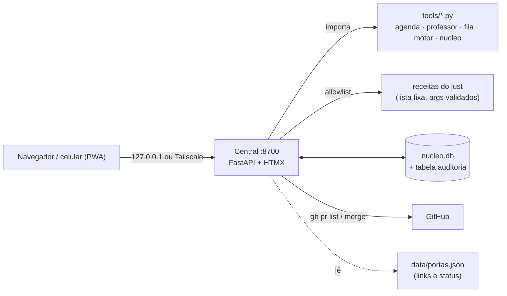

<!-- Escrito à mão. Avaliação completa do dev-setup v2.44.2, feita em 25/11/2026 a pedido do Alan, papel por papel. -->

# Avaliação completa do dev-setup (v2.44.2, 25/11/2026)

[← Índice da documentação](../README.md) · Central AMtech: [docs/central](../central/README.md) · Validação: [docs/operacao/validacao.md](../operacao/validacao.md)

**Pedido:** avaliar tudo o que está planejado e montado no dev-setup como uma equipe de TI completa faria (produto, arquitetura, UX, back-end, front-end, banco de dados, testes, DevOps, segurança e documentação), criticar sem rodeios e dizer o que fazer para a ideia funcionar e ser usada **como qualquer outro sistema**.

**Como foi avaliado:** leitura do repositório inteiro (502 arquivos), execução do `just check` completo (67 verificações), contagens tiradas dos próprios `data/*.json` e testes das correções. Nada aqui é estimativa solta: cada número tem a origem ao lado.

---

## 1. Veredito em uma página

**A qualidade de engenharia é boa. O problema é o tamanho, não a qualidade.**

| O que está bom | O que está errado |
|---|---|
| `just check` verde: **67 de 67** verificações (geradores, coerência, 45 pastas de testes) | O plano tem **1.471 horas** de roteiro (`data/implantacao.json`, soma de `tempo_min`): **74 semanas** no seu ritmo de 20 h/semana, antes de contar estudo e trabalho |
| Fonte única em `data/`, documentação gerada, CI que barra divergência | **344 dos 595 passos** são "só você" (`quem: voce`). Não dá para delegar nem automatizar |
| ADRs, CHANGELOG, ESTADO, regra de PR em rascunho: disciplina de equipe grande | **98 ofertas**, **86 ainda ideia**, **1 lançada** (o catálogo, que é grátis). Receita até hoje: zero |
| Segurança pensada: tudo em 127.0.0.1, segredos fora do Git, allowlist no bot, `deny` no Claude | **293 mil palavras** de documentação (uns 4 livros de 300 páginas) e **106 versões em 25 dias** |
| Regras de IA, custo mínimo, motor de decisão: raro ver isso num projeto pessoal | **4 fontes da verdade** (PLANO-UNICO no vault, CONTINUAR, ESTADO, `coerencia.json`) e você é o único leitor |

**Diagnóstico central:** o dev-setup virou **três sistemas misturados num repositório**:

1. **O ambiente de trabalho** (Windows, WSL, Docker, ferramentas, backup, segredos). É um setup de dev e está quase pronto.
2. **O plano de vida e de negócios** (6 empresas, 98 rendas, investimentos, Jarvis, robótica, construção civil, editora, Akita, Professor). É um documento de estratégia e cresce todo dia.
3. **As ferramentas internas** (Núcleo, motor, fila, bot, Professor, Central). É software de verdade, e é a parte que você quer **usar como qualquer outro sistema**.

O sistema 2 alimenta o 3 sem parar: cada ideia nova vira bloco, passo, receita e teste. Por isso nada termina. **Planejar virou o produto.**

**A recomendação mais importante de todo o relatório:** congelar o crescimento do sistema 2 por 8 semanas e usar esse tempo para terminar só o necessário dos sistemas 1 e 3, ou seja, um backup que funcione e uma Central enxuta com 3 telas. A regra do ESTADO de 01/11 ("parar de adicionar áreas e executar até a primeira venda") estava certa. Ela saiu da lista no mesmo dia, e o plano cresceu de novo.

---

## 2. Product Owner / Analista de Requisitos

**Papel:** decidir o que entra, o que sai e quando algo está pronto.

### Críticas

1. **Não existe MVP do sistema, só MVP de cada ideia.** O AM Gestão tem MVP (PDV + Pedidos + Financeiro), mas o próprio dev-setup não tem: tudo é "fase", e são 65 fases.
2. **A capacidade não fecha.** São 20 h/semana, das quais o Professor já reserva a maior parte para estudo. O roteiro sozinho pede 74 semanas. Somando estudo, aulas, o restaurante e a Licenciatura, o plano atual leva **anos**, e todo dia ganha passos novos.
3. **O limite de "3 frentes agora" não se sustenta.** A ADR 0015 ("nada pausado") reativou 42, AM-OS, pentest, treino de IA, robótica, agro, construção, idiomas, dados e AM Taskoro. Com tudo ativo, a prioridade deixa de existir.
4. **A métrica de sucesso está espalhada.** O portão (3 meses se pagando) é bom, mas ninguém mede "horas por semana gastas no setup em vez de na renda". Essa é a métrica que falta.
5. **A Central está planejada como produto completo**: 9 telas e 6 fases, com Homepage, OliveTin e a Central. Para um usuário só, isso é demais.

### O que fazer

- **Definição de "usar como qualquer outro sistema"** (proposta de critério de aceite): *abrir um endereço no notebook ou no celular, fazer login e, em menos de 1 minuto, ver o que espera você hoje, aprovar ou recusar, e rodar os 10 comandos que você mais usa, sem abrir o terminal.*
- **MVP da Central = 3 telas:** Hoje, Aprovar e Comandos. Estudo, Empresas, Serviços, Núcleo, Roteiro e Pedir ficam para depois do uso real de 2 semanas.
- **Regra "uma entra, uma sai":** área, oferta ou fase nova só entra se outra sair ou for concluída. Vale gravar em `data/coerencia.json` como decisão, para o CI lembrar.
- **Métrica nova no resumo da manhã:** horas no setup na semana (o ActivityWatch já está no plano) contra horas em ativo que gera renda.

---

## 3. Arquiteto de Software

### O que está certo

- **Dados → geradores → docs, com `--check` no CI.** É o padrão certo para documentação que não pode mentir.
- **Conectar ferramentas em vez de reescrever** (ADR 0009) e **montar → colar → construir** (triagem).
- **Python com biblioteca padrão nas ferramentas:** zero dependência para instalar, roda em qualquer Ubuntu.
- **A Central como camada fina** sobre `tools/*.py`, importando funções em vez de chamar o terminal e ler texto. Essa é a decisão certa.

### Críticas

1. **Três interfaces para a mesma coisa.** Homepage (links), OliveTin (botões) e Central (tudo) somam três serviços, três configurações e três superfícies de ataque para um usuário. **Recomendação:** pular Homepage e OliveTin e construir direto a Central enxuta. A Central já faz os dois papéis: o portal é uma lista gerada do `data/portas.json` e os botões são a allowlist do `just`.
2. **Estado vivo misturado com plano.** `data/implantacao.json` tem 307 KB, e o progresso (passos feitos) mora no `nucleo.db`. Tudo bem, mas o plano de 300 KB editado à mão é o maior risco de manutenção do repositório. **Recomendação:** congelar o formato e criar uma receita `just passo-novo` que edita o JSON por você, em vez de edição manual.
3. **Ponto único de falha: o notebook.** O Núcleo, a fila, o bot, os backups e a Central dependem do notebook ligado e do WSL aberto. A fase Soberania (VM) resolve isso, mas ela está no fim da fila. Para a Central "funcionar como qualquer sistema", isso precisa estar claro: **o notebook fechado deixa a Central fora do ar.**
4. **Serviços demais para a máquina.** São **33 portas publicadas** em 11 arquivos compose (ver `data/portas.json`), num notebook com 32 GB, dos quais 20 GB vão para o WSL. Nunca suba tudo junto. A Central deve mostrar o que está ligado e ligar sob demanda.
5. **ADR 0022 (Central) ainda não existe.** Ela deve registrar a decisão do item 1, seja qual for a sua escolha.

### Arquitetura recomendada da Central (enxuta)

---

## 4. UX/UI Designer

### Críticas

1. **55 receitas, todas no terminal.** O `just menu` ajuda, mas exige lembrar o nome e os argumentos. Este é o motivo de o setup "não parecer um sistema".
2. **Seis painéis HTML gerados** (cockpit, mapa, index, acompanhamento, portfólio, planejador) que **mostram o plano, não o estado**. Você abre o painel e vê o que deveria estar acontecendo, não o que está.
3. **O protótipo da Central é uma foto do passado.** `prototipo/dados.js` tem 254 KB de dados de 21/11 e já está desatualizado em relação ao v2.44.
4. **Aprovações espalhadas** em seis comandos diferentes. A "caixa de entrada única" do plano é a melhor ideia de UX do projeto inteiro: comece por ela.

### O que fazer

- **Tela Hoje** com no máximo 5 blocos: o que espera você, estudo do dia, fila, alertas (backup, disco, serviço caído) e onda 0.
- **Tela Aprovar:** lista única com dois botões por item (aprovar e recusar) e um campo opcional de ajuste.
- **Tela Comandos:** só as receitas que você usou nos últimos 30 dias no topo (o histórico vem da auditoria). O resto fica atrás de uma busca.
- **Celular primeiro:** 390 px, botões grandes, nada de tabela larga.

---

## 5. Desenvolvedor Back-end

### O que está certo

- Código legível, funções pequenas, nomes em português consistentes, `argparse` padronizado.
- `subprocess` sempre com lista de argumentos, sem `shell=True` com texto do usuário (conferido em `tools/remoto`).
- O bot só responde ao `TELEGRAM_CHAT_ID` configurado e só roda comandos fixos.

### Críticas

1. **`|| true` esconde erros.** São **14** no `justfile` e em `scripts/`. Dois bugs reais da rodada de validação (o evento do backup e o relatório da coerência) estavam escondidos assim. Cada `|| true` precisa de um comentário dizendo por que o erro pode ser ignorado, ou precisa sair.
2. **Cada ferramenta relê os mesmos JSON grandes.** Por enquanto é rápido (o `check` inteiro leva 8 s), mas a Central vai precisar de uma camada `fontes.py` com cache, para não reler 300 KB a cada requisição.
3. **Saídas pensadas para o terminal.** A maioria das funções imprime em vez de devolver dados. Para a Central, cada ferramenta usada nas 3 telas precisa de uma função que devolva `dict`/`list` (a impressão vira só uma camada em cima).

---

## 6. Desenvolvedor Front-end

- **HTMX + SSE é a escolha certa** para uma ferramenta interna: sem build, sem `node_modules` e poucos arquivos.
- **Não use o protótipo como base de código.** Ele tem 66 KB de HTML com JavaScript de simulação. Use-o só como referência visual.
- **PWA mínimo:** `manifest.json` + ícone + `service worker` que só guarda a casca (nunca dados).
- **Acessibilidade:** contraste, foco visível e botões com texto (não só ícone). O repositório já tem pa11y no modelo de esteira de sites: dá para reaproveitar.

---

## 7. Administrador de Banco de Dados (DBA)

### Críticas

1. **O banco do Núcleo não entrava no backup.** O `nucleo.db` fica em `~/.local/share/nucleo/`, fora das pastas do `BACKUP_PASTAS`. Decisões, auditoria e passos feitos se perderiam com o disco. **Corrigido neste PR:** o `backup.sh` agora sempre inclui uma cópia consistente do banco, feita pela API de backup do SQLite, que funciona mesmo com o banco aberto.
2. **Dois esquemas para manter** (`esquema.sql` e `esquema-postgres.sql`). Eles vão divergir. **Recomendação:** um teste que compara os nomes de tabelas e colunas dos dois arquivos.
3. **Sem migrações.** O esquema usa `CREATE TABLE IF NOT EXISTS`, que não altera tabela existente. A primeira coluna nova da Central vai precisar de uma tabela `versao_esquema` e de passos numerados.

---

## 8. QA / Testador

### Críticas

1. **O CI rodava menos testes que o `just check`.** A lista de pastas no `docs.yml` era fixa e **7 pastas com testes ficavam de fora**: biblioteca, colher, fontes, git, registro, senhas e validar. **Corrigido neste PR:** o CI usa o mesmo laço do `just check` (toda pasta com `test_*.py`).
2. **Scripts shell sem teste de comportamento.** O ShellCheck pega sintaxe, mas não lógica. Foi lá que estavam os bugs reais (backup, `just` 1.21). **Recomendação:** `bats` para `backup.sh`, `resumo-manha.sh` e `ligar-tudo.sh`, usando `--simular`.
3. **A matriz de validação (`just validar`) é excelente.** Ela é o teste de ponta a ponta que faltava. Rode-a toda semana pelo cron e mande o resultado para o resumo da manhã.

---

## 9. DevOps / SRE

### Críticas

1. **O backup falhava em silêncio.** O cron das 22h30 sai com erro toda noite (falta o `backup.env`), e o resumo da manhã procurava arquivos em `~/backups`, que **não é onde o restic grava**. **Corrigido neste PR:** o resumo agora lê o evento `backup.concluido` do Núcleo e avisa se ele não existe ou tem mais de 36 h. **Falta a sua parte:** criar o `backup.env` (passo 1 da seção 12).
2. **Cinco conflitos de porta.** Grafana × AdGuard (3001), Uptime Kuma × Metabase (3002), Forgejo × Juice Shop (3000), Zigbee2MQTT × WebGoat (8080) e PocketBase × Akaunting (8090). **Corrigido neste PR:** novas portas conforme o plano da Central, `data/portas.json` como fonte única e `tools/portas/portas.py --check` no `just check` e no CI, que agora falham se uma porta se repetir.
3. **12 imagens em `:latest`**: Paperless, Grocy, Metabase, Piper, openWakeWord, Zigbee2MQTT, Juice Shop (2x), WebGoat, AdGuard, MariaDB e BookStack. Uma atualização pode quebrar o serviço sem aviso. **Recomendação:** fixar versões e deixar o Renovate abrir PR de atualização.
4. **"Roda sozinho" depende do WSL aberto.** Uma tarefa no Agendador do Windows que acorda o WSL antes das 22h30 resolve (já listado em `validacao.md`).
5. **`just` 1.21 do apt.** Já há contorno no justfile; vale conferir a versão mínima no `verificar.sh`.

---

## 10. Especialista em Segurança

### O que está certo

- Tudo publicado em `127.0.0.1` (exceto o DNS do AdGuard na 53, que é intencional), acesso externo só pelo Tailscale.
- `permissions.deny` no `.claude/settings.json` bloqueia leitura de `.env`, `.kdbx`, `~/.ssh` e `~/financas`, além de `rm -rf`, `push --force` e `merge`.
- O bot do Telegram só aceita o seu chat e só roda comandos fixos.
- Regras claras: nada de dado de aluno em IA, nada de teste sem termo assinado, nada assinado por IA.

### Riscos

1. **A Central executa comandos no seu computador.** É o maior risco do projeto. Ela só deve existir com login, CSRF, allowlist, confirmação e auditoria desde a primeira linha, não na fase 6. **Recomendação:** inverter a ordem e fazer login e auditoria na fase da API, antes de qualquer botão.
2. **O cofre ainda não está no WSL** (faltam `keepassxc-cli`, age e sops, segundo a matriz de validação). Sem ele, a tendência é colocar segredo em `.env` em texto puro.
3. **Repositórios privados não substituem higiene.** O `gitleaks` roda no `just check` local, mas **não roda no CI**. Vale adicionar a action do gitleaks ao `docs.yml`.
4. **Serviços demais aumentam a superfície de ataque.** Cada serviço que você não usa toda semana deveria ficar desligado por padrão.

---

## 11. Redator Técnico

### Críticas

1. **293 mil palavras para um leitor.** Ninguém lê isso, nem você. O valor real está em 4 arquivos: CONTINUAR, ESTADO, `validacao.md` e o roteiro gerado.
2. **Quatro fontes da verdade.** O CONTINUAR diz que vale o PLANO-UNICO do vault, o `coerencia.json` guarda as decisões em vigor e o ESTADO guarda a memória curta. **Recomendação:** o `coerencia.json` vira a única fonte das decisões e o CONTINUAR passa a ser gerado a partir dele, como o README.
3. **O ESTADO cresce sem limite.** Ele tem 83 linhas desde 01/11. Ele diz "até 5 linhas por conversa", mas não diz quando arquivar. **Recomendação:** manter só os últimos 14 dias e mover o resto para o CHANGELOG, que já existe para isso.
4. **Falta um guia de uso de 1 página**, do tipo "como uso o sistema no dia a dia". Quando a Central existir, esse guia é a tela de ajuda dela.

---

## 12. Plano de atualização, em ordem

### Fase A: feita neste PR (v2.45.0)

- [x] 5 conflitos de porta resolvidos, `data/portas.json` e `tools/portas/portas.py --check` no `just check` e no CI.
- [x] CI rodando **todas** as pastas de teste (eram 7 a menos) e as conferências que só o `just check` fazia (biblioteca, senhas, fontes, portas).
- [x] Resumo da manhã avisa quando o backup restic não roda há mais de 36 h (`nucleo.py ultimo backup.concluido`).
- [x] `nucleo.db` sempre no backup, como cópia consistente.
- [x] Esta avaliação.

### Fase B: sua parte, no notebook (cerca de 1 hora)

1. **Backup (urgente).** No Ubuntu: copie `infra/templates/backup.env.example` para `~/.config/amtech/backup.env`, crie o arquivo de senha com `chmod 600` (a mesma senha no KeePassXC), rode `just backup` e depois `just validar --restaurar`.
2. **Puxe este PR e suba os serviços com as portas novas.** Se você já tinha AdGuard, Metabase, Juice Shop, WebGoat ou Akaunting no ar, as portas novas são 3011, 3012, 3100, 8180 e 8091.
3. **Cofre no WSL:** `sudo apt install keepassxc` e `bash scripts/wsl/extras.sh`.
4. **Decida as 3 perguntas da seção 13.**

### Fase C: Central enxuta (6 a 8 sessões curtas)

| Passo | Entrega | Pronto quando |
|---|---|---|
| C0 | ADR 0022 com a decisão da seção 13 | ADR escrita, `just check` verde |
| C1 | `tools/central/`: FastAPI + login + CSRF + auditoria, **sem nenhum botão ainda** | Login funciona em 127.0.0.1:8700; toda requisição vai para a auditoria; testes pytest |
| C2 | Tela **Hoje** lendo dado real | Mostra o que espera você, estudo, fila e alertas (backup, disco, serviços) |
| C3 | Tela **Aprovar** (PRs da fila, `akita pendentes`, decisões) | Aprovar um PR faz o merge pelo `gh` e grava na auditoria |
| C4 | Tela **Comandos** com allowlist e saída ao vivo (SSE) | 10 receitas seguras rodam; as perigosas pedem confirmação |
| C5 | Celular: PWA + `tailscale serve` | Abrir fora de casa, logar e aprovar um item |
| C6 | Revisão de segurança (Opus) + Playwright no CI | Revisão sem achado alto; teste de ponta a ponta verde |

Depois disso, use a Central por 2 semanas antes de qualquer tela nova.

### Fase D: higiene contínua (uma por semana, em paralelo)

- Fixar as 12 imagens `:latest` e ligar o Renovate.
- Remover ou justificar os 14 `|| true`.
- `gitleaks` no CI.
- Teste que compara `esquema.sql` com `esquema-postgres.sql`.
- Tarefa do Windows que acorda o WSL às 22h20.
- ESTADO enxuto (só 14 dias).

### Fase E: congelamento por 8 semanas

Nenhuma área, oferta, fase ou ferramenta nova até a Central C5 estar em uso **e** uma oferta da onda 0 ter a primeira venda. As ideias novas vão para um arquivo `IDEIAS.md`, sem passo, sem bloco e sem teste.

---

## 13. Decisões que são suas

1. **Central: só a Central enxuta (recomendado), ou o plano original com Homepage + OliveTin + Central?** A recomendação é a Central sozinha: um serviço, uma superfície de ataque, um código para manter.
2. **Congelamento de 8 semanas (Fase E): sim ou não?** A recomendação é sim. Sem ele, a Fase C vai competir com ideias novas e não termina.
3. **Onde a Central roda no começo: notebook (agora) ou VM (fase Soberania)?** A recomendação é o notebook agora, aceitando que ela fica fora do ar com o notebook fechado, e a VM só depois da primeira renda.

---

## 14. O que acrescentar (e que faltava no plano)

| Item | Por quê |
|---|---|
| **Critério de aceite da Central** (seção 2) | Sem ele, "funcionar como qualquer sistema" nunca termina |
| **Regra "uma entra, uma sai"** no `coerencia.json` | Freio automático para o crescimento do plano |
| **Métrica de horas no setup × horas em renda** | Mostra quando o setup está consumindo o tempo que deveria gerar dinheiro |
| **`IDEIAS.md` fora do CI** | Lugar para guardar ideia sem transformá-la em trabalho |
| **Migrações do banco** (`versao_esquema`) | A Central vai mudar o `nucleo.db`; sem migração, quebra os dados antigos |
| **Login + auditoria antes dos botões** | A Central executa comandos; a segurança não pode ficar para a última fase |
| **Guia de uso de 1 página** | Vira a tela de ajuda da Central |
