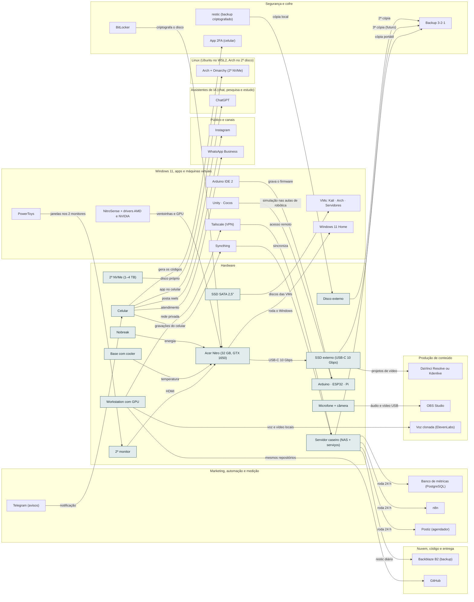

<!-- Arquivo GERADO por tools/gerar_docs.py a partir de data/. Edite os dados, não este arquivo. -->

# Camada 01 · Hardware

[← Arquitetura](../arquitetura.md) · [Índice da documentação](../README.md)

**13 blocos** · 0 precisam de conta · 5 marcados como futuro

## Mapa de conexões

## Blocos

| Bloco | Tipo | O que faz |
|---|---|---|
| [Nobreak](#ups) | Físico | Queda de energia no meio de um build, gravação ou atualização corrompe arquivo. Protege notebook, roteador e NAS. |
| [Base com cooler](#cool) | Físico | O Nitro esquenta com Docker, VMs e Ollama; menos calor, menos queda de desempenho. |
| [SSD SATA 2,5"](#sata) | Físico · futuro | Baia livre: espaço extra para VMs e imagens de laboratório. Confira cabo e suporte. |
| [Acer Nitro (32 GB, GTX 1650)](#nb) | Físico | Ryzen 7 5800H, 32 GB (até 64), SSD 1 TB. |
| [2º NVMe (1–4 TB)](#nvme) | Físico · futuro | Slot M.2 livre. |
| [2º monitor](#mon) | Físico | Código numa tela, app na outra. |
| [Microfone + câmera](#mic) | Físico · futuro | Áudio limpo vende mais curso que câmera boa. |
| [Celular](#cel) | Físico | Reels, 2FA e atendimento. |
| [Disco externo](#ext) | Físico | Segunda cópia do backup. |
| [Arduino · ESP32 · Pi](#rob) | Físico | Aulas, projeto agro e automação. |
| [Servidor caseiro (NAS + serviços)](#nas) | Físico · futuro | PC antigo ou mini PC com 16 GB de RAM e dois HDs em RAID 1, com Ubuntu Server e Docker (ou OpenMediaVault). Guarda o backup local e roda n8n, Postiz, banco de métricas, Grafana, Uptime Kuma e Gitea 24 horas. |
| [SSD externo (USB-C 10 Gbps)](#ssdext) | Físico | NVMe em gabinete USB 3.2 Gen 2: projetos de vídeo e backup portátil, criptografado. A porta USB-C do Nitro é de 10 Gbps, sem Thunderbolt. |
| [Workstation com GPU](#ws) | Físico · futuro | Segundo computador com 12 GB ou mais de memória de vídeo para voz, vídeo e IA locais. Só se sair mais barato que assinaturas e GPU por hora. |

### Nobreak

*Físico*

Queda de energia no meio de um build, gravação ou atualização corrompe arquivo. Protege notebook, roteador e NAS.

| Direção | Bloco | Camada | O que passa |
|---|---|---|---|
| → envia para | [Acer Nitro (32 GB, GTX 1650)](01-hw.md#nb) | Hardware | energia |

### Base com cooler

*Físico*

O Nitro esquenta com Docker, VMs e Ollama; menos calor, menos queda de desempenho.

| Direção | Bloco | Camada | O que passa |
|---|---|---|---|
| → envia para | [Acer Nitro (32 GB, GTX 1650)](01-hw.md#nb) | Hardware | temperatura |

### SSD SATA 2,5"

*Físico · futuro*

Baia livre: espaço extra para VMs e imagens de laboratório. Confira cabo e suporte.

| Direção | Bloco | Camada | O que passa |
|---|---|---|---|
| → envia para | [VMs: Kali · Arch · Servidores](03-win.md#vms) | Windows 11, apps e máquinas virtuais | discos das VMs |

### Acer Nitro (32 GB, GTX 1650)

*Físico*

Ryzen 7 5800H, 32 GB (até 64), SSD 1 TB.

| Direção | Bloco | Camada | O que passa |
|---|---|---|---|
| → envia para | [Windows 11 Home](03-win.md#w11) | Windows 11, apps e máquinas virtuais | roda o Windows |
| → envia para | [SSD externo (USB-C 10 Gbps)](01-hw.md#ssdext) | Hardware | USB-C 10 Gbps |
| ← recebe de | [2º monitor](01-hw.md#mon) | Hardware | HDMI |
| ← recebe de | [BitLocker](02-seg.md#bitl) | Segurança e cofre | criptografa o disco |
| ← recebe de | [NitroSense + drivers AMD e NVIDIA](03-win.md#nitro) | Windows 11, apps e máquinas virtuais | ventoinhas e GPU |
| ← recebe de | [Nobreak](01-hw.md#ups) | Hardware | energia |
| ← recebe de | [Base com cooler](01-hw.md#cool) | Hardware | temperatura |

### 2º NVMe (1–4 TB)

*Físico · futuro*

Slot M.2 livre.

| Direção | Bloco | Camada | O que passa |
|---|---|---|---|
| → envia para | [Arch + Omarchy (2º NVMe)](04-lin.md#arch) | Linux (Ubuntu no WSL2, Arch no 2º disco) | disco próprio |

### 2º monitor

*Físico*

Código numa tela, app na outra.

| Direção | Bloco | Camada | O que passa |
|---|---|---|---|
| → envia para | [Acer Nitro (32 GB, GTX 1650)](01-hw.md#nb) | Hardware | HDMI |
| ← recebe de | [PowerToys](03-win.md#ptoys) | Windows 11, apps e máquinas virtuais | janelas nos 2 monitores |

### Microfone + câmera

*Físico · futuro*

Áudio limpo vende mais curso que câmera boa.

| Direção | Bloco | Camada | O que passa |
|---|---|---|---|
| → envia para | [OBS Studio](12-cont.md#obss) | Produção de conteúdo | áudio e vídeo USB |

### Celular

*Físico*

Reels, 2FA e atendimento.

| Direção | Bloco | Camada | O que passa |
|---|---|---|---|
| → envia para | [Instagram](21-pub.md#ig) | Público e canais | posta reels |
| → envia para | [App 2FA (celular)](02-seg.md#tfa) | Segurança e cofre | gera os códigos |
| → envia para | [WhatsApp Business](21-pub.md#wa) | Público e canais | atendimento |
| → envia para | [ChatGPT](06-chat.md#gpt) | Assistentes de IA (chat, pesquisa e estudo) | app no celular |
| → envia para | [Syncthing](03-win.md#syncth) | Windows 11, apps e máquinas virtuais | gravações do celular |
| ← recebe de | [Telegram (avisos)](20-mkt.md#tg) | Marketing, automação e medição | notificação |

### Disco externo

*Físico*

Segunda cópia do backup.

| Direção | Bloco | Camada | O que passa |
|---|---|---|---|
| → envia para | [Backup 3-2-1](02-seg.md#bkp) | Segurança e cofre | 2ª cópia |
| ← recebe de | [restic (backup criptografado)](02-seg.md#restic) | Segurança e cofre | cópia local |

### Arduino · ESP32 · Pi

*Físico*

Aulas, projeto agro e automação.

| Direção | Bloco | Camada | O que passa |
|---|---|---|---|
| ← recebe de | [Arduino IDE 2](03-win.md#ard) | Windows 11, apps e máquinas virtuais | grava o firmware |
| ← recebe de | [Unity · Cocos](03-win.md#unity) | Windows 11, apps e máquinas virtuais | simulação nas aulas de robótica |

### Servidor caseiro (NAS + serviços)

*Físico · futuro*

PC antigo ou mini PC com 16 GB de RAM e dois HDs em RAID 1, com Ubuntu Server e Docker (ou OpenMediaVault). Guarda o backup local e roda n8n, Postiz, banco de métricas, Grafana, Uptime Kuma e Gitea 24 horas.

| Direção | Bloco | Camada | O que passa |
|---|---|---|---|
| → envia para | [Backup 3-2-1](02-seg.md#bkp) | Segurança e cofre | 3ª cópia (futuro) |
| → envia para | [Backblaze B2 (backup)](11-nuvem.md#b2) | Nuvem, código e entrega | restic diário |
| → envia para | [n8n](20-mkt.md#n8n) | Marketing, automação e medição | roda 24 h |
| → envia para | [Postiz (agendador)](20-mkt.md#postiz) | Marketing, automação e medição | roda 24 h |
| → envia para | [Banco de métricas (PostgreSQL)](20-mkt.md#metrics) | Marketing, automação e medição | roda 24 h |
| ← recebe de | [Tailscale (VPN)](03-win.md#tail) | Windows 11, apps e máquinas virtuais | acesso remoto |
| ← recebe de | [Syncthing](03-win.md#syncth) | Windows 11, apps e máquinas virtuais | sincroniza |

### SSD externo (USB-C 10 Gbps)

*Físico*

NVMe em gabinete USB 3.2 Gen 2: projetos de vídeo e backup portátil, criptografado. A porta USB-C do Nitro é de 10 Gbps, sem Thunderbolt.

| Direção | Bloco | Camada | O que passa |
|---|---|---|---|
| → envia para | [Backup 3-2-1](02-seg.md#bkp) | Segurança e cofre | cópia portátil |
| → envia para | [DaVinci Resolve ou Kdenlive](12-cont.md#edit) | Produção de conteúdo | projetos de vídeo |
| ← recebe de | [Acer Nitro (32 GB, GTX 1650)](01-hw.md#nb) | Hardware | USB-C 10 Gbps |

### Workstation com GPU

*Físico · futuro*

Segundo computador com 12 GB ou mais de memória de vídeo para voz, vídeo e IA locais. Só se sair mais barato que assinaturas e GPU por hora.

| Direção | Bloco | Camada | O que passa |
|---|---|---|---|
| → envia para | [Tailscale (VPN)](03-win.md#tail) | Windows 11, apps e máquinas virtuais | rede privada |
| → envia para | [GitHub](11-nuvem.md#gh) | Nuvem, código e entrega | mesmos repositórios |
| → envia para | [Voz clonada (ElevenLabs)](12-cont.md#voz) | Produção de conteúdo | voz e vídeo locais |

---

[↑ Camada 02 · Segurança e cofre](02-seg.md)
