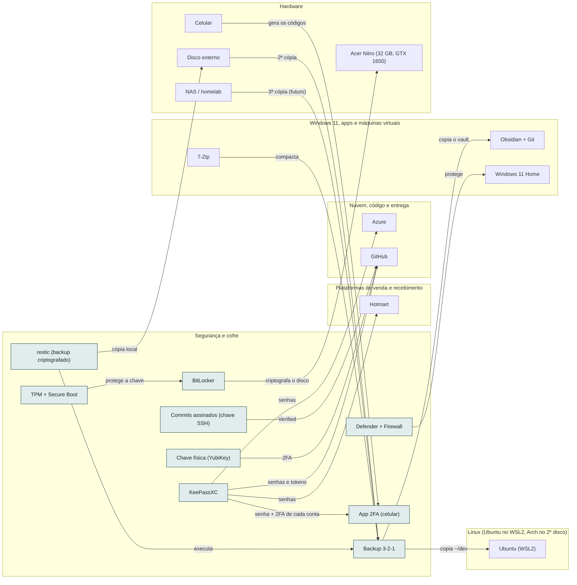

<!-- Arquivo GERADO por tools/gerar_docs.py a partir de data/. Edite os dados, não este arquivo. -->

# Camada 02 · Segurança e cofre

[← Arquitetura](../arquitetura.md) · [Índice da documentação](../README.md)

> **Ligação com a camada de baixo:** Drivers AMD e NVIDIA ligam o sistema ao hardware.

**9 blocos** · 0 precisam de conta · 1 marcados como futuro

## Mapa de conexões

## Blocos

| Bloco | Tipo | O que faz |
|---|---|---|
| [Commits assinados (chave SSH)](#sign) | Local | Selo Verified no GitHub: prova que o commit é seu. Usa a chave SSH que você já tem. |
| [restic (backup criptografado)](#restic) | Local | Backup criptografado e incremental para o disco externo e para a nuvem (ex.: armazenamento do seu plano Google). |
| [Chave física (YubiKey)](#ykey) | Físico · futuro | 2FA à prova de phishing para GitHub, Google e Microsoft. |
| [TPM + Secure Boot](#tpm) | Físico | Só sistema assinado dá boot. |
| [BitLocker](#bitl) | Local | Disco criptografado; chave guardada fora da máquina. |
| [Defender + Firewall](#def) | Local | Antivírus e bloqueio de rede. |
| [KeePassXC](#kee) | Local | Cofre de todas as senhas das contas marcadas com o ponto dourado. |
| [App 2FA (celular)](#tfa) | Local | Segundo fator de todas as contas. |
| [Backup 3-2-1](#bkp) | Local | GitHub + disco externo + (depois) NAS. |

### Commits assinados (chave SSH)

*Local*

Selo Verified no GitHub: prova que o commit é seu. Usa a chave SSH que você já tem.

| Direção | Bloco | Camada | O que passa |
|---|---|---|---|
| → envia para | [GitHub](11-nuvem.md#gh) | Nuvem, código e entrega | Verified |

### restic (backup criptografado)

*Local*

Backup criptografado e incremental para o disco externo e para a nuvem (ex.: armazenamento do seu plano Google).

| Direção | Bloco | Camada | O que passa |
|---|---|---|---|
| → envia para | [Disco externo](01-hw.md#ext) | Hardware | cópia local |
| → envia para | [Backup 3-2-1](02-seg.md#bkp) | Segurança e cofre | executa |

### Chave física (YubiKey)

*Físico · futuro*

2FA à prova de phishing para GitHub, Google e Microsoft.

| Direção | Bloco | Camada | O que passa |
|---|---|---|---|
| → envia para | [GitHub](11-nuvem.md#gh) | Nuvem, código e entrega | 2FA |

### TPM + Secure Boot

*Físico*

Só sistema assinado dá boot.

| Direção | Bloco | Camada | O que passa |
|---|---|---|---|
| → envia para | [BitLocker](02-seg.md#bitl) | Segurança e cofre | protege a chave |

### BitLocker

*Local*

Disco criptografado; chave guardada fora da máquina.

| Direção | Bloco | Camada | O que passa |
|---|---|---|---|
| → envia para | [Acer Nitro (32 GB, GTX 1650)](01-hw.md#nb) | Hardware | criptografa o disco |
| ← recebe de | [TPM + Secure Boot](02-seg.md#tpm) | Segurança e cofre | protege a chave |

### Defender + Firewall

*Local*

Antivírus e bloqueio de rede.

| Direção | Bloco | Camada | O que passa |
|---|---|---|---|
| → envia para | [Windows 11 Home](03-win.md#w11) | Windows 11, apps e máquinas virtuais | protege |

### KeePassXC

*Local*

Cofre de todas as senhas das contas marcadas com o ponto dourado.

| Direção | Bloco | Camada | O que passa |
|---|---|---|---|
| → envia para | [App 2FA (celular)](02-seg.md#tfa) | Segurança e cofre | senha + 2FA de cada conta |
| → envia para | [GitHub](11-nuvem.md#gh) | Nuvem, código e entrega | senhas e tokens |
| → envia para | [Hotmart](17-venda.md#hotm) | Plataformas de venda e recebimento | senhas |
| → envia para | [Azure](11-nuvem.md#azure) | Nuvem, código e entrega | senhas |

### App 2FA (celular)

*Local*

Segundo fator de todas as contas.

| Direção | Bloco | Camada | O que passa |
|---|---|---|---|
| ← recebe de | [Celular](01-hw.md#cel) | Hardware | gera os códigos |
| ← recebe de | [KeePassXC](02-seg.md#kee) | Segurança e cofre | senha + 2FA de cada conta |

### Backup 3-2-1

*Local*

GitHub + disco externo + (depois) NAS.

| Direção | Bloco | Camada | O que passa |
|---|---|---|---|
| → envia para | [Ubuntu (WSL2)](04-lin.md#wsl) | Linux (Ubuntu no WSL2, Arch no 2º disco) | copia ~/dev |
| → envia para | [Obsidian + Git](03-win.md#obsd) | Windows 11, apps e máquinas virtuais | copia o vault |
| ← recebe de | [Disco externo](01-hw.md#ext) | Hardware | 2ª cópia |
| ← recebe de | [NAS / homelab](01-hw.md#nas) | Hardware | 3ª cópia (futuro) |
| ← recebe de | [7-Zip](03-win.md#zip) | Windows 11, apps e máquinas virtuais | compacta |
| ← recebe de | [restic (backup criptografado)](02-seg.md#restic) | Segurança e cofre | executa |

---

[↑ Camada 03 · Windows 11, apps e máquinas virtuais](03-win.md) · [↓ Camada 01 · Hardware](01-hw.md)
