<!-- Arquivo GERADO por tools/gerar_docs.py a partir de data/. Edite os dados, não este arquivo. -->

# Camada 03 · Windows 11, apps e máquinas virtuais

[← Arquitetura](../arquitetura.md) · [Índice da documentação](../README.md)

> **Ligação com a camada de baixo:** O Windows depende de TPM, BitLocker e Defender para ficar protegido.

**21 blocos** · 2 precisam de conta · 3 marcados como futuro

## Mapa de conexões

```mermaid
flowchart LR
  subgraph L_win["Windows 11, apps e máquinas virtuais"]
    n_tail["Tailscale (VPN)"]
    n_wslcfg[".wslconfig + localhost"]
    n_wterm["Terminal · PowerShell · winget"]
    n_draw["Excalidraw / draw.io"]
    n_unity["Unity · Cocos"]
    n_boot["Gerenciador de boot"]
    n_nitro["NitroSense + drivers AMD e NVIDIA"]
    n_zip["7-Zip"]
    n_ptoys["PowerToys"]
    n_pdf["SumatraPDF"]
    n_sharex["ShareX"]
    n_office["LibreOffice"]
    n_ffox["Firefox (2º navegador)"]
    n_w11["Windows 11 Home"]
    n_vsc["VS Code"]
    n_obsd["Obsidian + Git"]
    n_dbv["DBeaver · Bruno"]
    n_nav["Navegador + Claude in Chrome"]
    n_vbox["VirtualBox"]
    n_vms["VMs: Kali · Arch · Servidores"]
    n_ard["Arduino IDE 2"]
  end
  subgraph L_pub["Público e canais"]
    n_ig["Instagram"]
  end
  subgraph L_venda["Plataformas de venda e recebimento"]
    n_dio["DIO (parceria)"]
    n_hotm["Hotmart"]
  end
  subgraph L_web["Vitrine web (sites e domínio)"]
    n_inst["Instituto AMS"]
  end
  subgraph L_prod["Produtos (o que você vende)"]
    n_curso["Mini-curso Lógica de Programação"]
    n_livro["Livro Lógica e Máquina"]
    n_sites["Sites para pequenas empresas"]
  end
  subgraph L_editora["Editora AMS Silva (produção de livros)"]
    n_fonte["Fonte única (Markdown + Pandoc)"]
  end
  subgraph L_est["Estudo e carreira"]
    n_anki["Anki"]
    n_plat["Alura · Rocketseat · DIO · Udemy"]
    n_road["roadmap.sh + Akita"]
    n_thm["TryHackMe / Hack The Box"]
  end
  subgraph L_cont["Produção de conteúdo"]
    n_whis["Whisper (local)"]
  end
  subgraph L_nuvem["Nuvem, código e entrega"]
    n_gh["GitHub"]
  end
  subgraph L_app["Aplicação: sistemas AM (Aura)"]
    n_api["API ASP.NET Core"]
    n_front["Next.js + Aura Design System"]
    n_oapi["OpenAPI + Scalar"]
  end
  subgraph L_cnt["Containers, Kubernetes e infra como código"]
    n_pg["PostgreSQL"]
  end
  subgraph L_clc["Claude: recursos, conectores e plugins"]
    n_cchr["Claude in Chrome + uso do computador"]
    n_cgws["Conector Google (Gmail, Drive…)"]
  end
  subgraph L_chat["Assistentes de IA (chat, pesquisa e estudo)"]
    n_capp2["Claude (app)"]
    n_codex["Codex (OpenAI)"]
    n_copi["GitHub Copilot"]
    n_gpt["ChatGPT"]
    n_nblm["NotebookLM"]
    n_perp["Perplexity"]
  end
  subgraph L_ia["Agentes de IA e sandbox"]
    n_rag["Base de conhecimento (RAG) das suas notas"]
  end
  subgraph L_lin["Linux (Ubuntu no WSL2, Arch no 2º disco)"]
    n_arch["Arch + Omarchy (2º NVMe)"]
    n_netw["nmap · dig · curl · Wireshark"]
    n_syncth["Syncthing"]
    n_wsl["Ubuntu (WSL2)"]
  end
  subgraph L_seg["Segurança e cofre"]
    n_bkp["Backup 3-2-1"]
    n_def["Defender + Firewall"]
  end
  subgraph L_hw["Hardware"]
    n_mon["2º monitor"]
    n_nas["Servidor caseiro (NAS + serviços)"]
    n_nb["Acer Nitro (32 GB, GTX 1650)"]
    n_rob["Arduino · ESP32 · Pi"]
    n_sata["SSD SATA 2,5#quot;"]
    n_ws["Workstation com GPU"]
  end
  n_tail -->|"acesso remoto"| n_nas
  n_ws -->|"rede privada"| n_tail
  n_wslcfg -->|"limite de RAM"| n_wsl
  n_wterm -->|"abre o Ubuntu"| n_wsl
  n_draw -->|"diagramas"| n_obsd
  n_boot -->|"boot"| n_arch
  n_boot -->|"boot"| n_w11
  n_nitro -->|"ventoinhas e GPU"| n_nb
  n_zip -->|"compacta"| n_bkp
  n_ptoys -->|"janelas nos 2 monitores"| n_mon
  n_pdf -->|"revisão do PDF"| n_livro
  n_sharex -->|"GIFs e prints"| n_ig
  n_sharex -->|"demonstrações"| n_curso
  n_office -->|"documentos de clientes"| n_sites
  n_ffox -->|"teste em outro navegador"| n_inst
  n_w11 -->|"WSL2"| n_wsl
  n_nb -->|"roda o Windows"| n_w11
  n_def -->|"protege"| n_w11
  n_cchr -->|"opera apps"| n_w11
  n_vsc -->|"Remote – WSL"| n_wsl
  n_copi -->|"autocompletar"| n_vsc
  n_codex -->|"extensão"| n_vsc
  n_obsd -->|"Obsidian Git"| n_gh
  n_obsd -->|"indexa as notas"| n_rag
  n_obsd -->|"artigos e projetos"| n_dio
  n_obsd -->|"capítulos"| n_livro
  n_obsd -->|"roteiro"| n_curso
  n_obsd -->|"rascunho"| n_fonte
  n_bkp -->|"copia o vault"| n_obsd
  n_capp2 -->|"roteiros e planos"| n_obsd
  n_gpt -->|"respostas salvas no vault"| n_obsd
  n_nblm -->|"resumos de estudo"| n_obsd
  n_perp -->|"pesquisa com fontes"| n_obsd
  n_plat -->|"suas anotações"| n_obsd
  n_anki -->|"cartões"| n_obsd
  n_road -->|"roteiro"| n_obsd
  n_cgws -->|"resumos de e-mail e agenda"| n_obsd
  n_whis -->|"transcrição"| n_obsd
  n_syncth -->|"vault"| n_obsd
  n_dbv -->|"porta 5432"| n_pg
  n_dbv -->|"HTTP (Bruno)"| n_api
  n_oapi -->|"Bruno importa"| n_dbv
  n_nav -->|"localhost:3000"| n_front
  n_nav -->|"painel web"| n_hotm
  n_cchr -->|"opera o navegador"| n_nav
  n_vbox -->|"executa"| n_vms
  n_netw -->|"diagnóstico"| n_vms
  n_sata -->|"discos das VMs"| n_vms
  n_thm -->|"prática"| n_vms
  n_ard -->|"grava o firmware"| n_rob
  n_rob -->|"USB serial"| n_ard
  classDef desta fill:#e2ecec,stroke:#0e3a45,color:#13262b
  class n_tail,n_wslcfg,n_wterm,n_draw,n_unity,n_boot,n_nitro,n_zip,n_ptoys,n_pdf,n_sharex,n_office,n_ffox,n_w11,n_vsc,n_obsd,n_dbv,n_nav,n_vbox,n_vms,n_ard desta
```

## Blocos

| Bloco | Tipo | O que faz |
|---|---|---|
| [Tailscale (VPN)](#tail) | Remoto · precisa de conta · futuro | Acesso seguro ao homelab e ao notebook de qualquer lugar, sem abrir porta no roteador. Grátis para uso pessoal. |
| [.wslconfig + localhost](#wslcfg) | Local | Limita o WSL a 12 GB de RAM e faz o localhost do Windows abrir os apps que rodam no Linux. |
| [Terminal · PowerShell · winget](#wterm) | Local | Terminal com abas para Ubuntu e PowerShell; winget instala e atualiza programas. |
| [Excalidraw / draw.io](#draw) | Local | Diagramas de arquitetura para ADRs, aulas e entrevistas. |
| [Unity · Cocos](#unity) | Local | Mantidos para as aulas de robótica. Decisão sua: ficam ou saem. |
| [Gerenciador de boot](#boot) | Local · futuro | Escolhe Windows ou Arch ao ligar; cada sistema no próprio disco. |
| [NitroSense + drivers AMD e NVIDIA](#nitro) | Local | Controle das ventoinhas e modos de energia do Nitro, mais os drivers de vídeo. Não remover. |
| [7-Zip](#zip) | Local | Abre e cria .zip, .7z e .tar (ISOs, backups, materiais de aula). |
| [PowerToys](#ptoys) | Local | Utilitários da Microsoft: organizar janelas nos dois monitores, renomear em lote, color picker para o design. |
| [SumatraPDF](#pdf) | Local | Leitor de PDF leve para livros, apostilas e o PDF do Lógica e Máquina. |
| [ShareX](#sharex) | Local | Prints, GIFs e gravações curtas da tela para aulas, posts e issues do GitHub. |
| [LibreOffice](#office) | Local | Abrir e editar .docx, .xlsx e .pptx que chegam da escola e de clientes. |
| [Firefox (2º navegador)](#ffox) | Local | Testar os sites em outro motor de navegador e separar contas pessoais das da empresa. |
| [Windows 11 Home](#w11) | Local · precisa de conta | Host do dia a dia (conta local, sem conta Microsoft). |
| [VS Code](#vsc) | Local | Editor; abre os projetos dentro do Linux. |
| [Obsidian + Git](#obsd) | Local | Vault de estudo, roteiros e planejamento. |
| [DBeaver · Bruno](#dbv) | Local | Banco de dados e testes de API. |
| [Navegador + Claude in Chrome](#nav) | Local | Testes, DevTools e acesso a todas as contas web. |
| [VirtualBox](#vbox) | Local | Roda as VMs de estudo. |
| [VMs: Kali · Arch · Servidores](#vms) | Local · futuro | Kali (segurança), Arch (treino da instalação), Ubuntu Server (deploy), Windows Server com Active Directory e RHEL/Rocky (corporativo). |
| [Arduino IDE 2](#ard) | Local | Programação das placas de robótica. |

### Tailscale (VPN)

*Remoto · precisa de conta · futuro*

Acesso seguro ao homelab e ao notebook de qualquer lugar, sem abrir porta no roteador. Grátis para uso pessoal.

| Direção | Bloco | Camada | O que passa |
|---|---|---|---|
| → envia para | [Servidor caseiro (NAS + serviços)](01-hw.md#nas) | Hardware | acesso remoto |
| ← recebe de | [Workstation com GPU](01-hw.md#ws) | Hardware | rede privada |

### .wslconfig + localhost

*Local*

Limita o WSL a 12 GB de RAM e faz o localhost do Windows abrir os apps que rodam no Linux.

| Direção | Bloco | Camada | O que passa |
|---|---|---|---|
| → envia para | [Ubuntu (WSL2)](04-lin.md#wsl) | Linux (Ubuntu no WSL2, Arch no 2º disco) | limite de RAM |

### Terminal · PowerShell · winget

*Local*

Terminal com abas para Ubuntu e PowerShell; winget instala e atualiza programas.

| Direção | Bloco | Camada | O que passa |
|---|---|---|---|
| → envia para | [Ubuntu (WSL2)](04-lin.md#wsl) | Linux (Ubuntu no WSL2, Arch no 2º disco) | abre o Ubuntu |

### Excalidraw / draw.io

*Local*

Diagramas de arquitetura para ADRs, aulas e entrevistas.

| Direção | Bloco | Camada | O que passa |
|---|---|---|---|
| → envia para | [Obsidian + Git](03-win.md#obsd) | Windows 11, apps e máquinas virtuais | diagramas |

### Unity · Cocos

*Local*

Mantidos para as aulas de robótica. Decisão sua: ficam ou saem.

_Sem conexões registradas._

### Gerenciador de boot

*Local · futuro*

Escolhe Windows ou Arch ao ligar; cada sistema no próprio disco.

| Direção | Bloco | Camada | O que passa |
|---|---|---|---|
| → envia para | [Arch + Omarchy (2º NVMe)](04-lin.md#arch) | Linux (Ubuntu no WSL2, Arch no 2º disco) | boot |
| → envia para | [Windows 11 Home](03-win.md#w11) | Windows 11, apps e máquinas virtuais | boot |

### NitroSense + drivers AMD e NVIDIA

*Local*

Controle das ventoinhas e modos de energia do Nitro, mais os drivers de vídeo. Não remover.

| Direção | Bloco | Camada | O que passa |
|---|---|---|---|
| → envia para | [Acer Nitro (32 GB, GTX 1650)](01-hw.md#nb) | Hardware | ventoinhas e GPU |

### 7-Zip

*Local*

Abre e cria .zip, .7z e .tar (ISOs, backups, materiais de aula).

| Direção | Bloco | Camada | O que passa |
|---|---|---|---|
| → envia para | [Backup 3-2-1](02-seg.md#bkp) | Segurança e cofre | compacta |

### PowerToys

*Local*

Utilitários da Microsoft: organizar janelas nos dois monitores, renomear em lote, color picker para o design.

| Direção | Bloco | Camada | O que passa |
|---|---|---|---|
| → envia para | [2º monitor](01-hw.md#mon) | Hardware | janelas nos 2 monitores |

### SumatraPDF

*Local*

Leitor de PDF leve para livros, apostilas e o PDF do Lógica e Máquina.

| Direção | Bloco | Camada | O que passa |
|---|---|---|---|
| → envia para | [Livro Lógica e Máquina](15-prod.md#livro) | Produtos (o que você vende) | revisão do PDF |

### ShareX

*Local*

Prints, GIFs e gravações curtas da tela para aulas, posts e issues do GitHub.

| Direção | Bloco | Camada | O que passa |
|---|---|---|---|
| → envia para | [Instagram](20-pub.md#ig) | Público e canais | GIFs e prints |
| → envia para | [Mini-curso Lógica de Programação](15-prod.md#curso) | Produtos (o que você vende) | demonstrações |

### LibreOffice

*Local*

Abrir e editar .docx, .xlsx e .pptx que chegam da escola e de clientes.

| Direção | Bloco | Camada | O que passa |
|---|---|---|---|
| → envia para | [Sites para pequenas empresas](15-prod.md#sites) | Produtos (o que você vende) | documentos de clientes |

### Firefox (2º navegador)

*Local*

Testar os sites em outro motor de navegador e separar contas pessoais das da empresa.

| Direção | Bloco | Camada | O que passa |
|---|---|---|---|
| → envia para | [Instituto AMS](16-web.md#inst) | Vitrine web (sites e domínio) | teste em outro navegador |

### Windows 11 Home

*Local · precisa de conta*

Host do dia a dia (conta local, sem conta Microsoft).

| Direção | Bloco | Camada | O que passa |
|---|---|---|---|
| → envia para | [Ubuntu (WSL2)](04-lin.md#wsl) | Linux (Ubuntu no WSL2, Arch no 2º disco) | WSL2 |
| ← recebe de | [Acer Nitro (32 GB, GTX 1650)](01-hw.md#nb) | Hardware | roda o Windows |
| ← recebe de | [Defender + Firewall](02-seg.md#def) | Segurança e cofre | protege |
| ← recebe de | [Gerenciador de boot](03-win.md#boot) | Windows 11, apps e máquinas virtuais | boot |
| ← recebe de | [Claude in Chrome + uso do computador](07-clc.md#cchr) | Claude: recursos, conectores e plugins | opera apps |

### VS Code

*Local*

Editor; abre os projetos dentro do Linux.

| Direção | Bloco | Camada | O que passa |
|---|---|---|---|
| → envia para | [Ubuntu (WSL2)](04-lin.md#wsl) | Linux (Ubuntu no WSL2, Arch no 2º disco) | Remote – WSL |
| ← recebe de | [GitHub Copilot](06-chat.md#copi) | Assistentes de IA (chat, pesquisa e estudo) | autocompletar |
| ← recebe de | [Codex (OpenAI)](06-chat.md#codex) | Assistentes de IA (chat, pesquisa e estudo) | extensão |

### Obsidian + Git

*Local*

Vault de estudo, roteiros e planejamento.

| Direção | Bloco | Camada | O que passa |
|---|---|---|---|
| → envia para | [GitHub](11-nuvem.md#gh) | Nuvem, código e entrega | Obsidian Git |
| → envia para | [Base de conhecimento (RAG) das suas notas](05-ia.md#rag) | Agentes de IA e sandbox | indexa as notas |
| → envia para | [DIO (parceria)](18-venda.md#dio) | Plataformas de venda e recebimento | artigos e projetos |
| → envia para | [Livro Lógica e Máquina](15-prod.md#livro) | Produtos (o que você vende) | capítulos |
| → envia para | [Mini-curso Lógica de Programação](15-prod.md#curso) | Produtos (o que você vende) | roteiro |
| → envia para | [Fonte única (Markdown + Pandoc)](14-editora.md#fonte) | Editora AMS Silva (produção de livros) | rascunho |
| ← recebe de | [Backup 3-2-1](02-seg.md#bkp) | Segurança e cofre | copia o vault |
| ← recebe de | [Claude (app)](06-chat.md#capp2) | Assistentes de IA (chat, pesquisa e estudo) | roteiros e planos |
| ← recebe de | [ChatGPT](06-chat.md#gpt) | Assistentes de IA (chat, pesquisa e estudo) | respostas salvas no vault |
| ← recebe de | [NotebookLM](06-chat.md#nblm) | Assistentes de IA (chat, pesquisa e estudo) | resumos de estudo |
| ← recebe de | [Perplexity](06-chat.md#perp) | Assistentes de IA (chat, pesquisa e estudo) | pesquisa com fontes |
| ← recebe de | [Alura · Rocketseat · DIO · Udemy](13-est.md#plat) | Estudo e carreira | suas anotações |
| ← recebe de | [Excalidraw / draw.io](03-win.md#draw) | Windows 11, apps e máquinas virtuais | diagramas |
| ← recebe de | [Anki](13-est.md#anki) | Estudo e carreira | cartões |
| ← recebe de | [roadmap.sh + Akita](13-est.md#road) | Estudo e carreira | roteiro |
| ← recebe de | [Conector Google (Gmail, Drive…)](07-clc.md#cgws) | Claude: recursos, conectores e plugins | resumos de e-mail e agenda |
| ← recebe de | [Whisper (local)](12-cont.md#whis) | Produção de conteúdo | transcrição |
| ← recebe de | [Syncthing](04-lin.md#syncth) | Linux (Ubuntu no WSL2, Arch no 2º disco) | vault |

### DBeaver · Bruno

*Local*

Banco de dados e testes de API.

| Direção | Bloco | Camada | O que passa |
|---|---|---|---|
| → envia para | [PostgreSQL](08-cnt.md#pg) | Containers, Kubernetes e infra como código | porta 5432 |
| → envia para | [API ASP.NET Core](10-app.md#api) | Aplicação: sistemas AM (Aura) | HTTP (Bruno) |
| ← recebe de | [OpenAPI + Scalar](10-app.md#oapi) | Aplicação: sistemas AM (Aura) | Bruno importa |

### Navegador + Claude in Chrome

*Local*

Testes, DevTools e acesso a todas as contas web.

| Direção | Bloco | Camada | O que passa |
|---|---|---|---|
| → envia para | [Next.js + Aura Design System](10-app.md#front) | Aplicação: sistemas AM (Aura) | localhost:3000 |
| → envia para | [Hotmart](18-venda.md#hotm) | Plataformas de venda e recebimento | painel web |
| ← recebe de | [Claude in Chrome + uso do computador](07-clc.md#cchr) | Claude: recursos, conectores e plugins | opera o navegador |

### VirtualBox

*Local*

Roda as VMs de estudo.

| Direção | Bloco | Camada | O que passa |
|---|---|---|---|
| → envia para | [VMs: Kali · Arch · Servidores](03-win.md#vms) | Windows 11, apps e máquinas virtuais | executa |

### VMs: Kali · Arch · Servidores

*Local · futuro*

Kali (segurança), Arch (treino da instalação), Ubuntu Server (deploy), Windows Server com Active Directory e RHEL/Rocky (corporativo).

| Direção | Bloco | Camada | O que passa |
|---|---|---|---|
| ← recebe de | [VirtualBox](03-win.md#vbox) | Windows 11, apps e máquinas virtuais | executa |
| ← recebe de | [nmap · dig · curl · Wireshark](04-lin.md#netw) | Linux (Ubuntu no WSL2, Arch no 2º disco) | diagnóstico |
| ← recebe de | [SSD SATA 2,5"](01-hw.md#sata) | Hardware | discos das VMs |
| ← recebe de | [TryHackMe / Hack The Box](13-est.md#thm) | Estudo e carreira | prática |

### Arduino IDE 2

*Local*

Programação das placas de robótica.

| Direção | Bloco | Camada | O que passa |
|---|---|---|---|
| → envia para | [Arduino · ESP32 · Pi](01-hw.md#rob) | Hardware | grava o firmware |
| ← recebe de | [Arduino · ESP32 · Pi](01-hw.md#rob) | Hardware | USB serial |

---

[↑ Camada 04 · Linux (Ubuntu no WSL2, Arch no 2º disco)](04-lin.md) · [↓ Camada 02 · Segurança e cofre](02-seg.md)
