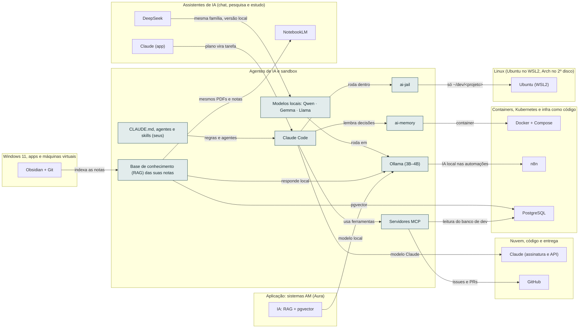

<!-- Arquivo GERADO por tools/gerar_docs.py a partir de data/. Edite os dados, não este arquivo. -->

# Camada 05 · Agentes de IA e sandbox

[← Arquitetura](../arquitetura.md) · [Índice da documentação](../README.md)

> **Ligação com a camada de baixo:** O agente roda dentro do ai-jail e só enxerga ~/dev/<projeto>.

**8 blocos** · 1 precisam de conta · 0 marcados como futuro

## Mapa de conexões

## Blocos

| Bloco | Tipo | O que faz |
|---|---|---|
| [Modelos locais: Qwen · Gemma · Llama](#lmods) | Local | Modelos abertos baixados pelo Ollama. Versões de 3B a 4B cabem na GTX 1650; inclui versões pequenas do DeepSeek-R1. Rodam offline, então servem para dados sensíveis. |
| [Base de conhecimento (RAG) das suas notas](#rag) | Local | Suas anotações, resumos com suas palavras, exercícios resolvidos e aulas que você mesmo gravou, indexados para a IA consultar. Roda com Ollama + pgvector (local) ou NotebookLM e Claude Projects. |
| [Claude Code](#cc) | Local · precisa de conta | Agente de programação no terminal. |
| [ai-jail](#jail) | Local | Sandbox do agente. |
| [ai-memory](#mem) | Local | Memória do agente entre sessões (container). |
| [Servidores MCP](#mcp) | Local | Agente acessa GitHub e banco de dev com permissão limitada. |
| [CLAUDE.md, agentes e skills (seus)](#kit) | Local | Revisor C#, /commit, /novo-sistema-aura e os demais que você vai criar. |
| [Ollama (3B–4B)](#oll) | Local | IA local na GTX 1650; API em localhost:11434. |

### Modelos locais: Qwen · Gemma · Llama

*Local*

Modelos abertos baixados pelo Ollama. Versões de 3B a 4B cabem na GTX 1650; inclui versões pequenas do DeepSeek-R1. Rodam offline, então servem para dados sensíveis.

| Direção | Bloco | Camada | O que passa |
|---|---|---|---|
| → envia para | [Ollama (3B–4B)](05-ia.md#oll) | Agentes de IA e sandbox | roda em |
| ← recebe de | [DeepSeek](06-chat.md#ds) | Assistentes de IA (chat, pesquisa e estudo) | mesma família, versão local |

### Base de conhecimento (RAG) das suas notas

*Local*

Suas anotações, resumos com suas palavras, exercícios resolvidos e aulas que você mesmo gravou, indexados para a IA consultar. Roda com Ollama + pgvector (local) ou NotebookLM e Claude Projects.

| Direção | Bloco | Camada | O que passa |
|---|---|---|---|
| → envia para | [Ollama (3B–4B)](05-ia.md#oll) | Agentes de IA e sandbox | responde local |
| → envia para | [PostgreSQL](08-cnt.md#pg) | Containers, Kubernetes e infra como código | pgvector |
| → envia para | [NotebookLM](06-chat.md#nblm) | Assistentes de IA (chat, pesquisa e estudo) | mesmos PDFs e notas |
| ← recebe de | [Obsidian + Git](03-win.md#obsd) | Windows 11, apps e máquinas virtuais | indexa as notas |

### Claude Code

*Local · precisa de conta*

Agente de programação no terminal.

| Direção | Bloco | Camada | O que passa |
|---|---|---|---|
| → envia para | [ai-jail](05-ia.md#jail) | Agentes de IA e sandbox | roda dentro |
| → envia para | [ai-memory](05-ia.md#mem) | Agentes de IA e sandbox | lembra decisões |
| → envia para | [Servidores MCP](05-ia.md#mcp) | Agentes de IA e sandbox | usa ferramentas |
| → envia para | [Claude (assinatura e API)](11-nuvem.md#anth) | Nuvem, código e entrega | modelo Claude |
| ← recebe de | [CLAUDE.md, agentes e skills (seus)](05-ia.md#kit) | Agentes de IA e sandbox | regras e agentes |
| ← recebe de | [Claude (app)](06-chat.md#capp2) | Assistentes de IA (chat, pesquisa e estudo) | plano vira tarefa |

### ai-jail

*Local*

Sandbox do agente.

| Direção | Bloco | Camada | O que passa |
|---|---|---|---|
| → envia para | [Ubuntu (WSL2)](04-lin.md#wsl) | Linux (Ubuntu no WSL2, Arch no 2º disco) | só ~/dev/<projeto> |
| ← recebe de | [Claude Code](05-ia.md#cc) | Agentes de IA e sandbox | roda dentro |

### ai-memory

*Local*

Memória do agente entre sessões (container).

| Direção | Bloco | Camada | O que passa |
|---|---|---|---|
| → envia para | [Docker + Compose](08-cnt.md#docker) | Containers, Kubernetes e infra como código | container |
| ← recebe de | [Claude Code](05-ia.md#cc) | Agentes de IA e sandbox | lembra decisões |

### Servidores MCP

*Local*

Agente acessa GitHub e banco de dev com permissão limitada.

| Direção | Bloco | Camada | O que passa |
|---|---|---|---|
| → envia para | [GitHub](11-nuvem.md#gh) | Nuvem, código e entrega | issues e PRs |
| → envia para | [PostgreSQL](08-cnt.md#pg) | Containers, Kubernetes e infra como código | leitura do banco de dev |
| ← recebe de | [Claude Code](05-ia.md#cc) | Agentes de IA e sandbox | usa ferramentas |

### CLAUDE.md, agentes e skills (seus)

*Local*

Revisor C#, /commit, /novo-sistema-aura e os demais que você vai criar.

| Direção | Bloco | Camada | O que passa |
|---|---|---|---|
| → envia para | [Claude Code](05-ia.md#cc) | Agentes de IA e sandbox | regras e agentes |

### Ollama (3B–4B)

*Local*

IA local na GTX 1650; API em localhost:11434.

| Direção | Bloco | Camada | O que passa |
|---|---|---|---|
| → envia para | [n8n](08-cnt.md#n8n) | Containers, Kubernetes e infra como código | IA local nas automações |
| ← recebe de | [Modelos locais: Qwen · Gemma · Llama](05-ia.md#lmods) | Agentes de IA e sandbox | roda em |
| ← recebe de | [Base de conhecimento (RAG) das suas notas](05-ia.md#rag) | Agentes de IA e sandbox | responde local |
| ← recebe de | [IA: RAG + pgvector](10-app.md#ai) | Aplicação: sistemas AM (Aura) | modelo local |

---

[↑ Camada 06 · Assistentes de IA (chat, pesquisa e estudo)](06-chat.md) · [↓ Camada 04 · Linux (Ubuntu no WSL2, Arch no 2º disco)](04-lin.md)
