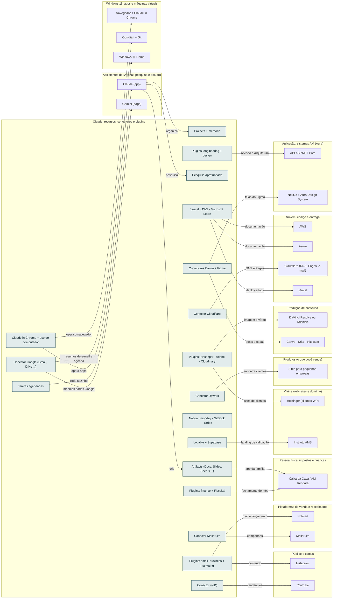

<!-- Arquivo GERADO por tools/gerar_docs.py a partir de data/. Edite os dados, não este arquivo. -->

# Camada 07 · Claude: recursos, conectores e plugins

[← Arquitetura](../arquitetura.md) · [Índice da documentação](../README.md)

> **Ligação com a camada de baixo:** Os conectores dão ao Claude acesso às suas contas, com permissão que você aprova; os plugins trazem rotinas prontas.

**18 blocos** · 14 precisam de conta · 0 marcados como futuro

## Mapa de conexões

## Blocos

| Bloco | Tipo | O que faz |
|---|---|---|
| [Projects + memória](#proj) | Remoto · precisa de conta | Um Project por frente (Aura, aulas, livro, infoprodutos) com arquivos e instruções fixas. A memória lembra o contexto entre conversas. |
| [Artifacts (Docs, Slides, Sheets…)](#arts) | Remoto · precisa de conta | Documentos, apresentações, planilhas e designs editáveis e compartilháveis. O Caixa da Casa e este diagrama são artifacts. |
| [Pesquisa aprofundada](#resq) | Remoto · precisa de conta | Relatório com dezenas de fontes: mercado de cursos, concorrentes, editais. |
| [Tarefas agendadas](#sched) | Remoto · precisa de conta | O Claude executa sozinho em horário marcado: resumo semanal dos repositórios, rascunho de post, revisão do plano de estudos. |
| [Claude in Chrome + uso do computador](#cchr) | Remoto · precisa de conta | O Claude opera o navegador e os apps do Windows por você, pedindo aprovação nas ações sensíveis. |
| [Conector Google (Gmail, Drive…)](#cgws) | Remoto · precisa de conta | Já conectado. Lê e organiza e-mail, agenda de aulas, arquivos do Drive, Docs, Sheets e Slides. |
| [Conectores Canva + Figma](#ccan) | Remoto · precisa de conta | Já conectados. Canva para posts e capas; Figma para as telas dos sistemas e do Instituto AMS. |
| [Conector MailerLite](#cml) | Remoto · precisa de conta | Já conectado. O Claude monta grupos, formulários e campanhas da newsletter. |
| [Vercel · AWS · Microsoft Learn](#cdev) | Remoto · precisa de conta | Já conectados. Deploy e logs na Vercel; documentação oficial da AWS e da Microsoft (Azure, .NET) direto na conversa. |
| [Conector Upwork](#cupw) | Remoto · precisa de conta | Já conectado. Busca freelas e ajuda com propostas: renda extra com sites e sistemas. |
| [Lovable + Supabase](#clov) | Remoto · precisa de conta | Já conectados. Fora da sua stack, mas ótimos para validar antes de construir: uma landing ou protótipo em horas para testar se vende. |
| [Notion · monday · GitBook · Stripe](#cdup) | Remoto · precisa de conta | Já conectados, mas repetem o que você já tem. Decidido: Notion sai, fica o Obsidian. monday, GitBook e Stripe também repetem GitHub Projects, MkDocs e as plataformas de curso. |
| [Plugins: small- business + marketing](#pbiz) | Remoto | Rotinas prontas de conteúdo, funil, SEO, propostas, cobrança e fechamento do mês. |
| [Plugins: engineering + design](#peng) | Remoto | Revisão de código, arquitetura, ADR, testes, incidentes, crítica de design e acessibilidade. |
| [Plugins: finance + Fiscal.ai](#pfin) | Remoto | Demonstrativos e conciliação para a empresa; dados de empresas abertas para os seus estudos de investimento. |
| [Plugins: Hostinger · Adobe · Cloudinary](#phst) | Remoto | Hostinger para os sites de clientes; Adobe e Cloudinary para editar e otimizar imagens e vídeos. |
| [Conector Cloudflare](#ccf) | Remoto · precisa de conta | Conectado. Este conector avisa que está descontinuado; troque pelo Cloudflare API MCP (mcp.cloudflare.com/mcp), que cobre DNS, Pages e R2. |
| [Conector vidIQ](#cvid) | Remoto · precisa de conta | Conectado. Palavras-chave, tendências, títulos e thumbnails para YouTube e Instagram. |

### Projects + memória

*Remoto · precisa de conta*

Um Project por frente (Aura, aulas, livro, infoprodutos) com arquivos e instruções fixas. A memória lembra o contexto entre conversas.

| Direção | Bloco | Camada | O que passa |
|---|---|---|---|
| ← recebe de | [Claude (app)](06-chat.md#capp2) | Assistentes de IA (chat, pesquisa e estudo) | organiza |

### Artifacts (Docs, Slides, Sheets…)

*Remoto · precisa de conta*

Documentos, apresentações, planilhas e designs editáveis e compartilháveis. O Caixa da Casa e este diagrama são artifacts.

| Direção | Bloco | Camada | O que passa |
|---|---|---|---|
| → envia para | [Caixa da Casa / AM Rendara](16-emp.md#caixa) | Pessoa física: impostos e finanças | app da família |
| ← recebe de | [Claude (app)](06-chat.md#capp2) | Assistentes de IA (chat, pesquisa e estudo) | cria |

### Pesquisa aprofundada

*Remoto · precisa de conta*

Relatório com dezenas de fontes: mercado de cursos, concorrentes, editais.

| Direção | Bloco | Camada | O que passa |
|---|---|---|---|
| ← recebe de | [Claude (app)](06-chat.md#capp2) | Assistentes de IA (chat, pesquisa e estudo) | pesquisa |

### Tarefas agendadas

*Remoto · precisa de conta*

O Claude executa sozinho em horário marcado: resumo semanal dos repositórios, rascunho de post, revisão do plano de estudos.

| Direção | Bloco | Camada | O que passa |
|---|---|---|---|
| → envia para | [Claude (app)](06-chat.md#capp2) | Assistentes de IA (chat, pesquisa e estudo) | roda sozinho |

### Claude in Chrome + uso do computador

*Remoto · precisa de conta*

O Claude opera o navegador e os apps do Windows por você, pedindo aprovação nas ações sensíveis.

| Direção | Bloco | Camada | O que passa |
|---|---|---|---|
| → envia para | [Navegador + Claude in Chrome](03-win.md#nav) | Windows 11, apps e máquinas virtuais | opera o navegador |
| → envia para | [Windows 11 Home](03-win.md#w11) | Windows 11, apps e máquinas virtuais | opera apps |

### Conector Google (Gmail, Drive…)

*Remoto · precisa de conta*

Já conectado. Lê e organiza e-mail, agenda de aulas, arquivos do Drive, Docs, Sheets e Slides.

| Direção | Bloco | Camada | O que passa |
|---|---|---|---|
| → envia para | [Gemini (pago)](06-chat.md#gem) | Assistentes de IA (chat, pesquisa e estudo) | mesmos dados Google |
| → envia para | [Obsidian + Git](03-win.md#obsd) | Windows 11, apps e máquinas virtuais | resumos de e-mail e agenda |

### Conectores Canva + Figma

*Remoto · precisa de conta*

Já conectados. Canva para posts e capas; Figma para as telas dos sistemas e do Instituto AMS.

| Direção | Bloco | Camada | O que passa |
|---|---|---|---|
| → envia para | [Canva · Krita · Inkscape](12-cont.md#img) | Produção de conteúdo | posts e capas |
| → envia para | [Next.js + Aura Design System](10-app.md#front) | Aplicação: sistemas AM (Aura) | telas do Figma |

### Conector MailerLite

*Remoto · precisa de conta*

Já conectado. O Claude monta grupos, formulários e campanhas da newsletter.

| Direção | Bloco | Camada | O que passa |
|---|---|---|---|
| → envia para | [MailerLite](17-venda.md#mailer) | Plataformas de venda e recebimento | campanhas |

### Vercel · AWS · Microsoft Learn

*Remoto · precisa de conta*

Já conectados. Deploy e logs na Vercel; documentação oficial da AWS e da Microsoft (Azure, .NET) direto na conversa.

| Direção | Bloco | Camada | O que passa |
|---|---|---|---|
| → envia para | [Vercel](11-nuvem.md#vercel) | Nuvem, código e entrega | deploy e logs |
| → envia para | [AWS](11-nuvem.md#aws) | Nuvem, código e entrega | documentação |
| → envia para | [Azure](11-nuvem.md#azure) | Nuvem, código e entrega | documentação |

### Conector Upwork

*Remoto · precisa de conta*

Já conectado. Busca freelas e ajuda com propostas: renda extra com sites e sistemas.

| Direção | Bloco | Camada | O que passa |
|---|---|---|---|
| → envia para | [Sites para pequenas empresas](14-prod.md#sites) | Produtos (o que você vende) | encontra clientes |

### Lovable + Supabase

*Remoto · precisa de conta*

Já conectados. Fora da sua stack, mas ótimos para validar antes de construir: uma landing ou protótipo em horas para testar se vende.

| Direção | Bloco | Camada | O que passa |
|---|---|---|---|
| → envia para | [Instituto AMS](15-web.md#inst) | Vitrine web (sites e domínio) | landing de validação |

### Notion · monday · GitBook · Stripe

*Remoto · precisa de conta*

Já conectados, mas repetem o que você já tem. Decidido: Notion sai, fica o Obsidian. monday, GitBook e Stripe também repetem GitHub Projects, MkDocs e as plataformas de curso.

_Sem conexões registradas._

### Plugins: small- business + marketing

*Remoto*

Rotinas prontas de conteúdo, funil, SEO, propostas, cobrança e fechamento do mês.

| Direção | Bloco | Camada | O que passa |
|---|---|---|---|
| → envia para | [Instagram](18-pub.md#ig) | Público e canais | conteúdo |
| → envia para | [Hotmart](17-venda.md#hotm) | Plataformas de venda e recebimento | funil e lançamento |

### Plugins: engineering + design

*Remoto*

Revisão de código, arquitetura, ADR, testes, incidentes, crítica de design e acessibilidade.

| Direção | Bloco | Camada | O que passa |
|---|---|---|---|
| → envia para | [API ASP.NET Core](10-app.md#api) | Aplicação: sistemas AM (Aura) | revisão e arquitetura |

### Plugins: finance + Fiscal.ai

*Remoto*

Demonstrativos e conciliação para a empresa; dados de empresas abertas para os seus estudos de investimento.

| Direção | Bloco | Camada | O que passa |
|---|---|---|---|
| → envia para | [Caixa da Casa / AM Rendara](16-emp.md#caixa) | Pessoa física: impostos e finanças | fechamento do mês |

### Plugins: Hostinger · Adobe · Cloudinary

*Remoto*

Hostinger para os sites de clientes; Adobe e Cloudinary para editar e otimizar imagens e vídeos.

| Direção | Bloco | Camada | O que passa |
|---|---|---|---|
| → envia para | [Hostinger (clientes WP)](15-web.md#hostg) | Vitrine web (sites e domínio) | sites de clientes |
| → envia para | [DaVinci Resolve ou Kdenlive](12-cont.md#edit) | Produção de conteúdo | imagem e vídeo |

### Conector Cloudflare

*Remoto · precisa de conta*

Conectado. Este conector avisa que está descontinuado; troque pelo Cloudflare API MCP (mcp.cloudflare.com/mcp), que cobre DNS, Pages e R2.

| Direção | Bloco | Camada | O que passa |
|---|---|---|---|
| → envia para | [Cloudflare (DNS, Pages, e-mail)](11-nuvem.md#cf) | Nuvem, código e entrega | DNS e Pages |

### Conector vidIQ

*Remoto · precisa de conta*

Conectado. Palavras-chave, tendências, títulos e thumbnails para YouTube e Instagram.

| Direção | Bloco | Camada | O que passa |
|---|---|---|---|
| → envia para | [YouTube](18-pub.md#yt) | Público e canais | tendências |

---

[↑ Camada 08 · Containers, Kubernetes e infra como código](08-cnt.md) · [↓ Camada 06 · Assistentes de IA (chat, pesquisa e estudo)](06-chat.md)
