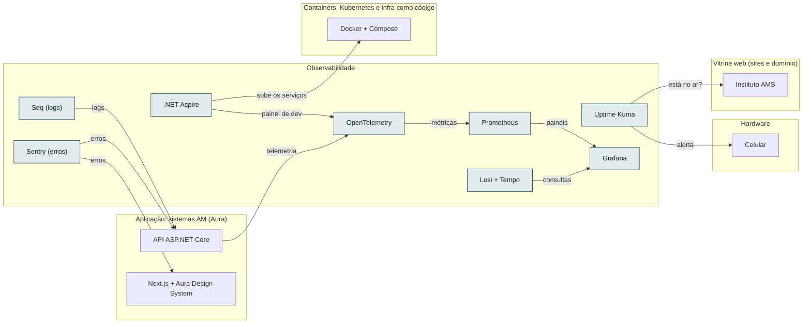

<!-- Arquivo GERADO por tools/gerar_docs.py a partir de data/. Edite os dados, não este arquivo. -->

# Camada 09 · Observabilidade

[← Arquitetura](../arquitetura.md) · [Índice da documentação](../README.md)

> **Ligação com a camada de baixo:** Coletor, Prometheus e Grafana rodam como containers.

**8 blocos** · 1 precisam de conta · 1 marcados como futuro

## Mapa de conexões

## Blocos

| Bloco | Tipo | O que faz |
|---|---|---|
| [Sentry (erros)](#sentry) | Remoto · precisa de conta | Avisa quando um erro acontece em produção, com o ponto exato no código. Plano grátis para um dev. |
| [Uptime Kuma](#kuma) | Local | Verifica a cada minuto se os sites e APIs estão no ar e avisa no celular. Open source. |
| [Seq (logs)](#seq) | Local | Visualizador de logs simples para começar, antes da stack Grafana. |
| [Loki + Tempo](#loki) | Local · futuro | Logs e rastreamento de requisições entre serviços, consultados no Grafana. |
| [OpenTelemetry](#otel) | Local | Coleta logs, métricas e traces da API. |
| [Prometheus](#prom) | Local | Guarda as métricas. |
| [Grafana](#graf) | Local | Painéis e alertas. |
| [.NET Aspire](#aspire) | Local | Sobe o sistema inteiro no dev com painel próprio. |

### Sentry (erros)

*Remoto · precisa de conta*

Avisa quando um erro acontece em produção, com o ponto exato no código. Plano grátis para um dev.

| Direção | Bloco | Camada | O que passa |
|---|---|---|---|
| → envia para | [API ASP.NET Core](10-app.md#api) | Aplicação: sistemas AM (Aura) | erros |
| → envia para | [Next.js + Aura Design System](10-app.md#front) | Aplicação: sistemas AM (Aura) | erros |

### Uptime Kuma

*Local*

Verifica a cada minuto se os sites e APIs estão no ar e avisa no celular. Open source.

| Direção | Bloco | Camada | O que passa |
|---|---|---|---|
| → envia para | [Instituto AMS](16-web.md#inst) | Vitrine web (sites e domínio) | está no ar? |
| → envia para | [Celular](01-hw.md#cel) | Hardware | alerta |

### Seq (logs)

*Local*

Visualizador de logs simples para começar, antes da stack Grafana.

| Direção | Bloco | Camada | O que passa |
|---|---|---|---|
| → envia para | [API ASP.NET Core](10-app.md#api) | Aplicação: sistemas AM (Aura) | logs |

### Loki + Tempo

*Local · futuro*

Logs e rastreamento de requisições entre serviços, consultados no Grafana.

| Direção | Bloco | Camada | O que passa |
|---|---|---|---|
| → envia para | [Grafana](09-obs.md#graf) | Observabilidade | consultas |

### OpenTelemetry

*Local*

Coleta logs, métricas e traces da API.

| Direção | Bloco | Camada | O que passa |
|---|---|---|---|
| → envia para | [Prometheus](09-obs.md#prom) | Observabilidade | métricas |
| ← recebe de | [API ASP.NET Core](10-app.md#api) | Aplicação: sistemas AM (Aura) | telemetria |
| ← recebe de | [.NET Aspire](09-obs.md#aspire) | Observabilidade | painel de dev |

### Prometheus

*Local*

Guarda as métricas.

| Direção | Bloco | Camada | O que passa |
|---|---|---|---|
| → envia para | [Grafana](09-obs.md#graf) | Observabilidade | painéis |
| ← recebe de | [OpenTelemetry](09-obs.md#otel) | Observabilidade | métricas |

### Grafana

*Local*

Painéis e alertas.

| Direção | Bloco | Camada | O que passa |
|---|---|---|---|
| ← recebe de | [Loki + Tempo](09-obs.md#loki) | Observabilidade | consultas |
| ← recebe de | [Prometheus](09-obs.md#prom) | Observabilidade | painéis |

### .NET Aspire

*Local*

Sobe o sistema inteiro no dev com painel próprio.

| Direção | Bloco | Camada | O que passa |
|---|---|---|---|
| → envia para | [OpenTelemetry](09-obs.md#otel) | Observabilidade | painel de dev |
| → envia para | [Docker + Compose](08-cnt.md#docker) | Containers, Kubernetes e infra como código | sobe os serviços |

---

[↑ Camada 10 · Aplicação: sistemas AM (Aura)](10-app.md) · [↓ Camada 08 · Containers, Kubernetes e infra como código](08-cnt.md)
