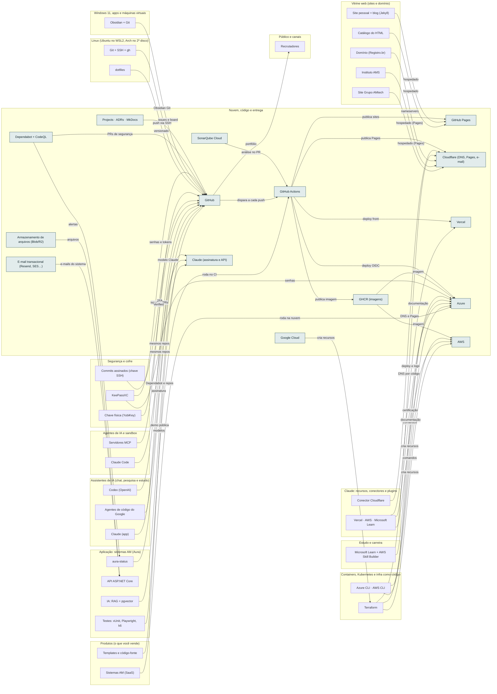

<!-- Arquivo GERADO por tools/gerar_docs.py a partir de data/. Edite os dados, não este arquivo. -->

# Camada 11 · Nuvem, código e entrega

[← Arquitetura](../arquitetura.md) · [Índice da documentação](../README.md)

> **Ligação com a camada de baixo:** git push via SSH leva o código ao GitHub; o Actions testa e publica.

**15 blocos** · 10 precisam de conta · 2 marcados como futuro

## Mapa de conexões

## Blocos

| Bloco | Tipo | O que faz |
|---|---|---|
| [Armazenamento de arquivos (Blob/R2)](#blob) | Remoto · precisa de conta | Fotos de produtos, anexos e PDFs dos sistemas AM fora do banco de dados. |
| [E-mail transacional (Resend, SES…)](#tmail) | Remoto · precisa de conta | E-mails automáticos dos sistemas: confirmação de conta, senha, recibo. |
| [SonarQube Cloud](#sonar) | Remoto · precisa de conta | Nota de qualidade e segurança do código a cada PR. Grátis para repositório público; recrutador vê o selo. |
| [Projects · ADRs · MkDocs](#ghproj) | Remoto | GitHub Projects espelhando o EPIC-01, decisões de arquitetura registradas e documentação publicada no Pages. |
| [Dependabot + CodeQL](#dbot) | Remoto | Dependabot atualiza pacotes vulneráveis; CodeQL procura falhas no seu código. Grátis em repositório público. |
| [Google Cloud](#gcp) | Remoto · precisa de conta · futuro | Terceira nuvem: só o básico, quando um projeto de IA ou dados pedir. |
| [GitHub](#gh) | Remoto · precisa de conta | Código, vault, ensino-ti e a org grupo-amtech-digital. É também o seu portfólio. |
| [GitHub Actions](#gha) | Remoto | CI/CD: build, testes, segurança e deploy. |
| [GHCR (imagens)](#ghcr) | Remoto | Registro das imagens Docker das APIs. |
| [GitHub Pages](#ghp) | Remoto | Hospeda site pessoal, blog e Catálogo do HTML. |
| [Cloudflare (DNS, Pages, e-mail)](#cf) | Remoto · precisa de conta | DNS, HTTPS, proteção, hospedagem estática dos sites comerciais e redirecionamento de e-mail do domínio. |
| [Vercel](#vercel) | Remoto · precisa de conta | Frontends Next.js. O plano grátis é para uso pessoal e não comercial; confira os termos antes de pôr venda nele. |
| [Azure](#azure) | Remoto · precisa de conta | Primeira nuvem para as APIs AM: App Service/Container Apps, PostgreSQL, Key Vault. |
| [AWS](#aws) | Remoto · precisa de conta · futuro | Segunda nuvem, para o mercado maior. |
| [Claude (assinatura e API)](#anth) | Remoto · precisa de conta | Assinatura usada pelo app e pelo Claude Code; API para as funções de IA dos sistemas. |

### Armazenamento de arquivos (Blob/R2)

*Remoto · precisa de conta*

Fotos de produtos, anexos e PDFs dos sistemas AM fora do banco de dados.

| Direção | Bloco | Camada | O que passa |
|---|---|---|---|
| → envia para | [API ASP.NET Core](10-app.md#api) | Aplicação: sistemas AM (Aura) | arquivos |

### E-mail transacional (Resend, SES…)

*Remoto · precisa de conta*

E-mails automáticos dos sistemas: confirmação de conta, senha, recibo.

| Direção | Bloco | Camada | O que passa |
|---|---|---|---|
| → envia para | [API ASP.NET Core](10-app.md#api) | Aplicação: sistemas AM (Aura) | e-mails do sistema |

### SonarQube Cloud

*Remoto · precisa de conta*

Nota de qualidade e segurança do código a cada PR. Grátis para repositório público; recrutador vê o selo.

| Direção | Bloco | Camada | O que passa |
|---|---|---|---|
| → envia para | [GitHub Actions](11-nuvem.md#gha) | Nuvem, código e entrega | análise no PR |

### Projects · ADRs · MkDocs

*Remoto*

GitHub Projects espelhando o EPIC-01, decisões de arquitetura registradas e documentação publicada no Pages.

| Direção | Bloco | Camada | O que passa |
|---|---|---|---|
| → envia para | [GitHub](11-nuvem.md#gh) | Nuvem, código e entrega | issues e board |

### Dependabot + CodeQL

*Remoto*

Dependabot atualiza pacotes vulneráveis; CodeQL procura falhas no seu código. Grátis em repositório público.

| Direção | Bloco | Camada | O que passa |
|---|---|---|---|
| → envia para | [GitHub](11-nuvem.md#gh) | Nuvem, código e entrega | PRs de segurança |
| → envia para | [aura-status](10-app.md#status) | Aplicação: sistemas AM (Aura) | alertas |

### Google Cloud

*Remoto · precisa de conta · futuro*

Terceira nuvem: só o básico, quando um projeto de IA ou dados pedir.

| Direção | Bloco | Camada | O que passa |
|---|---|---|---|
| → envia para | [Terraform](08-cnt.md#tf) | Containers, Kubernetes e infra como código | cria recursos |

### GitHub

*Remoto · precisa de conta*

Código, vault, ensino-ti e a org grupo-amtech-digital. É também o seu portfólio.

| Direção | Bloco | Camada | O que passa |
|---|---|---|---|
| → envia para | [GitHub Actions](11-nuvem.md#gha) | Nuvem, código e entrega | dispara a cada push |
| → envia para | [Recrutadores](18-pub.md#recr) | Público e canais | portfólio |
| ← recebe de | [KeePassXC](02-seg.md#kee) | Segurança e cofre | senhas e tokens |
| ← recebe de | [Obsidian + Git](03-win.md#obsd) | Windows 11, apps e máquinas virtuais | Obsidian Git |
| ← recebe de | [Git + SSH + gh](04-lin.md#git) | Linux (Ubuntu no WSL2, Arch no 2º disco) | push via SSH |
| ← recebe de | [dotfiles](04-lin.md#dot) | Linux (Ubuntu no WSL2, Arch no 2º disco) | versionado |
| ← recebe de | [Servidores MCP](05-ia.md#mcp) | Agentes de IA e sandbox | issues e PRs |
| ← recebe de | [Projects · ADRs · MkDocs](11-nuvem.md#ghproj) | Nuvem, código e entrega | issues e board |
| ← recebe de | [Dependabot + CodeQL](11-nuvem.md#dbot) | Nuvem, código e entrega | PRs de segurança |
| ← recebe de | [Commits assinados (chave SSH)](02-seg.md#sign) | Segurança e cofre | Verified |
| ← recebe de | [Chave física (YubiKey)](02-seg.md#ykey) | Segurança e cofre | 2FA |
| ← recebe de | [Codex (OpenAI)](06-chat.md#codex) | Assistentes de IA (chat, pesquisa e estudo) | mesmos repos |
| ← recebe de | [Agentes de código do Google](06-chat.md#gcode) | Assistentes de IA (chat, pesquisa e estudo) | mesmos repos |
| ← recebe de | [aura-status](10-app.md#status) | Aplicação: sistemas AM (Aura) | Dependabot e repos |
| ← recebe de | [Templates e código-fonte](14-prod.md#tmpl) | Produtos (o que você vende) | demo pública |

### GitHub Actions

*Remoto*

CI/CD: build, testes, segurança e deploy.

| Direção | Bloco | Camada | O que passa |
|---|---|---|---|
| → envia para | [GHCR (imagens)](11-nuvem.md#ghcr) | Nuvem, código e entrega | publica imagem |
| → envia para | [Azure](11-nuvem.md#azure) | Nuvem, código e entrega | deploy OIDC |
| → envia para | [Vercel](11-nuvem.md#vercel) | Nuvem, código e entrega | deploy front |
| → envia para | [GitHub Pages](11-nuvem.md#ghp) | Nuvem, código e entrega | publica sites |
| → envia para | [Cloudflare (DNS, Pages, e-mail)](11-nuvem.md#cf) | Nuvem, código e entrega | publica Pages |
| ← recebe de | [Testes: xUnit, Playwright, k6](10-app.md#tests) | Aplicação: sistemas AM (Aura) | roda no CI |
| ← recebe de | [SonarQube Cloud](11-nuvem.md#sonar) | Nuvem, código e entrega | análise no PR |
| ← recebe de | [GitHub](11-nuvem.md#gh) | Nuvem, código e entrega | dispara a cada push |

### GHCR (imagens)

*Remoto*

Registro das imagens Docker das APIs.

| Direção | Bloco | Camada | O que passa |
|---|---|---|---|
| → envia para | [Azure](11-nuvem.md#azure) | Nuvem, código e entrega | imagem |
| → envia para | [AWS](11-nuvem.md#aws) | Nuvem, código e entrega | imagem |
| ← recebe de | [GitHub Actions](11-nuvem.md#gha) | Nuvem, código e entrega | publica imagem |

### GitHub Pages

*Remoto*

Hospeda site pessoal, blog e Catálogo do HTML.

| Direção | Bloco | Camada | O que passa |
|---|---|---|---|
| ← recebe de | [GitHub Actions](11-nuvem.md#gha) | Nuvem, código e entrega | publica sites |
| ← recebe de | [Site pessoal + blog (Jekyll)](15-web.md#site) | Vitrine web (sites e domínio) | hospedado |
| ← recebe de | [Catálogo do HTML](15-web.md#catal) | Vitrine web (sites e domínio) | hospedado |

### Cloudflare (DNS, Pages, e-mail)

*Remoto · precisa de conta*

DNS, HTTPS, proteção, hospedagem estática dos sites comerciais e redirecionamento de e-mail do domínio.

| Direção | Bloco | Camada | O que passa |
|---|---|---|---|
| ← recebe de | [Conector Cloudflare](07-clc.md#ccf) | Claude: recursos, conectores e plugins | DNS e Pages |
| ← recebe de | [Terraform](08-cnt.md#tf) | Containers, Kubernetes e infra como código | DNS por código |
| ← recebe de | [GitHub Actions](11-nuvem.md#gha) | Nuvem, código e entrega | publica Pages |
| ← recebe de | [Domínio (Registro.br)](15-web.md#dom) | Vitrine web (sites e domínio) | nameservers |
| ← recebe de | [Instituto AMS](15-web.md#inst) | Vitrine web (sites e domínio) | hospedado (Pages) |
| ← recebe de | [Site Grupo AMtech](15-web.md#amsite) | Vitrine web (sites e domínio) | hospedado (Pages) |

### Vercel

*Remoto · precisa de conta*

Frontends Next.js. O plano grátis é para uso pessoal e não comercial; confira os termos antes de pôr venda nele.

| Direção | Bloco | Camada | O que passa |
|---|---|---|---|
| ← recebe de | [Vercel · AWS · Microsoft Learn](07-clc.md#cdev) | Claude: recursos, conectores e plugins | deploy e logs |
| ← recebe de | [GitHub Actions](11-nuvem.md#gha) | Nuvem, código e entrega | deploy front |

### Azure

*Remoto · precisa de conta*

Primeira nuvem para as APIs AM: App Service/Container Apps, PostgreSQL, Key Vault.

| Direção | Bloco | Camada | O que passa |
|---|---|---|---|
| ← recebe de | [KeePassXC](02-seg.md#kee) | Segurança e cofre | senhas |
| ← recebe de | [Azure CLI · AWS CLI](08-cnt.md#clis) | Containers, Kubernetes e infra como código | comandos |
| ← recebe de | [Microsoft Learn + AWS Skill Builder](13-est.md#learn) | Estudo e carreira | certificação |
| ← recebe de | [Vercel · AWS · Microsoft Learn](07-clc.md#cdev) | Claude: recursos, conectores e plugins | documentação |
| ← recebe de | [Terraform](08-cnt.md#tf) | Containers, Kubernetes e infra como código | cria recursos |
| ← recebe de | [GitHub Actions](11-nuvem.md#gha) | Nuvem, código e entrega | deploy OIDC |
| ← recebe de | [GHCR (imagens)](11-nuvem.md#ghcr) | Nuvem, código e entrega | imagem |
| ← recebe de | [Sistemas AM (SaaS)](14-prod.md#saas) | Produtos (o que você vende) | roda na nuvem |

### AWS

*Remoto · precisa de conta · futuro*

Segunda nuvem, para o mercado maior.

| Direção | Bloco | Camada | O que passa |
|---|---|---|---|
| ← recebe de | [Azure CLI · AWS CLI](08-cnt.md#clis) | Containers, Kubernetes e infra como código | comandos |
| ← recebe de | [Vercel · AWS · Microsoft Learn](07-clc.md#cdev) | Claude: recursos, conectores e plugins | documentação |
| ← recebe de | [Terraform](08-cnt.md#tf) | Containers, Kubernetes e infra como código | cria recursos |
| ← recebe de | [GHCR (imagens)](11-nuvem.md#ghcr) | Nuvem, código e entrega | imagem |

### Claude (assinatura e API)

*Remoto · precisa de conta*

Assinatura usada pelo app e pelo Claude Code; API para as funções de IA dos sistemas.

| Direção | Bloco | Camada | O que passa |
|---|---|---|---|
| ← recebe de | [Claude (app)](06-chat.md#capp2) | Assistentes de IA (chat, pesquisa e estudo) | assinatura |
| ← recebe de | [Claude Code](05-ia.md#cc) | Agentes de IA e sandbox | modelo Claude |
| ← recebe de | [IA: RAG + pgvector](10-app.md#ai) | Aplicação: sistemas AM (Aura) | modelos |

---

[↑ Camada 12 · Produção de conteúdo](12-cont.md) · [↓ Camada 10 · Aplicação: sistemas AM (Aura)](10-app.md)
