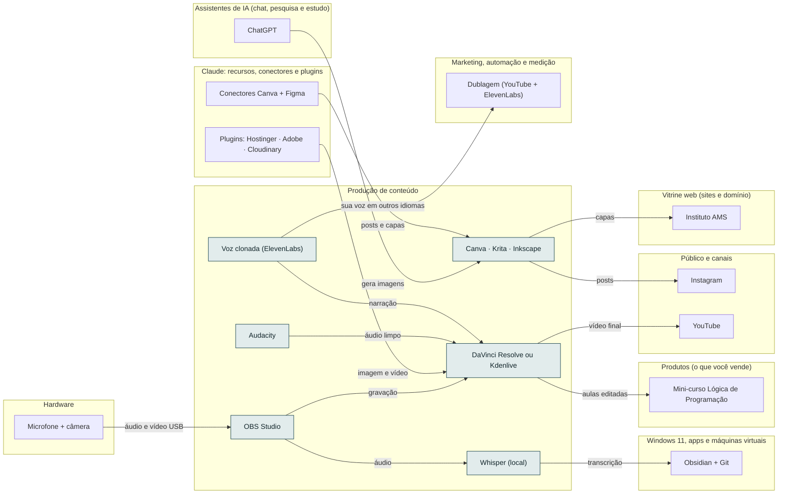

<!-- Arquivo GERADO por tools/gerar_docs.py a partir de data/. Edite os dados, não este arquivo. -->

# Camada 12 · Produção de conteúdo

[← Arquitetura](../arquitetura.md) · [Índice da documentação](../README.md)

> **Ligação com a camada de baixo:** Gravação e edição rodam no notebook; os arquivos finais sobem para as plataformas.

**6 blocos** · 2 precisam de conta · 0 marcados como futuro

## Mapa de conexões

## Blocos

| Bloco | Tipo | O que faz |
|---|---|---|
| [OBS Studio](#obss) | Local | Grava tela, câmera e áudio das aulas e vídeos. |
| [DaVinci Resolve ou Kdenlive](#edit) | Local | Edição de vídeo. Os dois têm versão grátis. |
| [Audacity](#aud) | Local | Limpa ruído e ajusta o áudio. |
| [Canva · Krita · Inkscape](#img) | Local · precisa de conta | Capas, posts e thumbnails. Canva precisa de conta; Krita e Inkscape são open source. |
| [Whisper (local)](#whis) | Local | Transcreve as aulas para legenda, artigo e capítulo. |
| [Voz clonada (ElevenLabs)](#voz) | Remoto · precisa de conta | Clonagem profissional da sua própria voz (plano Creator em diante, uso comercial nos planos pagos). Treino com 30 minutos ou mais de áudio limpo. Avise o público que a voz é gerada por IA. |

### OBS Studio

*Local*

Grava tela, câmera e áudio das aulas e vídeos.

| Direção | Bloco | Camada | O que passa |
|---|---|---|---|
| → envia para | [DaVinci Resolve ou Kdenlive](12-cont.md#edit) | Produção de conteúdo | gravação |
| → envia para | [Whisper (local)](12-cont.md#whis) | Produção de conteúdo | áudio |
| ← recebe de | [Microfone + câmera](01-hw.md#mic) | Hardware | áudio e vídeo USB |

### DaVinci Resolve ou Kdenlive

*Local*

Edição de vídeo. Os dois têm versão grátis.

| Direção | Bloco | Camada | O que passa |
|---|---|---|---|
| → envia para | [YouTube](19-pub.md#yt) | Público e canais | vídeo final |
| → envia para | [Mini-curso Lógica de Programação](14-prod.md#curso) | Produtos (o que você vende) | aulas editadas |
| ← recebe de | [Plugins: Hostinger · Adobe · Cloudinary](07-clc.md#phst) | Claude: recursos, conectores e plugins | imagem e vídeo |
| ← recebe de | [OBS Studio](12-cont.md#obss) | Produção de conteúdo | gravação |
| ← recebe de | [Audacity](12-cont.md#aud) | Produção de conteúdo | áudio limpo |
| ← recebe de | [Voz clonada (ElevenLabs)](12-cont.md#voz) | Produção de conteúdo | narração |

### Audacity

*Local*

Limpa ruído e ajusta o áudio.

| Direção | Bloco | Camada | O que passa |
|---|---|---|---|
| → envia para | [DaVinci Resolve ou Kdenlive](12-cont.md#edit) | Produção de conteúdo | áudio limpo |

### Canva · Krita · Inkscape

*Local · precisa de conta*

Capas, posts e thumbnails. Canva precisa de conta; Krita e Inkscape são open source.

| Direção | Bloco | Camada | O que passa |
|---|---|---|---|
| → envia para | [Instagram](19-pub.md#ig) | Público e canais | posts |
| → envia para | [Instituto AMS](15-web.md#inst) | Vitrine web (sites e domínio) | capas |
| ← recebe de | [ChatGPT](06-chat.md#gpt) | Assistentes de IA (chat, pesquisa e estudo) | gera imagens |
| ← recebe de | [Conectores Canva + Figma](07-clc.md#ccan) | Claude: recursos, conectores e plugins | posts e capas |

### Whisper (local)

*Local*

Transcreve as aulas para legenda, artigo e capítulo.

| Direção | Bloco | Camada | O que passa |
|---|---|---|---|
| → envia para | [Obsidian + Git](03-win.md#obsd) | Windows 11, apps e máquinas virtuais | transcrição |
| ← recebe de | [OBS Studio](12-cont.md#obss) | Produção de conteúdo | áudio |

### Voz clonada (ElevenLabs)

*Remoto · precisa de conta*

Clonagem profissional da sua própria voz (plano Creator em diante, uso comercial nos planos pagos). Treino com 30 minutos ou mais de áudio limpo. Avise o público que a voz é gerada por IA.

| Direção | Bloco | Camada | O que passa |
|---|---|---|---|
| → envia para | [DaVinci Resolve ou Kdenlive](12-cont.md#edit) | Produção de conteúdo | narração |
| → envia para | [Dublagem (YouTube + ElevenLabs)](18-mkt.md#dub) | Marketing, automação e medição | sua voz em outros idiomas |

---

[↑ Camada 13 · Estudo e carreira](13-est.md) · [↓ Camada 11 · Nuvem, código e entrega](11-nuvem.md)
