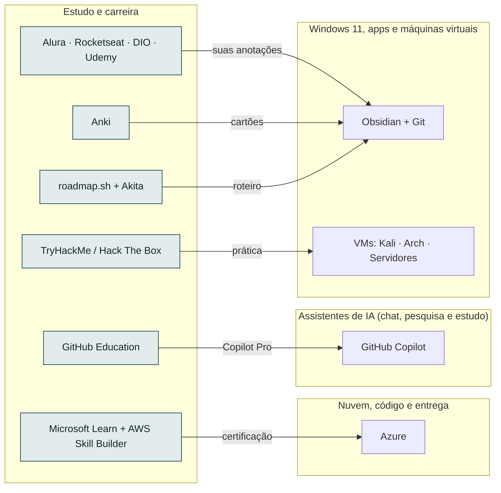

<!-- Arquivo GERADO por tools/gerar_docs.py a partir de data/. Edite os dados, não este arquivo. -->

# Camada 13 · Estudo e carreira

[← Arquitetura](../arquitetura.md) · [Índice da documentação](../README.md)

> **Ligação com a camada de baixo:** O que você estuda vira produto, aula, post e linha no currículo.

**6 blocos** · 4 precisam de conta · 0 marcados como futuro

## Mapa de conexões

## Blocos

| Bloco | Tipo | O que faz |
|---|---|---|
| [Microsoft Learn + AWS Skill Builder](#learn) | Remoto · precisa de conta | Trilhas oficiais e gratuitas para AZ-900, AZ-204 e AWS. |
| [TryHackMe / Hack The Box](#thm) | Remoto · precisa de conta | Laboratórios guiados de segurança para Security+, eJPT e OSCP. |
| [Alura · Rocketseat · DIO · Udemy](#plat) | Remoto · precisa de conta | Contas de aluno. A licença é para você assistir e estudar; baixar, copiar ou extrair as aulas para alimentar IA não é permitido. O que vai para a IA são as suas anotações e os seus projetos. |
| [Anki](#anki) | Local | Repetição espaçada para comandos, conceitos, certificações e concurso. Open source. |
| [roadmap.sh + Akita](#road) | Remoto | Roteiros de estudo e referência da trilha Linux. |
| [GitHub Education](#ghed) | Remoto · precisa de conta | Pacote para professores: Copilot Pro e outros benefícios. Peça a verificação. |

### Microsoft Learn + AWS Skill Builder

*Remoto · precisa de conta*

Trilhas oficiais e gratuitas para AZ-900, AZ-204 e AWS.

| Direção | Bloco | Camada | O que passa |
|---|---|---|---|
| → envia para | [Azure](11-nuvem.md#azure) | Nuvem, código e entrega | certificação |

### TryHackMe / Hack The Box

*Remoto · precisa de conta*

Laboratórios guiados de segurança para Security+, eJPT e OSCP.

| Direção | Bloco | Camada | O que passa |
|---|---|---|---|
| → envia para | [VMs: Kali · Arch · Servidores](03-win.md#vms) | Windows 11, apps e máquinas virtuais | prática |

### Alura · Rocketseat · DIO · Udemy

*Remoto · precisa de conta*

Contas de aluno. A licença é para você assistir e estudar; baixar, copiar ou extrair as aulas para alimentar IA não é permitido. O que vai para a IA são as suas anotações e os seus projetos.

| Direção | Bloco | Camada | O que passa |
|---|---|---|---|
| → envia para | [Obsidian + Git](03-win.md#obsd) | Windows 11, apps e máquinas virtuais | suas anotações |

### Anki

*Local*

Repetição espaçada para comandos, conceitos, certificações e concurso. Open source.

| Direção | Bloco | Camada | O que passa |
|---|---|---|---|
| → envia para | [Obsidian + Git](03-win.md#obsd) | Windows 11, apps e máquinas virtuais | cartões |

### roadmap.sh + Akita

*Remoto*

Roteiros de estudo e referência da trilha Linux.

| Direção | Bloco | Camada | O que passa |
|---|---|---|---|
| → envia para | [Obsidian + Git](03-win.md#obsd) | Windows 11, apps e máquinas virtuais | roteiro |

### GitHub Education

*Remoto · precisa de conta*

Pacote para professores: Copilot Pro e outros benefícios. Peça a verificação.

| Direção | Bloco | Camada | O que passa |
|---|---|---|---|
| → envia para | [GitHub Copilot](06-chat.md#copi) | Assistentes de IA (chat, pesquisa e estudo) | Copilot Pro |

---

[↑ Camada 14 · Produtos (o que você vende)](14-prod.md) · [↓ Camada 12 · Produção de conteúdo](12-cont.md)
