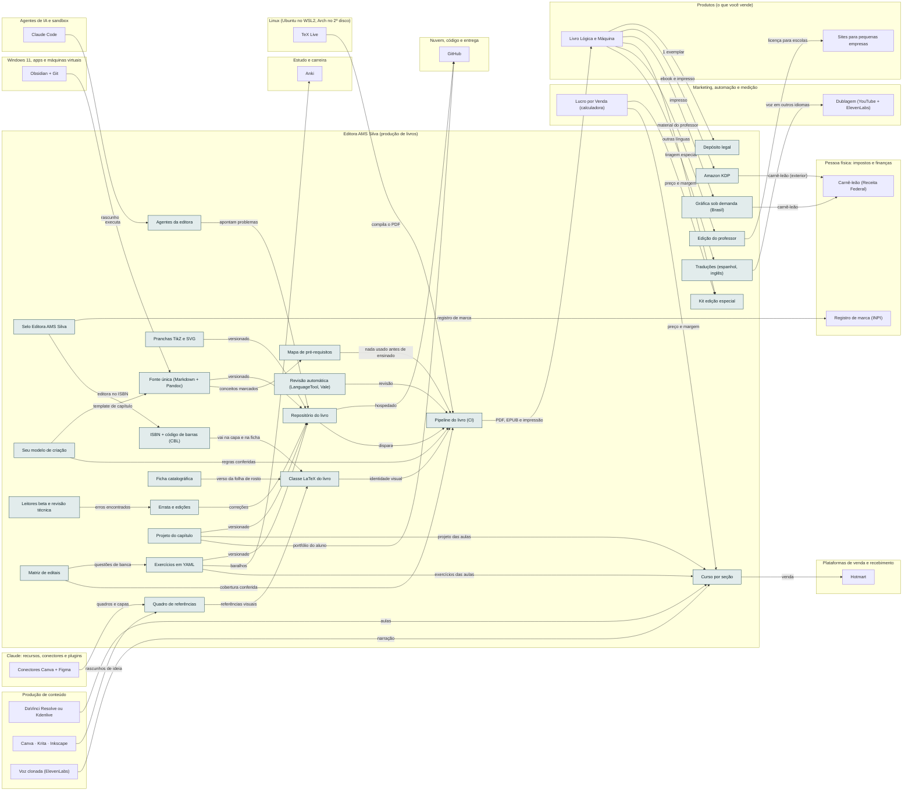

<!-- Arquivo GERADO por tools/gerar_docs.py a partir de data/. Edite os dados, não este arquivo. -->

# Camada 14 · Editora AMS Silva (produção de livros)

[← Arquitetura](../arquitetura.md) · [Índice da documentação](../README.md)

> **Ligação com a camada de baixo:** Cada livro sai do pipeline como produto pronto para as plataformas e para a gráfica.

**25 blocos** · 3 precisam de conta · 5 marcados como futuro

## Mapa de conexões

## Blocos

| Bloco | Tipo | O que faz |
|---|---|---|
| [Selo Editora AMS Silva](#selo) | Local | Marca da editora usada nos livros, no seu CPF por enquanto. Vira empresa quando a renda justificar. |
| [Repositório do livro](#brepo) | Remoto | Um repositório por livro: texto, exercícios, figuras, código, estilo, errata e changelog. |
| [Seu modelo de criação](#modelo) | Local | Template de capítulo e regras que o pipeline confere. Aguardando o seu modelo. |
| [Fonte única (Markdown + Pandoc)](#fonte) | Local | O texto escrito uma vez e convertido em LaTeX, EPUB e HTML. |
| [Exercícios em YAML](#exyaml) | Local | Enunciado, nível, fonte, gabarito e solução. Gera a lista do capítulo, o gabarito, o site am-mentor e o Anki. |
| [Pranchas TikZ e SVG](#tikz) | Local | Diagramas técnicos vetoriais versionados como código. |
| [Classe LaTeX do livro](#bcls) | Local | A identidade visual (papel creme, verdigris, latão, Garamond) aplicada a toda página. |
| [Pipeline do livro (CI)](#bci) | Remoto | A cada mudança: compila e testa o código, confere gabaritos, revisa texto e links, gera PDF, EPUB e arquivo de impressão. |
| [Revisão automática (LanguageTool, Vale)](#lint) | Local | Ortografia e regras de estilo da editora. |
| [Agentes da editora](#bagentes) | Local | Revisor técnico, gerador de testes, verificador de gabarito, leitor iniciante e consistência entre capítulos. |
| [Leitores beta e revisão técnica](#beta) | Físico | 3 a 5 leitores do público e uma segunda pessoa da área antes de cada edição. |
| [Errata e edições](#errata) | Remoto | Correções públicas e número de edição; o leitor reporta erros por formulário. |
| [ISBN + código de barras (CBL)](#isbn) | Remoto · precisa de conta | Um ISBN por formato (impresso e ebook), pela plataforma da Câmara Brasileira do Livro. |
| [Ficha catalográfica](#ficha) | Remoto | Feita pela CBL ou por bibliotecário com CRB; vai no verso da folha de rosto. |
| [Depósito legal](#deplegal) | Físico | Pelo menos 1 exemplar à Biblioteca Nacional até 30 dias após publicar (Lei 10.994/2004). |
| [Amazon KDP](#kdp) | Remoto · precisa de conta | Ebook com royalty de 35% ou 70% (no Brasil, 70% entre R$ 5,99 e R$ 31,99, com KDP Select) e impressão sob demanda. |
| [Gráfica sob demanda (Brasil)](#pod) | Remoto · precisa de conta · futuro | Livro impresso sem estoque; compare custo, prazo e cópia de prova. |
| [Kit edição especial](#bkit) | Físico · futuro | Tiragem limitada com capa dura, marcador e pôster, no modelo do VHSlins. |
| [Curso por seção](#bcurso) | Remoto · futuro | Uma aula por seção na ordem do sumário, com voz clonada e tela. |
| [Edição do professor](#prof) | Local · futuro | Slides, planos de aula, avaliações e gabaritos; licença para escolas. |
| [Traduções (espanhol, inglês)](#trad) | Remoto · futuro | Tradução revisada por nativo; ebook e curso dublados. |
| [Quadro de referências](#refs) | Remoto | Referências de design, pranchas, caixas e paletas testadas em impressão. |
| [Matriz de editais](#editais) | Local | Cada tópico dos editais de PF, PRF e Forças Armadas ligado ao capítulo que o ensina; o pipeline mostra a cobertura e aponta lacunas. |
| [Projeto do capítulo](#projcap) | Local | Cada capítulo termina com um projeto que só se resolve dominando o assunto, no estilo da École 42. |
| [Mapa de pré-requisitos](#prereq) | Local | Cada conceito tem identificador; o pipeline avisa quando algo é usado antes de ser ensinado ou exige outro livro. |

### Selo Editora AMS Silva

*Local*

Marca da editora usada nos livros, no seu CPF por enquanto. Vira empresa quando a renda justificar.

| Direção | Bloco | Camada | O que passa |
|---|---|---|---|
| → envia para | [Registro de marca (INPI)](17-emp.md#inpi) | Pessoa física: impostos e finanças | registro de marca |
| → envia para | [ISBN + código de barras (CBL)](14-editora.md#isbn) | Editora AMS Silva (produção de livros) | editora no ISBN |

### Repositório do livro

*Remoto*

Um repositório por livro: texto, exercícios, figuras, código, estilo, errata e changelog.

| Direção | Bloco | Camada | O que passa |
|---|---|---|---|
| → envia para | [GitHub](11-nuvem.md#gh) | Nuvem, código e entrega | hospedado |
| → envia para | [Pipeline do livro (CI)](14-editora.md#bci) | Editora AMS Silva (produção de livros) | dispara |
| ← recebe de | [Fonte única (Markdown + Pandoc)](14-editora.md#fonte) | Editora AMS Silva (produção de livros) | versionado |
| ← recebe de | [Exercícios em YAML](14-editora.md#exyaml) | Editora AMS Silva (produção de livros) | versionado |
| ← recebe de | [Pranchas TikZ e SVG](14-editora.md#tikz) | Editora AMS Silva (produção de livros) | versionado |
| ← recebe de | [Agentes da editora](14-editora.md#bagentes) | Editora AMS Silva (produção de livros) | apontam problemas |
| ← recebe de | [Errata e edições](14-editora.md#errata) | Editora AMS Silva (produção de livros) | correções |
| ← recebe de | [Projeto do capítulo](14-editora.md#projcap) | Editora AMS Silva (produção de livros) | versionado |

### Seu modelo de criação

*Local*

Template de capítulo e regras que o pipeline confere. Aguardando o seu modelo.

| Direção | Bloco | Camada | O que passa |
|---|---|---|---|
| → envia para | [Fonte única (Markdown + Pandoc)](14-editora.md#fonte) | Editora AMS Silva (produção de livros) | template de capítulo |
| → envia para | [Pipeline do livro (CI)](14-editora.md#bci) | Editora AMS Silva (produção de livros) | regras conferidas |

### Fonte única (Markdown + Pandoc)

*Local*

O texto escrito uma vez e convertido em LaTeX, EPUB e HTML.

| Direção | Bloco | Camada | O que passa |
|---|---|---|---|
| → envia para | [Repositório do livro](14-editora.md#brepo) | Editora AMS Silva (produção de livros) | versionado |
| → envia para | [Mapa de pré-requisitos](14-editora.md#prereq) | Editora AMS Silva (produção de livros) | conceitos marcados |
| ← recebe de | [Seu modelo de criação](14-editora.md#modelo) | Editora AMS Silva (produção de livros) | template de capítulo |
| ← recebe de | [Obsidian + Git](03-win.md#obsd) | Windows 11, apps e máquinas virtuais | rascunho |

### Exercícios em YAML

*Local*

Enunciado, nível, fonte, gabarito e solução. Gera a lista do capítulo, o gabarito, o site am-mentor e o Anki.

| Direção | Bloco | Camada | O que passa |
|---|---|---|---|
| → envia para | [Repositório do livro](14-editora.md#brepo) | Editora AMS Silva (produção de livros) | versionado |
| → envia para | [Anki](13-est.md#anki) | Estudo e carreira | baralhos |
| → envia para | [Curso por seção](14-editora.md#bcurso) | Editora AMS Silva (produção de livros) | exercícios das aulas |
| ← recebe de | [Matriz de editais](14-editora.md#editais) | Editora AMS Silva (produção de livros) | questões de banca |

### Pranchas TikZ e SVG

*Local*

Diagramas técnicos vetoriais versionados como código.

| Direção | Bloco | Camada | O que passa |
|---|---|---|---|
| → envia para | [Repositório do livro](14-editora.md#brepo) | Editora AMS Silva (produção de livros) | versionado |

### Classe LaTeX do livro

*Local*

A identidade visual (papel creme, verdigris, latão, Garamond) aplicada a toda página.

| Direção | Bloco | Camada | O que passa |
|---|---|---|---|
| → envia para | [Pipeline do livro (CI)](14-editora.md#bci) | Editora AMS Silva (produção de livros) | identidade visual |
| ← recebe de | [ISBN + código de barras (CBL)](14-editora.md#isbn) | Editora AMS Silva (produção de livros) | vai na capa e na ficha |
| ← recebe de | [Ficha catalográfica](14-editora.md#ficha) | Editora AMS Silva (produção de livros) | verso da folha de rosto |
| ← recebe de | [Quadro de referências](14-editora.md#refs) | Editora AMS Silva (produção de livros) | referências visuais |

### Pipeline do livro (CI)

*Remoto*

A cada mudança: compila e testa o código, confere gabaritos, revisa texto e links, gera PDF, EPUB e arquivo de impressão.

| Direção | Bloco | Camada | O que passa |
|---|---|---|---|
| → envia para | [Livro Lógica e Máquina](15-prod.md#livro) | Produtos (o que você vende) | PDF, EPUB e impressão |
| ← recebe de | [Seu modelo de criação](14-editora.md#modelo) | Editora AMS Silva (produção de livros) | regras conferidas |
| ← recebe de | [Repositório do livro](14-editora.md#brepo) | Editora AMS Silva (produção de livros) | dispara |
| ← recebe de | [Classe LaTeX do livro](14-editora.md#bcls) | Editora AMS Silva (produção de livros) | identidade visual |
| ← recebe de | [TeX Live](04-lin.md#tex) | Linux (Ubuntu no WSL2, Arch no 2º disco) | compila o PDF |
| ← recebe de | [Revisão automática (LanguageTool, Vale)](14-editora.md#lint) | Editora AMS Silva (produção de livros) | revisão |
| ← recebe de | [Matriz de editais](14-editora.md#editais) | Editora AMS Silva (produção de livros) | cobertura conferida |
| ← recebe de | [Mapa de pré-requisitos](14-editora.md#prereq) | Editora AMS Silva (produção de livros) | nada usado antes de ensinado |

### Revisão automática (LanguageTool, Vale)

*Local*

Ortografia e regras de estilo da editora.

| Direção | Bloco | Camada | O que passa |
|---|---|---|---|
| → envia para | [Pipeline do livro (CI)](14-editora.md#bci) | Editora AMS Silva (produção de livros) | revisão |

### Agentes da editora

*Local*

Revisor técnico, gerador de testes, verificador de gabarito, leitor iniciante e consistência entre capítulos.

| Direção | Bloco | Camada | O que passa |
|---|---|---|---|
| → envia para | [Repositório do livro](14-editora.md#brepo) | Editora AMS Silva (produção de livros) | apontam problemas |
| ← recebe de | [Claude Code](05-ia.md#cc) | Agentes de IA e sandbox | executa |

### Leitores beta e revisão técnica

*Físico*

3 a 5 leitores do público e uma segunda pessoa da área antes de cada edição.

| Direção | Bloco | Camada | O que passa |
|---|---|---|---|
| → envia para | [Errata e edições](14-editora.md#errata) | Editora AMS Silva (produção de livros) | erros encontrados |

### Errata e edições

*Remoto*

Correções públicas e número de edição; o leitor reporta erros por formulário.

| Direção | Bloco | Camada | O que passa |
|---|---|---|---|
| → envia para | [Repositório do livro](14-editora.md#brepo) | Editora AMS Silva (produção de livros) | correções |
| ← recebe de | [Leitores beta e revisão técnica](14-editora.md#beta) | Editora AMS Silva (produção de livros) | erros encontrados |

### ISBN + código de barras (CBL)

*Remoto · precisa de conta*

Um ISBN por formato (impresso e ebook), pela plataforma da Câmara Brasileira do Livro.

| Direção | Bloco | Camada | O que passa |
|---|---|---|---|
| → envia para | [Classe LaTeX do livro](14-editora.md#bcls) | Editora AMS Silva (produção de livros) | vai na capa e na ficha |
| ← recebe de | [Selo Editora AMS Silva](14-editora.md#selo) | Editora AMS Silva (produção de livros) | editora no ISBN |

### Ficha catalográfica

*Remoto*

Feita pela CBL ou por bibliotecário com CRB; vai no verso da folha de rosto.

| Direção | Bloco | Camada | O que passa |
|---|---|---|---|
| → envia para | [Classe LaTeX do livro](14-editora.md#bcls) | Editora AMS Silva (produção de livros) | verso da folha de rosto |

### Depósito legal

*Físico*

Pelo menos 1 exemplar à Biblioteca Nacional até 30 dias após publicar (Lei 10.994/2004).

| Direção | Bloco | Camada | O que passa |
|---|---|---|---|
| ← recebe de | [Livro Lógica e Máquina](15-prod.md#livro) | Produtos (o que você vende) | 1 exemplar |

### Amazon KDP

*Remoto · precisa de conta*

Ebook com royalty de 35% ou 70% (no Brasil, 70% entre R$ 5,99 e R$ 31,99, com KDP Select) e impressão sob demanda.

| Direção | Bloco | Camada | O que passa |
|---|---|---|---|
| → envia para | [Carnê-leão (Receita Federal)](17-emp.md#nfse) | Pessoa física: impostos e finanças | carnê-leão (exterior) |
| ← recebe de | [Livro Lógica e Máquina](15-prod.md#livro) | Produtos (o que você vende) | ebook e impresso |

### Gráfica sob demanda (Brasil)

*Remoto · precisa de conta · futuro*

Livro impresso sem estoque; compare custo, prazo e cópia de prova.

| Direção | Bloco | Camada | O que passa |
|---|---|---|---|
| → envia para | [Carnê-leão (Receita Federal)](17-emp.md#nfse) | Pessoa física: impostos e finanças | carnê-leão |
| ← recebe de | [Livro Lógica e Máquina](15-prod.md#livro) | Produtos (o que você vende) | impresso |

### Kit edição especial

*Físico · futuro*

Tiragem limitada com capa dura, marcador e pôster, no modelo do VHSlins.

| Direção | Bloco | Camada | O que passa |
|---|---|---|---|
| ← recebe de | [Livro Lógica e Máquina](15-prod.md#livro) | Produtos (o que você vende) | tiragem especial |
| ← recebe de | [Lucro por Venda (calculadora)](19-mkt.md#calc) | Marketing, automação e medição | preço e margem |

### Curso por seção

*Remoto · futuro*

Uma aula por seção na ordem do sumário, com voz clonada e tela.

| Direção | Bloco | Camada | O que passa |
|---|---|---|---|
| → envia para | [Hotmart](18-venda.md#hotm) | Plataformas de venda e recebimento | venda |
| ← recebe de | [Exercícios em YAML](14-editora.md#exyaml) | Editora AMS Silva (produção de livros) | exercícios das aulas |
| ← recebe de | [Voz clonada (ElevenLabs)](12-cont.md#voz) | Produção de conteúdo | narração |
| ← recebe de | [DaVinci Resolve ou Kdenlive](12-cont.md#edit) | Produção de conteúdo | aulas |
| ← recebe de | [Lucro por Venda (calculadora)](19-mkt.md#calc) | Marketing, automação e medição | preço e margem |
| ← recebe de | [Projeto do capítulo](14-editora.md#projcap) | Editora AMS Silva (produção de livros) | projeto das aulas |

### Edição do professor

*Local · futuro*

Slides, planos de aula, avaliações e gabaritos; licença para escolas.

| Direção | Bloco | Camada | O que passa |
|---|---|---|---|
| → envia para | [Sites para pequenas empresas](15-prod.md#sites) | Produtos (o que você vende) | licença para escolas |
| ← recebe de | [Livro Lógica e Máquina](15-prod.md#livro) | Produtos (o que você vende) | material do professor |

### Traduções (espanhol, inglês)

*Remoto · futuro*

Tradução revisada por nativo; ebook e curso dublados.

| Direção | Bloco | Camada | O que passa |
|---|---|---|---|
| → envia para | [Dublagem (YouTube + ElevenLabs)](19-mkt.md#dub) | Marketing, automação e medição | voz em outros idiomas |
| ← recebe de | [Livro Lógica e Máquina](15-prod.md#livro) | Produtos (o que você vende) | outras línguas |

### Quadro de referências

*Remoto*

Referências de design, pranchas, caixas e paletas testadas em impressão.

| Direção | Bloco | Camada | O que passa |
|---|---|---|---|
| → envia para | [Classe LaTeX do livro](14-editora.md#bcls) | Editora AMS Silva (produção de livros) | referências visuais |
| ← recebe de | [Canva · Krita · Inkscape](12-cont.md#img) | Produção de conteúdo | rascunhos de ideia |
| ← recebe de | [Conectores Canva + Figma](07-clc.md#ccan) | Claude: recursos, conectores e plugins | quadros e capas |

### Matriz de editais

*Local*

Cada tópico dos editais de PF, PRF e Forças Armadas ligado ao capítulo que o ensina; o pipeline mostra a cobertura e aponta lacunas.

| Direção | Bloco | Camada | O que passa |
|---|---|---|---|
| → envia para | [Pipeline do livro (CI)](14-editora.md#bci) | Editora AMS Silva (produção de livros) | cobertura conferida |
| → envia para | [Exercícios em YAML](14-editora.md#exyaml) | Editora AMS Silva (produção de livros) | questões de banca |

### Projeto do capítulo

*Local*

Cada capítulo termina com um projeto que só se resolve dominando o assunto, no estilo da École 42.

| Direção | Bloco | Camada | O que passa |
|---|---|---|---|
| → envia para | [Repositório do livro](14-editora.md#brepo) | Editora AMS Silva (produção de livros) | versionado |
| → envia para | [Curso por seção](14-editora.md#bcurso) | Editora AMS Silva (produção de livros) | projeto das aulas |
| → envia para | [GitHub](11-nuvem.md#gh) | Nuvem, código e entrega | portfólio do aluno |

### Mapa de pré-requisitos

*Local*

Cada conceito tem identificador; o pipeline avisa quando algo é usado antes de ser ensinado ou exige outro livro.

| Direção | Bloco | Camada | O que passa |
|---|---|---|---|
| → envia para | [Pipeline do livro (CI)](14-editora.md#bci) | Editora AMS Silva (produção de livros) | nada usado antes de ensinado |
| ← recebe de | [Fonte única (Markdown + Pandoc)](14-editora.md#fonte) | Editora AMS Silva (produção de livros) | conceitos marcados |

---

[↑ Camada 15 · Produtos (o que você vende)](15-prod.md) · [↓ Camada 13 · Estudo e carreira](13-est.md)
