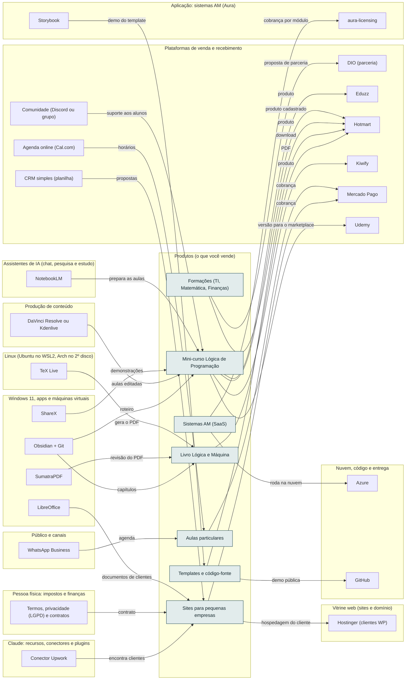

<!-- Arquivo GERADO por tools/gerar_docs.py a partir de data/. Edite os dados, não este arquivo. -->

# Camada 14 · Produtos (o que você vende)

[← Arquitetura](../arquitetura.md) · [Índice da documentação](../README.md)

> **Ligação com a camada de baixo:** Cada produto nasce do conteúdo gravado, escrito ou programado.

**7 blocos** · 0 precisam de conta · 2 marcados como futuro

## Mapa de conexões

## Blocos

| Bloco | Tipo | O que faz |
|---|---|---|
| [Mini-curso Lógica de Programação](#curso) | Local | Primeiro produto de lançamento, para validar antes de construir mais. |
| [Formações (TI, Matemática, Finanças)](#form) | Local · futuro | Cursos completos, depois que o mini-curso vender. |
| [Templates e código-fonte](#tmpl) | Local | Frontends prontos e projetos vendidos como download. |
| [Livro Lógica e Máquina](#livro) | Local | PDF primeiro; impresso depois. |
| [Aulas particulares](#aulas) | Físico | Seus estudos viram aula paga. |
| [Sites para pequenas empresas](#sites) | Local | Freelance em Barbacena: sites e lojas. |
| [Sistemas AM (SaaS)](#saas) | Remoto · futuro | AM Kaixara, AM Rendara e os demais, vendidos por assinatura. |

### Mini-curso Lógica de Programação

*Local*

Primeiro produto de lançamento, para validar antes de construir mais.

| Direção | Bloco | Camada | O que passa |
|---|---|---|---|
| → envia para | [Kiwify](17-venda.md#kiwi) | Plataformas de venda e recebimento | produto |
| → envia para | [Udemy](17-venda.md#udemy) | Plataformas de venda e recebimento | versão para o marketplace |
| → envia para | [Eduzz](17-venda.md#eduzz) | Plataformas de venda e recebimento | produto |
| → envia para | [Hotmart](17-venda.md#hotm) | Plataformas de venda e recebimento | produto cadastrado |
| ← recebe de | [NotebookLM](06-chat.md#nblm) | Assistentes de IA (chat, pesquisa e estudo) | prepara as aulas |
| ← recebe de | [ShareX](03-win.md#sharex) | Windows 11, apps e máquinas virtuais | demonstrações |
| ← recebe de | [Comunidade (Discord ou grupo)](17-venda.md#comu) | Plataformas de venda e recebimento | suporte aos alunos |
| ← recebe de | [DaVinci Resolve ou Kdenlive](12-cont.md#edit) | Produção de conteúdo | aulas editadas |
| ← recebe de | [Obsidian + Git](03-win.md#obsd) | Windows 11, apps e máquinas virtuais | roteiro |

### Formações (TI, Matemática, Finanças)

*Local · futuro*

Cursos completos, depois que o mini-curso vender.

| Direção | Bloco | Camada | O que passa |
|---|---|---|---|
| → envia para | [DIO (parceria)](17-venda.md#dio) | Plataformas de venda e recebimento | proposta de parceria |
| → envia para | [Hotmart](17-venda.md#hotm) | Plataformas de venda e recebimento | produto |

### Templates e código-fonte

*Local*

Frontends prontos e projetos vendidos como download.

| Direção | Bloco | Camada | O que passa |
|---|---|---|---|
| → envia para | [Hotmart](17-venda.md#hotm) | Plataformas de venda e recebimento | download |
| → envia para | [GitHub](11-nuvem.md#gh) | Nuvem, código e entrega | demo pública |
| ← recebe de | [Storybook](10-app.md#story) | Aplicação: sistemas AM (Aura) | demo do template |

### Livro Lógica e Máquina

*Local*

PDF primeiro; impresso depois.

| Direção | Bloco | Camada | O que passa |
|---|---|---|---|
| → envia para | [Hotmart](17-venda.md#hotm) | Plataformas de venda e recebimento | PDF |
| ← recebe de | [TeX Live](04-lin.md#tex) | Linux (Ubuntu no WSL2, Arch no 2º disco) | gera o PDF |
| ← recebe de | [SumatraPDF](03-win.md#pdf) | Windows 11, apps e máquinas virtuais | revisão do PDF |
| ← recebe de | [Obsidian + Git](03-win.md#obsd) | Windows 11, apps e máquinas virtuais | capítulos |

### Aulas particulares

*Físico*

Seus estudos viram aula paga.

| Direção | Bloco | Camada | O que passa |
|---|---|---|---|
| → envia para | [Mercado Pago](17-venda.md#mp) | Plataformas de venda e recebimento | cobrança |
| ← recebe de | [Agenda online (Cal.com)](17-venda.md#agenda) | Plataformas de venda e recebimento | horários |
| ← recebe de | [WhatsApp Business](18-pub.md#wa) | Público e canais | agenda |

### Sites para pequenas empresas

*Local*

Freelance em Barbacena: sites e lojas.

| Direção | Bloco | Camada | O que passa |
|---|---|---|---|
| → envia para | [Mercado Pago](17-venda.md#mp) | Plataformas de venda e recebimento | cobrança |
| → envia para | [Hostinger (clientes WP)](15-web.md#hostg) | Vitrine web (sites e domínio) | hospedagem do cliente |
| ← recebe de | [LibreOffice](03-win.md#office) | Windows 11, apps e máquinas virtuais | documentos de clientes |
| ← recebe de | [CRM simples (planilha)](17-venda.md#crm) | Plataformas de venda e recebimento | propostas |
| ← recebe de | [Termos, privacidade (LGPD) e contratos](16-emp.md#legal) | Pessoa física: impostos e finanças | contrato |
| ← recebe de | [Conector Upwork](07-clc.md#cupw) | Claude: recursos, conectores e plugins | encontra clientes |

### Sistemas AM (SaaS)

*Remoto · futuro*

AM Kaixara, AM Rendara e os demais, vendidos por assinatura.

| Direção | Bloco | Camada | O que passa |
|---|---|---|---|
| → envia para | [Azure](11-nuvem.md#azure) | Nuvem, código e entrega | roda na nuvem |
| → envia para | [aura-licensing](10-app.md#lic) | Aplicação: sistemas AM (Aura) | cobrança por módulo |

---

[↑ Camada 15 · Vitrine web (sites e domínio)](15-web.md) · [↓ Camada 13 · Estudo e carreira](13-est.md)
