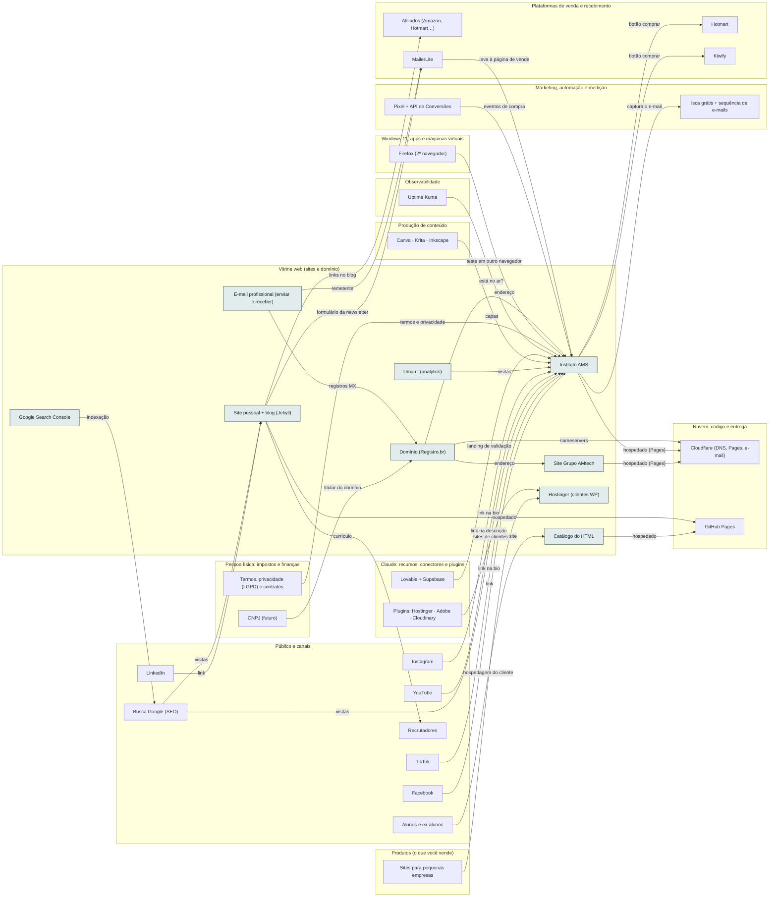

<!-- Arquivo GERADO por tools/gerar_docs.py a partir de data/. Edite os dados, não este arquivo. -->

# Camada 15 · Vitrine web (sites e domínio)

[← Arquitetura](../arquitetura.md) · [Índice da documentação](../README.md)

> **Ligação com a camada de baixo:** Os sites mostram e vendem os produtos e o seu portfólio.

**9 blocos** · 4 precisam de conta · 0 marcados como futuro

## Mapa de conexões

## Blocos

| Bloco | Tipo | O que faz |
|---|---|---|
| [E-mail profissional (enviar e receber)](#mail) | Remoto · precisa de conta | contato@seu-dominio. O roteamento da Cloudflare só recebe; para enviar, é preciso um provedor de e-mail. |
| [Domínio (Registro.br)](#dom) | Remoto · precisa de conta | Seu domínio .com.br, registrado no seu CPF. Os nameservers apontam para a Cloudflare. |
| [Site pessoal + blog (Jekyll)](#site) | Remoto | alanmateus17.github.io: portfólio, blog e newsletter. |
| [Instituto AMS](#inst) | Remoto | Site dos cursos: páginas de venda que levam ao checkout. |
| [Site Grupo AMtech](#amsite) | Remoto | Site institucional da empresa: serviços, sistemas AM e contato. |
| [Catálogo do HTML](#catal) | Remoto | Site didático para os alunos publicarem os próprios sites. |
| [Umami (analytics)](#umami) | Remoto | Estatística de visitas sem cookies invasivos. Open source. |
| [Google Search Console](#gsc) | Remoto · precisa de conta | Mostra como o Google indexa os sites e quais buscas trazem visitas. |
| [Hostinger (clientes WP)](#hostg) | Remoto · precisa de conta | Hospedagem WordPress que você já tem; serve para sites de clientes. |

### E-mail profissional (enviar e receber)

*Remoto · precisa de conta*

contato@seu-dominio. O roteamento da Cloudflare só recebe; para enviar, é preciso um provedor de e-mail.

| Direção | Bloco | Camada | O que passa |
|---|---|---|---|
| → envia para | [Domínio (Registro.br)](15-web.md#dom) | Vitrine web (sites e domínio) | registros MX |
| → envia para | [MailerLite](17-venda.md#mailer) | Plataformas de venda e recebimento | remetente |

### Domínio (Registro.br)

*Remoto · precisa de conta*

Seu domínio .com.br, registrado no seu CPF. Os nameservers apontam para a Cloudflare.

| Direção | Bloco | Camada | O que passa |
|---|---|---|---|
| → envia para | [Cloudflare (DNS, Pages, e-mail)](11-nuvem.md#cf) | Nuvem, código e entrega | nameservers |
| → envia para | [Instituto AMS](15-web.md#inst) | Vitrine web (sites e domínio) | endereço |
| → envia para | [Site Grupo AMtech](15-web.md#amsite) | Vitrine web (sites e domínio) | endereço |
| ← recebe de | [E-mail profissional (enviar e receber)](15-web.md#mail) | Vitrine web (sites e domínio) | registros MX |
| ← recebe de | [CNPJ (futuro)](16-emp.md#cnpj) | Pessoa física: impostos e finanças | titular do domínio |

### Site pessoal + blog (Jekyll)

*Remoto*

alanmateus17.github.io: portfólio, blog e newsletter.

| Direção | Bloco | Camada | O que passa |
|---|---|---|---|
| → envia para | [GitHub Pages](11-nuvem.md#ghp) | Nuvem, código e entrega | hospedado |
| → envia para | [MailerLite](17-venda.md#mailer) | Plataformas de venda e recebimento | formulário da newsletter |
| → envia para | [Afiliados (Amazon, Hotmart…)](17-venda.md#afil) | Plataformas de venda e recebimento | links no blog |
| → envia para | [Recrutadores](19-pub.md#recr) | Público e canais | currículo |
| ← recebe de | [Busca Google (SEO)](19-pub.md#seo) | Público e canais | visitas |
| ← recebe de | [LinkedIn](19-pub.md#li) | Público e canais | link |

### Instituto AMS

*Remoto*

Site dos cursos: páginas de venda que levam ao checkout.

| Direção | Bloco | Camada | O que passa |
|---|---|---|---|
| → envia para | [Kiwify](17-venda.md#kiwi) | Plataformas de venda e recebimento | botão comprar |
| → envia para | [Cloudflare (DNS, Pages, e-mail)](11-nuvem.md#cf) | Nuvem, código e entrega | hospedado (Pages) |
| → envia para | [Hotmart](17-venda.md#hotm) | Plataformas de venda e recebimento | botão comprar |
| → envia para | [Isca grátis + sequência de e-mails](18-mkt.md#isca) | Marketing, automação e medição | captura o e-mail |
| ← recebe de | [Firefox (2º navegador)](03-win.md#ffox) | Windows 11, apps e máquinas virtuais | teste em outro navegador |
| ← recebe de | [Termos, privacidade (LGPD) e contratos](16-emp.md#legal) | Pessoa física: impostos e finanças | termos e privacidade |
| ← recebe de | [Uptime Kuma](09-obs.md#kuma) | Observabilidade | está no ar? |
| ← recebe de | [Lovable + Supabase](07-clc.md#clov) | Claude: recursos, conectores e plugins | landing de validação |
| ← recebe de | [Canva · Krita · Inkscape](12-cont.md#img) | Produção de conteúdo | capas |
| ← recebe de | [Domínio (Registro.br)](15-web.md#dom) | Vitrine web (sites e domínio) | endereço |
| ← recebe de | [Umami (analytics)](15-web.md#umami) | Vitrine web (sites e domínio) | visitas |
| ← recebe de | [MailerLite](17-venda.md#mailer) | Plataformas de venda e recebimento | leva à página de venda |
| ← recebe de | [Instagram](19-pub.md#ig) | Público e canais | link na bio |
| ← recebe de | [YouTube](19-pub.md#yt) | Público e canais | link na descrição |
| ← recebe de | [Busca Google (SEO)](19-pub.md#seo) | Público e canais | visitas |
| ← recebe de | [Pixel + API de Conversões](18-mkt.md#pixel) | Marketing, automação e medição | eventos de compra |
| ← recebe de | [TikTok](19-pub.md#tiktok) | Público e canais | link na bio |
| ← recebe de | [Facebook](19-pub.md#facebook) | Público e canais | link |

### Site Grupo AMtech

*Remoto*

Site institucional da empresa: serviços, sistemas AM e contato.

| Direção | Bloco | Camada | O que passa |
|---|---|---|---|
| → envia para | [Cloudflare (DNS, Pages, e-mail)](11-nuvem.md#cf) | Nuvem, código e entrega | hospedado (Pages) |
| ← recebe de | [Domínio (Registro.br)](15-web.md#dom) | Vitrine web (sites e domínio) | endereço |

### Catálogo do HTML

*Remoto*

Site didático para os alunos publicarem os próprios sites.

| Direção | Bloco | Camada | O que passa |
|---|---|---|---|
| → envia para | [GitHub Pages](11-nuvem.md#ghp) | Nuvem, código e entrega | hospedado |
| ← recebe de | [Alunos e ex-alunos](19-pub.md#alunos) | Público e canais | usam o site |

### Umami (analytics)

*Remoto*

Estatística de visitas sem cookies invasivos. Open source.

| Direção | Bloco | Camada | O que passa |
|---|---|---|---|
| → envia para | [Instituto AMS](15-web.md#inst) | Vitrine web (sites e domínio) | visitas |

### Google Search Console

*Remoto · precisa de conta*

Mostra como o Google indexa os sites e quais buscas trazem visitas.

| Direção | Bloco | Camada | O que passa |
|---|---|---|---|
| → envia para | [Busca Google (SEO)](19-pub.md#seo) | Público e canais | indexação |

### Hostinger (clientes WP)

*Remoto · precisa de conta*

Hospedagem WordPress que você já tem; serve para sites de clientes.

| Direção | Bloco | Camada | O que passa |
|---|---|---|---|
| ← recebe de | [Plugins: Hostinger · Adobe · Cloudinary](07-clc.md#phst) | Claude: recursos, conectores e plugins | sites de clientes |
| ← recebe de | [Sites para pequenas empresas](14-prod.md#sites) | Produtos (o que você vende) | hospedagem do cliente |

---

[↑ Camada 16 · Pessoa física: impostos e finanças](16-emp.md) · [↓ Camada 14 · Produtos (o que você vende)](14-prod.md)
