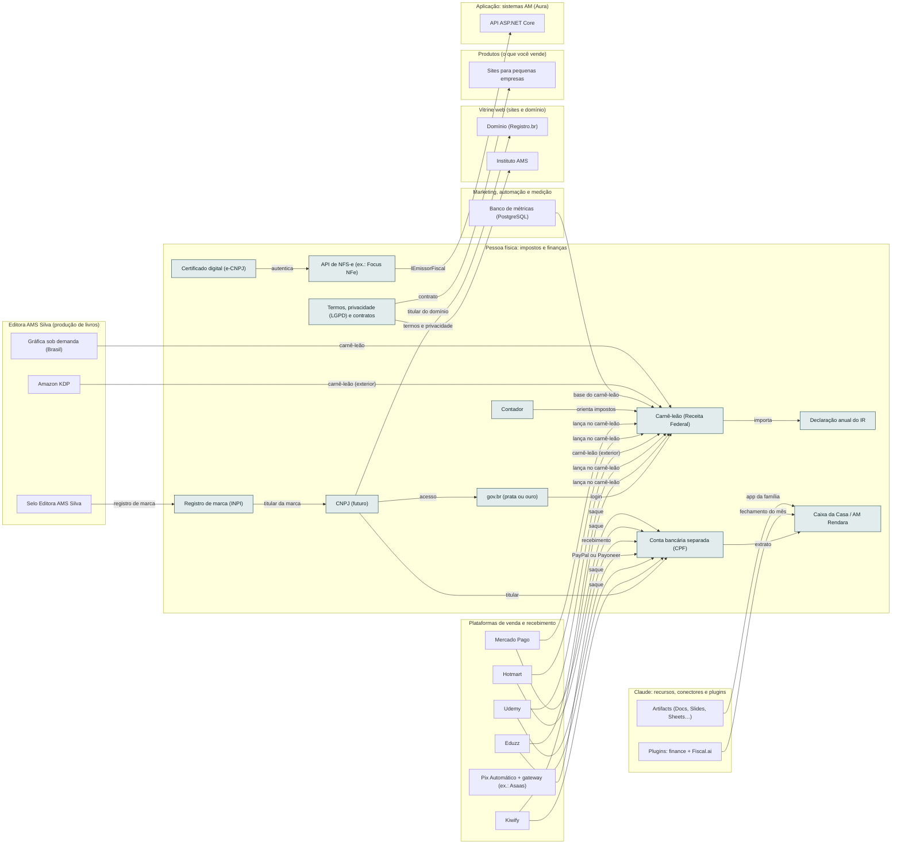

<!-- Arquivo GERADO por tools/gerar_docs.py a partir de data/. Edite os dados, não este arquivo. -->

# Camada 17 · Pessoa física: impostos e finanças

[← Arquitetura](../arquitetura.md) · [Índice da documentação](../README.md)

> **Ligação com a camada de baixo:** Tudo no seu CPF por enquanto; o CNPJ entra quando a renda justificar.

**11 blocos** · 8 precisam de conta · 3 marcados como futuro

## Mapa de conexões

## Blocos

| Bloco | Tipo | O que faz |
|---|---|---|
| [Registro de marca (INPI)](#inpi) | Remoto · precisa de conta | Proteger AMtech, Instituto AMS e os nomes AM antes de investir na marca. Pode ser pedido no seu CPF; confira no INPI o desconto disponível para pessoa física. |
| [Termos, privacidade (LGPD) e contratos](#legal) | Local | Termos de uso, política de privacidade nos sites e contrato padrão de serviço. Obrigatório antes de coletar e-mail ou vender. |
| [Certificado digital (e-CNPJ)](#ecnpj) | Remoto · precisa de conta · futuro | Só quando houver CNPJ: emissão de nota por API e assinatura de documentos da empresa. |
| [API de NFS-e (ex.: Focus NFe)](#nfapi) | Remoto · precisa de conta · futuro | Só quando houver CNPJ. Implementa o seu IEmissorFiscal: os sistemas AM emitem nota sozinhos. |
| [CNPJ (futuro)](#cnpj) | Remoto · precisa de conta · futuro | Ainda não. Quando a renda crescer, MEI ou SLU. Até lá, tudo no seu CPF. |
| [gov.br (prata ou ouro)](#govbr) | Remoto · precisa de conta | Acesso ao carnê-leão online e à declaração do Imposto de Renda. |
| [Carnê-leão (Receita Federal)](#nfse) | Remoto · precisa de conta | Todo mês você lança o que recebeu de compradores (Hotmart, Kiwify, aulas, sites) e do exterior (Udemy) e paga o DARF até o último dia útil do mês seguinte. |
| [Declaração anual do IR](#irpf) | Remoto · precisa de conta | Os valores lançados no carnê-leão entram sozinhos na declaração. |
| [Conta bancária separada (CPF)](#banco) | Remoto · precisa de conta | Uma conta só para receber vendas e serviços, separada do salário. Facilita o carnê-leão e a futura passagem para CNPJ. |
| [Contador](#conta) | Físico | Uma consulta para montar o carnê-leão do jeito certo e dizer a partir de que renda vale abrir CNPJ. |
| [Caixa da Casa / AM Rendara](#caixa) | Local | Controle financeiro pessoal e da empresa (seu sistema). |

### Registro de marca (INPI)

*Remoto · precisa de conta*

Proteger AMtech, Instituto AMS e os nomes AM antes de investir na marca. Pode ser pedido no seu CPF; confira no INPI o desconto disponível para pessoa física.

| Direção | Bloco | Camada | O que passa |
|---|---|---|---|
| → envia para | [CNPJ (futuro)](17-emp.md#cnpj) | Pessoa física: impostos e finanças | titular da marca |
| ← recebe de | [Selo Editora AMS Silva](14-editora.md#selo) | Editora AMS Silva (produção de livros) | registro de marca |

### Termos, privacidade (LGPD) e contratos

*Local*

Termos de uso, política de privacidade nos sites e contrato padrão de serviço. Obrigatório antes de coletar e-mail ou vender.

| Direção | Bloco | Camada | O que passa |
|---|---|---|---|
| → envia para | [Instituto AMS](16-web.md#inst) | Vitrine web (sites e domínio) | termos e privacidade |
| → envia para | [Sites para pequenas empresas](15-prod.md#sites) | Produtos (o que você vende) | contrato |

### Certificado digital (e-CNPJ)

*Remoto · precisa de conta · futuro*

Só quando houver CNPJ: emissão de nota por API e assinatura de documentos da empresa.

| Direção | Bloco | Camada | O que passa |
|---|---|---|---|
| → envia para | [API de NFS-e (ex.: Focus NFe)](17-emp.md#nfapi) | Pessoa física: impostos e finanças | autentica |

### API de NFS-e (ex.: Focus NFe)

*Remoto · precisa de conta · futuro*

Só quando houver CNPJ. Implementa o seu IEmissorFiscal: os sistemas AM emitem nota sozinhos.

| Direção | Bloco | Camada | O que passa |
|---|---|---|---|
| → envia para | [API ASP.NET Core](10-app.md#api) | Aplicação: sistemas AM (Aura) | IEmissorFiscal |
| ← recebe de | [Certificado digital (e-CNPJ)](17-emp.md#ecnpj) | Pessoa física: impostos e finanças | autentica |

### CNPJ (futuro)

*Remoto · precisa de conta · futuro*

Ainda não. Quando a renda crescer, MEI ou SLU. Até lá, tudo no seu CPF.

| Direção | Bloco | Camada | O que passa |
|---|---|---|---|
| → envia para | [gov.br (prata ou ouro)](17-emp.md#govbr) | Pessoa física: impostos e finanças | acesso |
| → envia para | [Conta bancária separada (CPF)](17-emp.md#banco) | Pessoa física: impostos e finanças | titular |
| → envia para | [Domínio (Registro.br)](16-web.md#dom) | Vitrine web (sites e domínio) | titular do domínio |
| ← recebe de | [Registro de marca (INPI)](17-emp.md#inpi) | Pessoa física: impostos e finanças | titular da marca |

### gov.br (prata ou ouro)

*Remoto · precisa de conta*

Acesso ao carnê-leão online e à declaração do Imposto de Renda.

| Direção | Bloco | Camada | O que passa |
|---|---|---|---|
| → envia para | [Carnê-leão (Receita Federal)](17-emp.md#nfse) | Pessoa física: impostos e finanças | login |
| ← recebe de | [CNPJ (futuro)](17-emp.md#cnpj) | Pessoa física: impostos e finanças | acesso |

### Carnê-leão (Receita Federal)

*Remoto · precisa de conta*

Todo mês você lança o que recebeu de compradores (Hotmart, Kiwify, aulas, sites) e do exterior (Udemy) e paga o DARF até o último dia útil do mês seguinte.

| Direção | Bloco | Camada | O que passa |
|---|---|---|---|
| → envia para | [Declaração anual do IR](17-emp.md#irpf) | Pessoa física: impostos e finanças | importa |
| ← recebe de | [Kiwify](18-venda.md#kiwi) | Plataformas de venda e recebimento | lança no carnê-leão |
| ← recebe de | [Eduzz](18-venda.md#eduzz) | Plataformas de venda e recebimento | lança no carnê-leão |
| ← recebe de | [Udemy](18-venda.md#udemy) | Plataformas de venda e recebimento | carnê-leão (exterior) |
| ← recebe de | [Hotmart](18-venda.md#hotm) | Plataformas de venda e recebimento | lança no carnê-leão |
| ← recebe de | [Mercado Pago](18-venda.md#mp) | Plataformas de venda e recebimento | lança no carnê-leão |
| ← recebe de | [Contador](17-emp.md#conta) | Pessoa física: impostos e finanças | orienta impostos |
| ← recebe de | [gov.br (prata ou ouro)](17-emp.md#govbr) | Pessoa física: impostos e finanças | login |
| ← recebe de | [Banco de métricas (PostgreSQL)](19-mkt.md#metrics) | Marketing, automação e medição | base do carnê-leão |
| ← recebe de | [Amazon KDP](14-editora.md#kdp) | Editora AMS Silva (produção de livros) | carnê-leão (exterior) |
| ← recebe de | [Gráfica sob demanda (Brasil)](14-editora.md#pod) | Editora AMS Silva (produção de livros) | carnê-leão |

### Declaração anual do IR

*Remoto · precisa de conta*

Os valores lançados no carnê-leão entram sozinhos na declaração.

| Direção | Bloco | Camada | O que passa |
|---|---|---|---|
| ← recebe de | [Carnê-leão (Receita Federal)](17-emp.md#nfse) | Pessoa física: impostos e finanças | importa |

### Conta bancária separada (CPF)

*Remoto · precisa de conta*

Uma conta só para receber vendas e serviços, separada do salário. Facilita o carnê-leão e a futura passagem para CNPJ.

| Direção | Bloco | Camada | O que passa |
|---|---|---|---|
| → envia para | [Caixa da Casa / AM Rendara](17-emp.md#caixa) | Pessoa física: impostos e finanças | extrato |
| ← recebe de | [Kiwify](18-venda.md#kiwi) | Plataformas de venda e recebimento | saque |
| ← recebe de | [Eduzz](18-venda.md#eduzz) | Plataformas de venda e recebimento | saque |
| ← recebe de | [Udemy](18-venda.md#udemy) | Plataformas de venda e recebimento | PayPal ou Payoneer |
| ← recebe de | [Pix Automático + gateway (ex.: Asaas)](18-venda.md#pixa) | Plataformas de venda e recebimento | recebimento |
| ← recebe de | [Hotmart](18-venda.md#hotm) | Plataformas de venda e recebimento | saque |
| ← recebe de | [Mercado Pago](18-venda.md#mp) | Plataformas de venda e recebimento | saque |
| ← recebe de | [CNPJ (futuro)](17-emp.md#cnpj) | Pessoa física: impostos e finanças | titular |

### Contador

*Físico*

Uma consulta para montar o carnê-leão do jeito certo e dizer a partir de que renda vale abrir CNPJ.

| Direção | Bloco | Camada | O que passa |
|---|---|---|---|
| → envia para | [Carnê-leão (Receita Federal)](17-emp.md#nfse) | Pessoa física: impostos e finanças | orienta impostos |

### Caixa da Casa / AM Rendara

*Local*

Controle financeiro pessoal e da empresa (seu sistema).

| Direção | Bloco | Camada | O que passa |
|---|---|---|---|
| ← recebe de | [Plugins: finance + Fiscal.ai](07-clc.md#pfin) | Claude: recursos, conectores e plugins | fechamento do mês |
| ← recebe de | [Artifacts (Docs, Slides, Sheets…)](07-clc.md#arts) | Claude: recursos, conectores e plugins | app da família |
| ← recebe de | [Conta bancária separada (CPF)](17-emp.md#banco) | Pessoa física: impostos e finanças | extrato |

---

[↑ Camada 18 · Plataformas de venda e recebimento](18-venda.md) · [↓ Camada 16 · Vitrine web (sites e domínio)](16-web.md)
