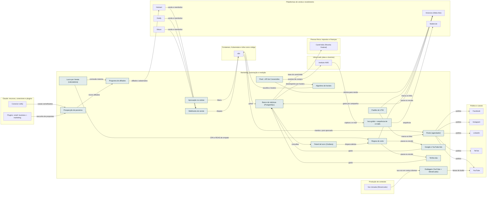

<!-- Arquivo GERADO por tools/gerar_docs.py a partir de data/. Edite os dados, não este arquivo. -->

# Camada 18 · Marketing, automação e medição

[← Arquitetura](../arquitetura.md) · [Índice da documentação](../README.md)

> **Ligação com a camada de baixo:** O que é publicado e anunciado aqui leva às plataformas de venda; cada venda volta como dado para o banco de métricas.

**16 blocos** · 3 precisam de conta · 10 marcados como futuro

## Mapa de conexões

## Blocos

| Bloco | Tipo | O que faz |
|---|---|---|
| [Isca grátis + sequência de e-mails](#isca) | Local | Aula ou PDF grátis que captura o e-mail e abre uma sequência de 5 a 7 e-mails até o mini-curso. |
| [Postiz (agendador)](#postiz) | Local · futuro | Agendador open source (AGPL-3.0) que publica em mais de 28 redes. Roda no seu Docker com PostgreSQL e Redis; integra com o n8n. |
| [Aprovação no celular](#aprov) | Local · futuro | Nenhum post sai sem o seu ok (Telegram ou e-mail). Protege o canal de erro da IA. |
| [Algoritmo de horário](#horario) | Local · futuro | Calcula o desempenho por rede, dia e hora com os seus dados; 80% dos posts nas melhores faixas, 20% testando faixas novas. |
| [Pixel + API de Conversões](#pixel) | Remoto · precisa de conta | Pixel e CAPI da Meta juntos, com deduplicação por event_id. Sem isso o anúncio não aprende quem compra. |
| [Padrão de UTM](#utm) | Local | Todo link marcado com fonte, meio, campanha e criativo, para ligar cada venda ao anúncio ou post que a trouxe. |
| [Google e YouTube Ads](#gads) | Remoto · precisa de conta · futuro | Para vídeos longos que já convertem e buscas com intenção de compra. |
| [TikTok Ads](#ttads) | Remoto · precisa de conta · futuro | Depois que os cortes orgânicos mostrarem tração. |
| [Regras de corte](#regras) | Local | Pausa criativo ou conjunto quando o CPA passa do de empate; sobe 15% do orçamento quando fica abaixo do CPA da margem. |
| [Lucro por Venda (calculadora)](#calc) | Remoto | Artefato com taxas das plataformas, imposto, CPA e ROAS de empate, simulador e o lucro real de cada campanha. |
| [Webhooks de venda](#hooks) | Remoto · futuro | Hotmart, Kiwify e Eduzz avisam cada venda e reembolso; o n8n grava no banco. |
| [Banco de métricas (PostgreSQL)](#metrics) | Local · futuro | Tabelas de produtos, vendas, gastos, ferramentas e impostos. |
| [Painel de lucro (Grafana)](#painel) | Local · futuro | Lucro por produto, canal, campanha e país, atualizado sozinho. |
| [Programa de afiliados](#afprog) | Remoto · futuro | Comissão definida pela calculadora, aberta depois de 20 vendas próprias. |
| [Prospecção de parceiros](#prosp) | Local | Busca e qualificação de parceiros com IA; mensagem revisada e enviada por você. |
| [Dublagem (YouTube + ElevenLabs)](#dub) | Remoto · futuro | Dublagem automática do YouTube para vídeos; ElevenLabs para cursos fora do YouTube. Espanhol primeiro. |

### Isca grátis + sequência de e-mails

*Local*

Aula ou PDF grátis que captura o e-mail e abre uma sequência de 5 a 7 e-mails até o mini-curso.

| Direção | Bloco | Camada | O que passa |
|---|---|---|---|
| → envia para | [MailerLite](17-venda.md#mailer) | Plataformas de venda e recebimento | sequência |
| ← recebe de | [Instituto AMS](15-web.md#inst) | Vitrine web (sites e domínio) | captura o e-mail |

### Postiz (agendador)

*Local · futuro*

Agendador open source (AGPL-3.0) que publica em mais de 28 redes. Roda no seu Docker com PostgreSQL e Redis; integra com o n8n.

| Direção | Bloco | Camada | O que passa |
|---|---|---|---|
| → envia para | [YouTube](19-pub.md#yt) | Público e canais | publica |
| → envia para | [Instagram](19-pub.md#ig) | Público e canais | publica |
| → envia para | [TikTok](19-pub.md#tiktok) | Público e canais | publica |
| → envia para | [Facebook](19-pub.md#facebook) | Público e canais | publica |
| → envia para | [LinkedIn](19-pub.md#li) | Público e canais | publica |
| ← recebe de | [n8n](08-cnt.md#n8n) | Containers, Kubernetes e infra como código | manda o post aprovado |
| ← recebe de | [Padrão de UTM](18-mkt.md#utm) | Marketing, automação e medição | marca os links |

### Aprovação no celular

*Local · futuro*

Nenhum post sai sem o seu ok (Telegram ou e-mail). Protege o canal de erro da IA.

| Direção | Bloco | Camada | O que passa |
|---|---|---|---|
| → envia para | [n8n](08-cnt.md#n8n) | Containers, Kubernetes e infra como código | libera |

### Algoritmo de horário

*Local · futuro*

Calcula o desempenho por rede, dia e hora com os seus dados; 80% dos posts nas melhores faixas, 20% testando faixas novas.

| Direção | Bloco | Camada | O que passa |
|---|---|---|---|
| → envia para | [n8n](08-cnt.md#n8n) | Containers, Kubernetes e infra como código | escolhe o horário |
| ← recebe de | [Banco de métricas (PostgreSQL)](18-mkt.md#metrics) | Marketing, automação e medição | desempenho por horário |

### Pixel + API de Conversões

*Remoto · precisa de conta*

Pixel e CAPI da Meta juntos, com deduplicação por event_id. Sem isso o anúncio não aprende quem compra.

| Direção | Bloco | Camada | O que passa |
|---|---|---|---|
| → envia para | [Instituto AMS](15-web.md#inst) | Vitrine web (sites e domínio) | eventos de compra |
| → envia para | [Anúncios (Meta Ads)](17-venda.md#ads) | Plataformas de venda e recebimento | otimiza para venda |

### Padrão de UTM

*Local*

Todo link marcado com fonte, meio, campanha e criativo, para ligar cada venda ao anúncio ou post que a trouxe.

| Direção | Bloco | Camada | O que passa |
|---|---|---|---|
| → envia para | [Anúncios (Meta Ads)](17-venda.md#ads) | Plataformas de venda e recebimento | marca os links |
| → envia para | [Postiz (agendador)](18-mkt.md#postiz) | Marketing, automação e medição | marca os links |

### Google e YouTube Ads

*Remoto · precisa de conta · futuro*

Para vídeos longos que já convertem e buscas com intenção de compra.

| Direção | Bloco | Camada | O que passa |
|---|---|---|---|
| → envia para | [Banco de métricas (PostgreSQL)](18-mkt.md#metrics) | Marketing, automação e medição | gasto |
| ← recebe de | [Regras de corte](18-mkt.md#regras) | Marketing, automação e medição | pausa ou escala |

### TikTok Ads

*Remoto · precisa de conta · futuro*

Depois que os cortes orgânicos mostrarem tração.

| Direção | Bloco | Camada | O que passa |
|---|---|---|---|
| → envia para | [Banco de métricas (PostgreSQL)](18-mkt.md#metrics) | Marketing, automação e medição | gasto |
| ← recebe de | [Regras de corte](18-mkt.md#regras) | Marketing, automação e medição | pausa ou escala |

### Regras de corte

*Local*

Pausa criativo ou conjunto quando o CPA passa do de empate; sobe 15% do orçamento quando fica abaixo do CPA da margem.

| Direção | Bloco | Camada | O que passa |
|---|---|---|---|
| → envia para | [Anúncios (Meta Ads)](17-venda.md#ads) | Plataformas de venda e recebimento | pausa ou escala |
| → envia para | [Google e YouTube Ads](18-mkt.md#gads) | Marketing, automação e medição | pausa ou escala |
| → envia para | [TikTok Ads](18-mkt.md#ttads) | Marketing, automação e medição | pausa ou escala |
| ← recebe de | [Lucro por Venda (calculadora)](18-mkt.md#calc) | Marketing, automação e medição | CPA e ROAS de empate |
| ← recebe de | [Painel de lucro (Grafana)](18-mkt.md#painel) | Marketing, automação e medição | dispara alertas |

### Lucro por Venda (calculadora)

*Remoto*

Artefato com taxas das plataformas, imposto, CPA e ROAS de empate, simulador e o lucro real de cada campanha.

| Direção | Bloco | Camada | O que passa |
|---|---|---|---|
| → envia para | [Regras de corte](18-mkt.md#regras) | Marketing, automação e medição | CPA e ROAS de empate |
| → envia para | [Programa de afiliados](18-mkt.md#afprog) | Marketing, automação e medição | comissão máxima |

### Webhooks de venda

*Remoto · futuro*

Hotmart, Kiwify e Eduzz avisam cada venda e reembolso; o n8n grava no banco.

| Direção | Bloco | Camada | O que passa |
|---|---|---|---|
| → envia para | [n8n](08-cnt.md#n8n) | Containers, Kubernetes e infra como código | dispara |
| ← recebe de | [Hotmart](17-venda.md#hotm) | Plataformas de venda e recebimento | venda e reembolso |
| ← recebe de | [Kiwify](17-venda.md#kiwi) | Plataformas de venda e recebimento | venda e reembolso |
| ← recebe de | [Eduzz](17-venda.md#eduzz) | Plataformas de venda e recebimento | venda e reembolso |

### Banco de métricas (PostgreSQL)

*Local · futuro*

Tabelas de produtos, vendas, gastos, ferramentas e impostos.

| Direção | Bloco | Camada | O que passa |
|---|---|---|---|
| → envia para | [Painel de lucro (Grafana)](18-mkt.md#painel) | Marketing, automação e medição | consultas |
| → envia para | [Algoritmo de horário](18-mkt.md#horario) | Marketing, automação e medição | desempenho por horário |
| → envia para | [Carnê-leão (Receita Federal)](16-emp.md#nfse) | Pessoa física: impostos e finanças | base do carnê-leão |
| ← recebe de | [n8n](08-cnt.md#n8n) | Containers, Kubernetes e infra como código | grava |
| ← recebe de | [Anúncios (Meta Ads)](17-venda.md#ads) | Plataformas de venda e recebimento | gasto por campanha |
| ← recebe de | [Google e YouTube Ads](18-mkt.md#gads) | Marketing, automação e medição | gasto |
| ← recebe de | [TikTok Ads](18-mkt.md#ttads) | Marketing, automação e medição | gasto |

### Painel de lucro (Grafana)

*Local · futuro*

Lucro por produto, canal, campanha e país, atualizado sozinho.

| Direção | Bloco | Camada | O que passa |
|---|---|---|---|
| → envia para | [Regras de corte](18-mkt.md#regras) | Marketing, automação e medição | dispara alertas |
| ← recebe de | [Banco de métricas (PostgreSQL)](18-mkt.md#metrics) | Marketing, automação e medição | consultas |

### Programa de afiliados

*Remoto · futuro*

Comissão definida pela calculadora, aberta depois de 20 vendas próprias.

| Direção | Bloco | Camada | O que passa |
|---|---|---|---|
| → envia para | [Hotmart](17-venda.md#hotm) | Plataformas de venda e recebimento | afiliados cadastrados |
| ← recebe de | [Prospecção de parceiros](18-mkt.md#prosp) | Marketing, automação e medição | novos afiliados |
| ← recebe de | [Lucro por Venda (calculadora)](18-mkt.md#calc) | Marketing, automação e medição | comissão máxima |

### Prospecção de parceiros

*Local*

Busca e qualificação de parceiros com IA; mensagem revisada e enviada por você.

| Direção | Bloco | Camada | O que passa |
|---|---|---|---|
| → envia para | [Programa de afiliados](18-mkt.md#afprog) | Marketing, automação e medição | novos afiliados |
| ← recebe de | [Conector vidIQ](07-clc.md#cvid) | Claude: recursos, conectores e plugins | canais semelhantes |
| ← recebe de | [Plugins: small- business + marketing](07-clc.md#pbiz) | Claude: recursos, conectores e plugins | rascunho de propostas |

### Dublagem (YouTube + ElevenLabs)

*Remoto · futuro*

Dublagem automática do YouTube para vídeos; ElevenLabs para cursos fora do YouTube. Espanhol primeiro.

| Direção | Bloco | Camada | O que passa |
|---|---|---|---|
| → envia para | [YouTube](19-pub.md#yt) | Público e canais | faixas de áudio |
| ← recebe de | [Voz clonada (ElevenLabs)](12-cont.md#voz) | Produção de conteúdo | sua voz em outros idiomas |

---

[↑ Camada 19 · Público e canais](19-pub.md) · [↓ Camada 17 · Plataformas de venda e recebimento](17-venda.md)
