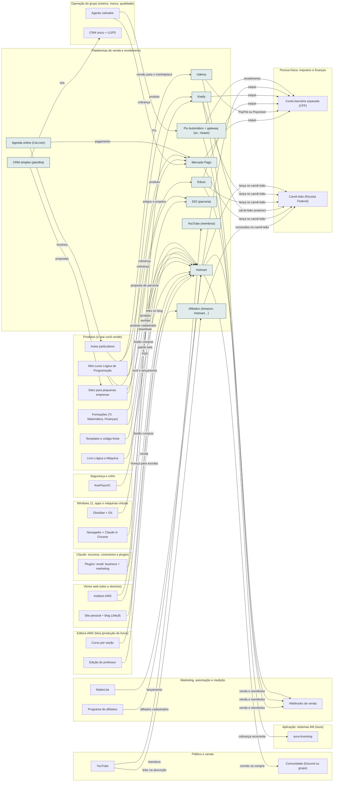

<!-- Arquivo GERADO por tools/gerar_docs.py a partir de data/. Edite os dados, não este arquivo. -->

# Camada 19 · Plataformas de venda e recebimento

[← Arquitetura](../arquitetura.md) · [Índice da documentação](../README.md)

> **Ligação com a camada de baixo:** Cada venda é lançada no carnê-leão e o dinheiro cai na sua conta separada.

**11 blocos** · 10 precisam de conta · 2 marcados como futuro

## Mapa de conexões

## Blocos

| Bloco | Tipo | O que faz |
|---|---|---|
| [Pix Automático + gateway (ex.: Asaas)](#pixa) | Remoto · precisa de conta · futuro | Cobrança recorrente dos sistemas AM por Pix, sem cartão. Lançado pelo Banco Central em 2025. Entra quando o primeiro SaaS tiver cliente. |
| [Agenda online (Cal.com)](#agenda) | Remoto · precisa de conta | Aluno particular escolhe horário sozinho e já paga. Open source, com plano grátis. |
| [CRM simples (planilha)](#crm) | Local | Lista de alunos, clientes e propostas. Uma planilha resolve até dezenas de clientes. |
| [Hotmart](#hotm) | Remoto · precisa de conta | Checkout, área de membros e afiliados para cursos e PDFs. Aceita vender no CPF. Melhor quando você mesmo leva o público. |
| [Kiwify](#kiwi) | Remoto · precisa de conta | Mesma função da Hotmart, com painel mais simples. Aceita vender no CPF. |
| [Eduzz](#eduzz) | Remoto · precisa de conta | Outra plataforma brasileira de infoprodutos, com programa de afiliados próprio. |
| [Udemy](#udemy) | Remoto · precisa de conta | Marketplace mundial: ela traz alunos que você não alcançaria. Ganha bem menos por venda orgânica do que pelo seu cupom. Recebe por PayPal ou Payoneer e pede um formulário fiscal dos EUA. |
| [DIO (parceria)](#dio) | Remoto · precisa de conta | Não é marketplace aberto como a Udemy. Os experts trabalham em parceria com a DIO; o caminho é publicar artigos e projetos lá e se candidatar ou ser convidado. |
| [YouTube (membros)](#ytm) | Remoto · precisa de conta · futuro | Assinatura mensal do canal, quando houver público. |
| [Mercado Pago](#mp) | Remoto · precisa de conta | Pix e cartão para aulas particulares e serviços de sites. |
| [Afiliados (Amazon, Hotmart…)](#afil) | Remoto · precisa de conta | Links de produtos de terceiros no blog e nos vídeos. |

### Pix Automático + gateway (ex.: Asaas)

*Remoto · precisa de conta · futuro*

Cobrança recorrente dos sistemas AM por Pix, sem cartão. Lançado pelo Banco Central em 2025. Entra quando o primeiro SaaS tiver cliente.

| Direção | Bloco | Camada | O que passa |
|---|---|---|---|
| → envia para | [aura-licensing](10-app.md#lic) | Aplicação: sistemas AM (Aura) | cobrança recorrente |
| → envia para | [Conta bancária separada (CPF)](18-emp.md#banco) | Pessoa física: impostos e finanças | recebimento |
| ← recebe de | [Agente cobrador](22-oper.md#ocob) | Operação do grupo (esteira, marca, qualidade) | Pix |

### Agenda online (Cal.com)

*Remoto · precisa de conta*

Aluno particular escolhe horário sozinho e já paga. Open source, com plano grátis.

| Direção | Bloco | Camada | O que passa |
|---|---|---|---|
| → envia para | [Aulas particulares](16-prod.md#aulas) | Produtos (o que você vende) | horários |
| → envia para | [Mercado Pago](19-venda.md#mp) | Plataformas de venda e recebimento | pagamento |

### CRM simples (planilha)

*Local*

Lista de alunos, clientes e propostas. Uma planilha resolve até dezenas de clientes.

| Direção | Bloco | Camada | O que passa |
|---|---|---|---|
| → envia para | [Sites para pequenas empresas](16-prod.md#sites) | Produtos (o que você vende) | propostas |
| → envia para | [CRM único + LGPD](22-oper.md#ocrm) | Operação do grupo (esteira, marca, qualidade) | vira |

### Hotmart

*Remoto · precisa de conta*

Checkout, área de membros e afiliados para cursos e PDFs. Aceita vender no CPF. Melhor quando você mesmo leva o público.

| Direção | Bloco | Camada | O que passa |
|---|---|---|---|
| → envia para | [Carnê-leão (Receita Federal)](18-emp.md#nfse) | Pessoa física: impostos e finanças | lança no carnê-leão |
| → envia para | [Conta bancária separada (CPF)](18-emp.md#banco) | Pessoa física: impostos e finanças | saque |
| → envia para | [Webhooks de venda](20-mkt.md#hooks) | Marketing, automação e medição | venda e reembolso |
| → envia para | [Comunidade (Discord ou grupo)](21-pub.md#comu) | Público e canais | convite na compra |
| ← recebe de | [KeePassXC](02-seg.md#kee) | Segurança e cofre | senhas |
| ← recebe de | [Navegador + Claude in Chrome](03-win.md#nav) | Windows 11, apps e máquinas virtuais | painel web |
| ← recebe de | [Plugins: small- business + marketing](07-clc.md#pbiz) | Claude: recursos, conectores e plugins | funil e lançamento |
| ← recebe de | [Mini-curso Lógica de Programação](16-prod.md#curso) | Produtos (o que você vende) | produto cadastrado |
| ← recebe de | [Formações (TI, Matemática, Finanças)](16-prod.md#form) | Produtos (o que você vende) | produto |
| ← recebe de | [Templates e código-fonte](16-prod.md#tmpl) | Produtos (o que você vende) | download |
| ← recebe de | [Livro Lógica e Máquina](16-prod.md#livro) | Produtos (o que você vende) | PDF |
| ← recebe de | [Instituto AMS](17-web.md#inst) | Vitrine web (sites e domínio) | botão comprar |
| ← recebe de | [MailerLite](20-mkt.md#mailer) | Marketing, automação e medição | lançamento |
| ← recebe de | [Programa de afiliados](20-mkt.md#afprog) | Marketing, automação e medição | afiliados cadastrados |
| ← recebe de | [Curso por seção](14-editora.md#bcurso) | Editora AMS Silva (produção de livros) | venda |
| ← recebe de | [Edição do professor](14-editora.md#prof) | Editora AMS Silva (produção de livros) | licença para escolas |

### Kiwify

*Remoto · precisa de conta*

Mesma função da Hotmart, com painel mais simples. Aceita vender no CPF.

| Direção | Bloco | Camada | O que passa |
|---|---|---|---|
| → envia para | [Carnê-leão (Receita Federal)](18-emp.md#nfse) | Pessoa física: impostos e finanças | lança no carnê-leão |
| → envia para | [Conta bancária separada (CPF)](18-emp.md#banco) | Pessoa física: impostos e finanças | saque |
| → envia para | [Webhooks de venda](20-mkt.md#hooks) | Marketing, automação e medição | venda e reembolso |
| ← recebe de | [Mini-curso Lógica de Programação](16-prod.md#curso) | Produtos (o que você vende) | produto |
| ← recebe de | [Instituto AMS](17-web.md#inst) | Vitrine web (sites e domínio) | botão comprar |

### Eduzz

*Remoto · precisa de conta*

Outra plataforma brasileira de infoprodutos, com programa de afiliados próprio.

| Direção | Bloco | Camada | O que passa |
|---|---|---|---|
| → envia para | [Carnê-leão (Receita Federal)](18-emp.md#nfse) | Pessoa física: impostos e finanças | lança no carnê-leão |
| → envia para | [Conta bancária separada (CPF)](18-emp.md#banco) | Pessoa física: impostos e finanças | saque |
| → envia para | [Webhooks de venda](20-mkt.md#hooks) | Marketing, automação e medição | venda e reembolso |
| ← recebe de | [Mini-curso Lógica de Programação](16-prod.md#curso) | Produtos (o que você vende) | produto |

### Udemy

*Remoto · precisa de conta*

Marketplace mundial: ela traz alunos que você não alcançaria. Ganha bem menos por venda orgânica do que pelo seu cupom. Recebe por PayPal ou Payoneer e pede um formulário fiscal dos EUA.

| Direção | Bloco | Camada | O que passa |
|---|---|---|---|
| → envia para | [Carnê-leão (Receita Federal)](18-emp.md#nfse) | Pessoa física: impostos e finanças | carnê-leão (exterior) |
| → envia para | [Conta bancária separada (CPF)](18-emp.md#banco) | Pessoa física: impostos e finanças | PayPal ou Payoneer |
| ← recebe de | [Mini-curso Lógica de Programação](16-prod.md#curso) | Produtos (o que você vende) | versão para o marketplace |

### DIO (parceria)

*Remoto · precisa de conta*

Não é marketplace aberto como a Udemy. Os experts trabalham em parceria com a DIO; o caminho é publicar artigos e projetos lá e se candidatar ou ser convidado.

| Direção | Bloco | Camada | O que passa |
|---|---|---|---|
| ← recebe de | [Formações (TI, Matemática, Finanças)](16-prod.md#form) | Produtos (o que você vende) | proposta de parceria |
| ← recebe de | [Obsidian + Git](03-win.md#obsd) | Windows 11, apps e máquinas virtuais | artigos e projetos |

### YouTube (membros)

*Remoto · precisa de conta · futuro*

Assinatura mensal do canal, quando houver público.

| Direção | Bloco | Camada | O que passa |
|---|---|---|---|
| ← recebe de | [YouTube](21-pub.md#yt) | Público e canais | membros |

### Mercado Pago

*Remoto · precisa de conta*

Pix e cartão para aulas particulares e serviços de sites.

| Direção | Bloco | Camada | O que passa |
|---|---|---|---|
| → envia para | [Carnê-leão (Receita Federal)](18-emp.md#nfse) | Pessoa física: impostos e finanças | lança no carnê-leão |
| → envia para | [Conta bancária separada (CPF)](18-emp.md#banco) | Pessoa física: impostos e finanças | saque |
| ← recebe de | [Agenda online (Cal.com)](19-venda.md#agenda) | Plataformas de venda e recebimento | pagamento |
| ← recebe de | [Aulas particulares](16-prod.md#aulas) | Produtos (o que você vende) | cobrança |
| ← recebe de | [Sites para pequenas empresas](16-prod.md#sites) | Produtos (o que você vende) | cobrança |
| ← recebe de | [Agente cobrador](22-oper.md#ocob) | Operação do grupo (esteira, marca, qualidade) | cobrança |

### Afiliados (Amazon, Hotmart…)

*Remoto · precisa de conta*

Links de produtos de terceiros no blog e nos vídeos.

| Direção | Bloco | Camada | O que passa |
|---|---|---|---|
| → envia para | [Carnê-leão (Receita Federal)](18-emp.md#nfse) | Pessoa física: impostos e finanças | comissões no carnê-leão |
| ← recebe de | [Site pessoal + blog (Jekyll)](17-web.md#site) | Vitrine web (sites e domínio) | links no blog |
| ← recebe de | [YouTube](21-pub.md#yt) | Público e canais | links na descrição |

---

[↑ Camada 20 · Marketing, automação e medição](20-mkt.md) · [↓ Camada 18 · Pessoa física: impostos e finanças](18-emp.md)
