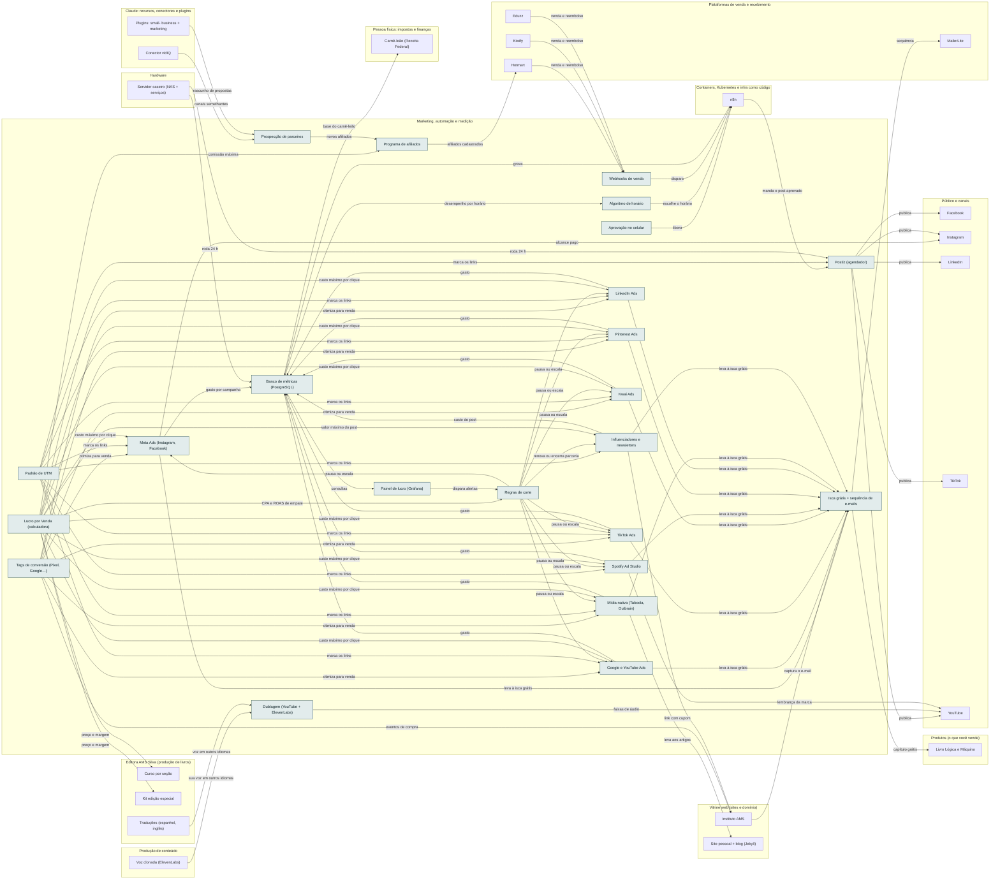

<!-- Arquivo GERADO por tools/gerar_docs.py a partir de data/. Edite os dados, não este arquivo. -->

# Camada 20 · Marketing, automação e medição

[← Arquitetura](../arquitetura.md) · [Índice da documentação](../README.md)

> **Ligação com a camada de baixo:** O que é publicado e anunciado aqui leva às plataformas de venda; cada venda volta como dado para o banco de métricas.

**23 blocos** · 9 precisam de conta · 17 marcados como futuro

## Mapa de conexões

## Blocos

| Bloco | Tipo | O que faz |
|---|---|---|
| [Meta Ads (Instagram, Facebook)](#ads) | Remoto · precisa de conta · futuro | Primeiro canal pago: anúncios da isca grátis e remarketing do mini-curso. Desde jan/2026 a fatura tem +12,15% de impostos sobre a mídia. |
| [Isca grátis + sequência de e-mails](#isca) | Local | Aula ou PDF grátis que captura o e-mail e abre uma sequência de 5 a 7 e-mails até o mini-curso. |
| [Postiz (agendador)](#postiz) | Local · futuro | Agendador open source (AGPL-3.0) que publica em mais de 28 redes. Roda no seu Docker com PostgreSQL e Redis; integra com o n8n. |
| [Aprovação no celular](#aprov) | Local · futuro | Nenhum post sai sem o seu ok (Telegram ou e-mail). Protege o canal de erro da IA. |
| [Algoritmo de horário](#horario) | Local · futuro | Calcula o desempenho por rede, dia e hora com os seus dados; 80% dos posts nas melhores faixas, 20% testando faixas novas. |
| [Tags de conversão (Pixel, Google…)](#pixel) | Remoto · precisa de conta | Pixel + API de Conversões da Meta, tag do Google Ads, pixel do TikTok e as tags de Kwai, Pinterest, LinkedIn e nativos. Sem a tag, o canal não aprende quem compra e a venda não chega ao painel. |
| [Padrão de UTM](#utm) | Local | Todo link marcado com fonte, meio, campanha e criativo, para ligar cada venda ao anúncio ou post que a trouxe. |
| [Google e YouTube Ads](#gads) | Remoto · precisa de conta · futuro | Para vídeos longos que já convertem e buscas com intenção de compra. |
| [TikTok Ads](#ttads) | Remoto · precisa de conta · futuro | Depois que os cortes orgânicos mostrarem tração. |
| [Regras de corte](#regras) | Local | Pausa criativo ou conjunto quando o CPA passa do de empate; sobe 15% do orçamento quando fica abaixo do CPA da margem. |
| [Lucro por Venda (calculadora)](#calc) | Remoto | Artefato com taxas das plataformas, imposto, CPA e ROAS de empate, simulador e o lucro real de cada campanha. |
| [Webhooks de venda](#hooks) | Remoto · futuro | Hotmart, Kiwify e Eduzz avisam cada venda e reembolso; o n8n grava no banco. |
| [Banco de métricas (PostgreSQL)](#metrics) | Local · futuro | Tabelas de produtos, vendas, gastos, ferramentas e impostos. |
| [Painel de lucro (Grafana)](#painel) | Local · futuro | Lucro por produto, canal, campanha e país, atualizado sozinho. |
| [Programa de afiliados](#afprog) | Remoto · futuro | Comissão definida pela calculadora, aberta depois de 20 vendas próprias. |
| [Prospecção de parceiros](#prosp) | Local | Busca e qualificação de parceiros com IA; mensagem revisada e enviada por você. |
| [Dublagem (YouTube + ElevenLabs)](#dub) | Remoto · futuro | Dublagem automática do YouTube para vídeos; ElevenLabs para cursos fora do YouTube. Espanhol primeiro. |
| [Spotify Ad Studio](#spotads) | Remoto · precisa de conta · futuro | Anúncios em áudio e podcast, abertos a anunciantes no Brasil. Clique baixo: serve para marca, não para venda direta. |
| [Kwai Ads](#kwaiads) | Remoto · precisa de conta · futuro | Plataforma de anúncios do Kwai no Brasil; teste depois de Meta e TikTok. |
| [Pinterest Ads](#pinads) | Remoto · precisa de conta · futuro | Para templates e material visual; confira se a conta aceita o Brasil. |
| [LinkedIn Ads](#liads) | Remoto · precisa de conta · futuro | Caro; só para B2B (sistemas AM e consultoria). |
| [Mídia nativa (Taboola, Outbrain)](#nativo) | Remoto · precisa de conta · futuro | Clique barato e conversão baixa; leva leitores a artigos do blog que vendem. |
| [Influenciadores e newsletters](#infl) | Remoto · futuro | Post pago ou por desempenho no nicho de TI e educação; peça números reais e use cupom. |

### Meta Ads (Instagram, Facebook)

*Remoto · precisa de conta · futuro*

Primeiro canal pago: anúncios da isca grátis e remarketing do mini-curso. Desde jan/2026 a fatura tem +12,15% de impostos sobre a mídia.

| Direção | Bloco | Camada | O que passa |
|---|---|---|---|
| → envia para | [Instagram](21-pub.md#ig) | Público e canais | alcance pago |
| → envia para | [Banco de métricas (PostgreSQL)](20-mkt.md#metrics) | Marketing, automação e medição | gasto por campanha |
| → envia para | [Isca grátis + sequência de e-mails](20-mkt.md#isca) | Marketing, automação e medição | leva à isca grátis |
| ← recebe de | [Tags de conversão (Pixel, Google…)](20-mkt.md#pixel) | Marketing, automação e medição | otimiza para venda |
| ← recebe de | [Padrão de UTM](20-mkt.md#utm) | Marketing, automação e medição | marca os links |
| ← recebe de | [Regras de corte](20-mkt.md#regras) | Marketing, automação e medição | pausa ou escala |
| ← recebe de | [Lucro por Venda (calculadora)](20-mkt.md#calc) | Marketing, automação e medição | custo máximo por clique |

### Isca grátis + sequência de e-mails

*Local*

Aula ou PDF grátis que captura o e-mail e abre uma sequência de 5 a 7 e-mails até o mini-curso.

| Direção | Bloco | Camada | O que passa |
|---|---|---|---|
| → envia para | [MailerLite](19-venda.md#mailer) | Plataformas de venda e recebimento | sequência |
| → envia para | [Livro Lógica e Máquina](16-prod.md#livro) | Produtos (o que você vende) | capítulo grátis |
| ← recebe de | [Instituto AMS](17-web.md#inst) | Vitrine web (sites e domínio) | captura o e-mail |
| ← recebe de | [Meta Ads (Instagram, Facebook)](20-mkt.md#ads) | Marketing, automação e medição | leva à isca grátis |
| ← recebe de | [Google e YouTube Ads](20-mkt.md#gads) | Marketing, automação e medição | leva à isca grátis |
| ← recebe de | [TikTok Ads](20-mkt.md#ttads) | Marketing, automação e medição | leva à isca grátis |
| ← recebe de | [Kwai Ads](20-mkt.md#kwaiads) | Marketing, automação e medição | leva à isca grátis |
| ← recebe de | [Spotify Ad Studio](20-mkt.md#spotads) | Marketing, automação e medição | leva à isca grátis |
| ← recebe de | [Pinterest Ads](20-mkt.md#pinads) | Marketing, automação e medição | leva à isca grátis |
| ← recebe de | [LinkedIn Ads](20-mkt.md#liads) | Marketing, automação e medição | leva à isca grátis |
| ← recebe de | [Mídia nativa (Taboola, Outbrain)](20-mkt.md#nativo) | Marketing, automação e medição | leva à isca grátis |
| ← recebe de | [Influenciadores e newsletters](20-mkt.md#infl) | Marketing, automação e medição | leva à isca grátis |

### Postiz (agendador)

*Local · futuro*

Agendador open source (AGPL-3.0) que publica em mais de 28 redes. Roda no seu Docker com PostgreSQL e Redis; integra com o n8n.

| Direção | Bloco | Camada | O que passa |
|---|---|---|---|
| → envia para | [YouTube](21-pub.md#yt) | Público e canais | publica |
| → envia para | [Instagram](21-pub.md#ig) | Público e canais | publica |
| → envia para | [TikTok](21-pub.md#tiktok) | Público e canais | publica |
| → envia para | [Facebook](21-pub.md#facebook) | Público e canais | publica |
| → envia para | [LinkedIn](21-pub.md#li) | Público e canais | publica |
| ← recebe de | [n8n](08-cnt.md#n8n) | Containers, Kubernetes e infra como código | manda o post aprovado |
| ← recebe de | [Padrão de UTM](20-mkt.md#utm) | Marketing, automação e medição | marca os links |
| ← recebe de | [Servidor caseiro (NAS + serviços)](01-hw.md#nas) | Hardware | roda 24 h |

### Aprovação no celular

*Local · futuro*

Nenhum post sai sem o seu ok (Telegram ou e-mail). Protege o canal de erro da IA.

| Direção | Bloco | Camada | O que passa |
|---|---|---|---|
| → envia para | [n8n](08-cnt.md#n8n) | Containers, Kubernetes e infra como código | libera |

### Algoritmo de horário

*Local · futuro*

Calcula o desempenho por rede, dia e hora com os seus dados; 80% dos posts nas melhores faixas, 20% testando faixas novas.

| Direção | Bloco | Camada | O que passa |
|---|---|---|---|
| → envia para | [n8n](08-cnt.md#n8n) | Containers, Kubernetes e infra como código | escolhe o horário |
| ← recebe de | [Banco de métricas (PostgreSQL)](20-mkt.md#metrics) | Marketing, automação e medição | desempenho por horário |

### Tags de conversão (Pixel, Google…)

*Remoto · precisa de conta*

Pixel + API de Conversões da Meta, tag do Google Ads, pixel do TikTok e as tags de Kwai, Pinterest, LinkedIn e nativos. Sem a tag, o canal não aprende quem compra e a venda não chega ao painel.

| Direção | Bloco | Camada | O que passa |
|---|---|---|---|
| → envia para | [Instituto AMS](17-web.md#inst) | Vitrine web (sites e domínio) | eventos de compra |
| → envia para | [Meta Ads (Instagram, Facebook)](20-mkt.md#ads) | Marketing, automação e medição | otimiza para venda |
| → envia para | [Google e YouTube Ads](20-mkt.md#gads) | Marketing, automação e medição | otimiza para venda |
| → envia para | [TikTok Ads](20-mkt.md#ttads) | Marketing, automação e medição | otimiza para venda |
| → envia para | [Kwai Ads](20-mkt.md#kwaiads) | Marketing, automação e medição | otimiza para venda |
| → envia para | [Pinterest Ads](20-mkt.md#pinads) | Marketing, automação e medição | otimiza para venda |
| → envia para | [LinkedIn Ads](20-mkt.md#liads) | Marketing, automação e medição | otimiza para venda |
| → envia para | [Mídia nativa (Taboola, Outbrain)](20-mkt.md#nativo) | Marketing, automação e medição | otimiza para venda |

### Padrão de UTM

*Local*

Todo link marcado com fonte, meio, campanha e criativo, para ligar cada venda ao anúncio ou post que a trouxe.

| Direção | Bloco | Camada | O que passa |
|---|---|---|---|
| → envia para | [Meta Ads (Instagram, Facebook)](20-mkt.md#ads) | Marketing, automação e medição | marca os links |
| → envia para | [Postiz (agendador)](20-mkt.md#postiz) | Marketing, automação e medição | marca os links |
| → envia para | [Google e YouTube Ads](20-mkt.md#gads) | Marketing, automação e medição | marca os links |
| → envia para | [TikTok Ads](20-mkt.md#ttads) | Marketing, automação e medição | marca os links |
| → envia para | [Kwai Ads](20-mkt.md#kwaiads) | Marketing, automação e medição | marca os links |
| → envia para | [Spotify Ad Studio](20-mkt.md#spotads) | Marketing, automação e medição | marca os links |
| → envia para | [Pinterest Ads](20-mkt.md#pinads) | Marketing, automação e medição | marca os links |
| → envia para | [LinkedIn Ads](20-mkt.md#liads) | Marketing, automação e medição | marca os links |
| → envia para | [Mídia nativa (Taboola, Outbrain)](20-mkt.md#nativo) | Marketing, automação e medição | marca os links |
| → envia para | [Influenciadores e newsletters](20-mkt.md#infl) | Marketing, automação e medição | marca os links |

### Google e YouTube Ads

*Remoto · precisa de conta · futuro*

Para vídeos longos que já convertem e buscas com intenção de compra.

| Direção | Bloco | Camada | O que passa |
|---|---|---|---|
| → envia para | [Banco de métricas (PostgreSQL)](20-mkt.md#metrics) | Marketing, automação e medição | gasto |
| → envia para | [Isca grátis + sequência de e-mails](20-mkt.md#isca) | Marketing, automação e medição | leva à isca grátis |
| ← recebe de | [Regras de corte](20-mkt.md#regras) | Marketing, automação e medição | pausa ou escala |
| ← recebe de | [Padrão de UTM](20-mkt.md#utm) | Marketing, automação e medição | marca os links |
| ← recebe de | [Tags de conversão (Pixel, Google…)](20-mkt.md#pixel) | Marketing, automação e medição | otimiza para venda |
| ← recebe de | [Lucro por Venda (calculadora)](20-mkt.md#calc) | Marketing, automação e medição | custo máximo por clique |

### TikTok Ads

*Remoto · precisa de conta · futuro*

Depois que os cortes orgânicos mostrarem tração.

| Direção | Bloco | Camada | O que passa |
|---|---|---|---|
| → envia para | [Banco de métricas (PostgreSQL)](20-mkt.md#metrics) | Marketing, automação e medição | gasto |
| → envia para | [Isca grátis + sequência de e-mails](20-mkt.md#isca) | Marketing, automação e medição | leva à isca grátis |
| ← recebe de | [Regras de corte](20-mkt.md#regras) | Marketing, automação e medição | pausa ou escala |
| ← recebe de | [Padrão de UTM](20-mkt.md#utm) | Marketing, automação e medição | marca os links |
| ← recebe de | [Tags de conversão (Pixel, Google…)](20-mkt.md#pixel) | Marketing, automação e medição | otimiza para venda |
| ← recebe de | [Lucro por Venda (calculadora)](20-mkt.md#calc) | Marketing, automação e medição | custo máximo por clique |

### Regras de corte

*Local*

Pausa criativo ou conjunto quando o CPA passa do de empate; sobe 15% do orçamento quando fica abaixo do CPA da margem.

| Direção | Bloco | Camada | O que passa |
|---|---|---|---|
| → envia para | [Meta Ads (Instagram, Facebook)](20-mkt.md#ads) | Marketing, automação e medição | pausa ou escala |
| → envia para | [Google e YouTube Ads](20-mkt.md#gads) | Marketing, automação e medição | pausa ou escala |
| → envia para | [TikTok Ads](20-mkt.md#ttads) | Marketing, automação e medição | pausa ou escala |
| → envia para | [Spotify Ad Studio](20-mkt.md#spotads) | Marketing, automação e medição | pausa ou escala |
| → envia para | [Kwai Ads](20-mkt.md#kwaiads) | Marketing, automação e medição | pausa ou escala |
| → envia para | [Pinterest Ads](20-mkt.md#pinads) | Marketing, automação e medição | pausa ou escala |
| → envia para | [LinkedIn Ads](20-mkt.md#liads) | Marketing, automação e medição | pausa ou escala |
| → envia para | [Mídia nativa (Taboola, Outbrain)](20-mkt.md#nativo) | Marketing, automação e medição | pausa ou escala |
| → envia para | [Influenciadores e newsletters](20-mkt.md#infl) | Marketing, automação e medição | renova ou encerra parceria |
| ← recebe de | [Lucro por Venda (calculadora)](20-mkt.md#calc) | Marketing, automação e medição | CPA e ROAS de empate |
| ← recebe de | [Painel de lucro (Grafana)](20-mkt.md#painel) | Marketing, automação e medição | dispara alertas |

### Lucro por Venda (calculadora)

*Remoto*

Artefato com taxas das plataformas, imposto, CPA e ROAS de empate, simulador e o lucro real de cada campanha.

| Direção | Bloco | Camada | O que passa |
|---|---|---|---|
| → envia para | [Regras de corte](20-mkt.md#regras) | Marketing, automação e medição | CPA e ROAS de empate |
| → envia para | [Programa de afiliados](20-mkt.md#afprog) | Marketing, automação e medição | comissão máxima |
| → envia para | [Influenciadores e newsletters](20-mkt.md#infl) | Marketing, automação e medição | valor máximo do post |
| → envia para | [Meta Ads (Instagram, Facebook)](20-mkt.md#ads) | Marketing, automação e medição | custo máximo por clique |
| → envia para | [Google e YouTube Ads](20-mkt.md#gads) | Marketing, automação e medição | custo máximo por clique |
| → envia para | [TikTok Ads](20-mkt.md#ttads) | Marketing, automação e medição | custo máximo por clique |
| → envia para | [Kwai Ads](20-mkt.md#kwaiads) | Marketing, automação e medição | custo máximo por clique |
| → envia para | [Spotify Ad Studio](20-mkt.md#spotads) | Marketing, automação e medição | custo máximo por clique |
| → envia para | [Pinterest Ads](20-mkt.md#pinads) | Marketing, automação e medição | custo máximo por clique |
| → envia para | [LinkedIn Ads](20-mkt.md#liads) | Marketing, automação e medição | custo máximo por clique |
| → envia para | [Mídia nativa (Taboola, Outbrain)](20-mkt.md#nativo) | Marketing, automação e medição | custo máximo por clique |
| → envia para | [Kit edição especial](14-editora.md#bkit) | Editora AMS Silva (produção de livros) | preço e margem |
| → envia para | [Curso por seção](14-editora.md#bcurso) | Editora AMS Silva (produção de livros) | preço e margem |

### Webhooks de venda

*Remoto · futuro*

Hotmart, Kiwify e Eduzz avisam cada venda e reembolso; o n8n grava no banco.

| Direção | Bloco | Camada | O que passa |
|---|---|---|---|
| → envia para | [n8n](08-cnt.md#n8n) | Containers, Kubernetes e infra como código | dispara |
| ← recebe de | [Hotmart](19-venda.md#hotm) | Plataformas de venda e recebimento | venda e reembolso |
| ← recebe de | [Kiwify](19-venda.md#kiwi) | Plataformas de venda e recebimento | venda e reembolso |
| ← recebe de | [Eduzz](19-venda.md#eduzz) | Plataformas de venda e recebimento | venda e reembolso |

### Banco de métricas (PostgreSQL)

*Local · futuro*

Tabelas de produtos, vendas, gastos, ferramentas e impostos.

| Direção | Bloco | Camada | O que passa |
|---|---|---|---|
| → envia para | [Painel de lucro (Grafana)](20-mkt.md#painel) | Marketing, automação e medição | consultas |
| → envia para | [Algoritmo de horário](20-mkt.md#horario) | Marketing, automação e medição | desempenho por horário |
| → envia para | [Carnê-leão (Receita Federal)](18-emp.md#nfse) | Pessoa física: impostos e finanças | base do carnê-leão |
| ← recebe de | [n8n](08-cnt.md#n8n) | Containers, Kubernetes e infra como código | grava |
| ← recebe de | [Meta Ads (Instagram, Facebook)](20-mkt.md#ads) | Marketing, automação e medição | gasto por campanha |
| ← recebe de | [Google e YouTube Ads](20-mkt.md#gads) | Marketing, automação e medição | gasto |
| ← recebe de | [TikTok Ads](20-mkt.md#ttads) | Marketing, automação e medição | gasto |
| ← recebe de | [Spotify Ad Studio](20-mkt.md#spotads) | Marketing, automação e medição | gasto |
| ← recebe de | [Kwai Ads](20-mkt.md#kwaiads) | Marketing, automação e medição | gasto |
| ← recebe de | [Pinterest Ads](20-mkt.md#pinads) | Marketing, automação e medição | gasto |
| ← recebe de | [LinkedIn Ads](20-mkt.md#liads) | Marketing, automação e medição | gasto |
| ← recebe de | [Mídia nativa (Taboola, Outbrain)](20-mkt.md#nativo) | Marketing, automação e medição | gasto |
| ← recebe de | [Influenciadores e newsletters](20-mkt.md#infl) | Marketing, automação e medição | custo do post |
| ← recebe de | [Servidor caseiro (NAS + serviços)](01-hw.md#nas) | Hardware | roda 24 h |

### Painel de lucro (Grafana)

*Local · futuro*

Lucro por produto, canal, campanha e país, atualizado sozinho.

| Direção | Bloco | Camada | O que passa |
|---|---|---|---|
| → envia para | [Regras de corte](20-mkt.md#regras) | Marketing, automação e medição | dispara alertas |
| ← recebe de | [Banco de métricas (PostgreSQL)](20-mkt.md#metrics) | Marketing, automação e medição | consultas |

### Programa de afiliados

*Remoto · futuro*

Comissão definida pela calculadora, aberta depois de 20 vendas próprias.

| Direção | Bloco | Camada | O que passa |
|---|---|---|---|
| → envia para | [Hotmart](19-venda.md#hotm) | Plataformas de venda e recebimento | afiliados cadastrados |
| ← recebe de | [Prospecção de parceiros](20-mkt.md#prosp) | Marketing, automação e medição | novos afiliados |
| ← recebe de | [Lucro por Venda (calculadora)](20-mkt.md#calc) | Marketing, automação e medição | comissão máxima |

### Prospecção de parceiros

*Local*

Busca e qualificação de parceiros com IA; mensagem revisada e enviada por você.

| Direção | Bloco | Camada | O que passa |
|---|---|---|---|
| → envia para | [Programa de afiliados](20-mkt.md#afprog) | Marketing, automação e medição | novos afiliados |
| ← recebe de | [Conector vidIQ](07-clc.md#cvid) | Claude: recursos, conectores e plugins | canais semelhantes |
| ← recebe de | [Plugins: small- business + marketing](07-clc.md#pbiz) | Claude: recursos, conectores e plugins | rascunho de propostas |

### Dublagem (YouTube + ElevenLabs)

*Remoto · futuro*

Dublagem automática do YouTube para vídeos; ElevenLabs para cursos fora do YouTube. Espanhol primeiro.

| Direção | Bloco | Camada | O que passa |
|---|---|---|---|
| → envia para | [YouTube](21-pub.md#yt) | Público e canais | faixas de áudio |
| ← recebe de | [Voz clonada (ElevenLabs)](12-cont.md#voz) | Produção de conteúdo | sua voz em outros idiomas |
| ← recebe de | [Traduções (espanhol, inglês)](14-editora.md#trad) | Editora AMS Silva (produção de livros) | voz em outros idiomas |

### Spotify Ad Studio

*Remoto · precisa de conta · futuro*

Anúncios em áudio e podcast, abertos a anunciantes no Brasil. Clique baixo: serve para marca, não para venda direta.

| Direção | Bloco | Camada | O que passa |
|---|---|---|---|
| → envia para | [Banco de métricas (PostgreSQL)](20-mkt.md#metrics) | Marketing, automação e medição | gasto |
| → envia para | [Isca grátis + sequência de e-mails](20-mkt.md#isca) | Marketing, automação e medição | leva à isca grátis |
| → envia para | [YouTube](21-pub.md#yt) | Público e canais | lembrança da marca |
| ← recebe de | [Regras de corte](20-mkt.md#regras) | Marketing, automação e medição | pausa ou escala |
| ← recebe de | [Padrão de UTM](20-mkt.md#utm) | Marketing, automação e medição | marca os links |
| ← recebe de | [Lucro por Venda (calculadora)](20-mkt.md#calc) | Marketing, automação e medição | custo máximo por clique |

### Kwai Ads

*Remoto · precisa de conta · futuro*

Plataforma de anúncios do Kwai no Brasil; teste depois de Meta e TikTok.

| Direção | Bloco | Camada | O que passa |
|---|---|---|---|
| → envia para | [Banco de métricas (PostgreSQL)](20-mkt.md#metrics) | Marketing, automação e medição | gasto |
| → envia para | [Isca grátis + sequência de e-mails](20-mkt.md#isca) | Marketing, automação e medição | leva à isca grátis |
| ← recebe de | [Regras de corte](20-mkt.md#regras) | Marketing, automação e medição | pausa ou escala |
| ← recebe de | [Padrão de UTM](20-mkt.md#utm) | Marketing, automação e medição | marca os links |
| ← recebe de | [Tags de conversão (Pixel, Google…)](20-mkt.md#pixel) | Marketing, automação e medição | otimiza para venda |
| ← recebe de | [Lucro por Venda (calculadora)](20-mkt.md#calc) | Marketing, automação e medição | custo máximo por clique |

### Pinterest Ads

*Remoto · precisa de conta · futuro*

Para templates e material visual; confira se a conta aceita o Brasil.

| Direção | Bloco | Camada | O que passa |
|---|---|---|---|
| → envia para | [Banco de métricas (PostgreSQL)](20-mkt.md#metrics) | Marketing, automação e medição | gasto |
| → envia para | [Isca grátis + sequência de e-mails](20-mkt.md#isca) | Marketing, automação e medição | leva à isca grátis |
| ← recebe de | [Regras de corte](20-mkt.md#regras) | Marketing, automação e medição | pausa ou escala |
| ← recebe de | [Padrão de UTM](20-mkt.md#utm) | Marketing, automação e medição | marca os links |
| ← recebe de | [Tags de conversão (Pixel, Google…)](20-mkt.md#pixel) | Marketing, automação e medição | otimiza para venda |
| ← recebe de | [Lucro por Venda (calculadora)](20-mkt.md#calc) | Marketing, automação e medição | custo máximo por clique |

### LinkedIn Ads

*Remoto · precisa de conta · futuro*

Caro; só para B2B (sistemas AM e consultoria).

| Direção | Bloco | Camada | O que passa |
|---|---|---|---|
| → envia para | [Banco de métricas (PostgreSQL)](20-mkt.md#metrics) | Marketing, automação e medição | gasto |
| → envia para | [Isca grátis + sequência de e-mails](20-mkt.md#isca) | Marketing, automação e medição | leva à isca grátis |
| ← recebe de | [Regras de corte](20-mkt.md#regras) | Marketing, automação e medição | pausa ou escala |
| ← recebe de | [Padrão de UTM](20-mkt.md#utm) | Marketing, automação e medição | marca os links |
| ← recebe de | [Tags de conversão (Pixel, Google…)](20-mkt.md#pixel) | Marketing, automação e medição | otimiza para venda |
| ← recebe de | [Lucro por Venda (calculadora)](20-mkt.md#calc) | Marketing, automação e medição | custo máximo por clique |

### Mídia nativa (Taboola, Outbrain)

*Remoto · precisa de conta · futuro*

Clique barato e conversão baixa; leva leitores a artigos do blog que vendem.

| Direção | Bloco | Camada | O que passa |
|---|---|---|---|
| → envia para | [Banco de métricas (PostgreSQL)](20-mkt.md#metrics) | Marketing, automação e medição | gasto |
| → envia para | [Site pessoal + blog (Jekyll)](17-web.md#site) | Vitrine web (sites e domínio) | leva aos artigos |
| → envia para | [Isca grátis + sequência de e-mails](20-mkt.md#isca) | Marketing, automação e medição | leva à isca grátis |
| ← recebe de | [Regras de corte](20-mkt.md#regras) | Marketing, automação e medição | pausa ou escala |
| ← recebe de | [Padrão de UTM](20-mkt.md#utm) | Marketing, automação e medição | marca os links |
| ← recebe de | [Tags de conversão (Pixel, Google…)](20-mkt.md#pixel) | Marketing, automação e medição | otimiza para venda |
| ← recebe de | [Lucro por Venda (calculadora)](20-mkt.md#calc) | Marketing, automação e medição | custo máximo por clique |

### Influenciadores e newsletters

*Remoto · futuro*

Post pago ou por desempenho no nicho de TI e educação; peça números reais e use cupom.

| Direção | Bloco | Camada | O que passa |
|---|---|---|---|
| → envia para | [Banco de métricas (PostgreSQL)](20-mkt.md#metrics) | Marketing, automação e medição | custo do post |
| → envia para | [Instituto AMS](17-web.md#inst) | Vitrine web (sites e domínio) | link com cupom |
| → envia para | [Isca grátis + sequência de e-mails](20-mkt.md#isca) | Marketing, automação e medição | leva à isca grátis |
| ← recebe de | [Lucro por Venda (calculadora)](20-mkt.md#calc) | Marketing, automação e medição | valor máximo do post |
| ← recebe de | [Padrão de UTM](20-mkt.md#utm) | Marketing, automação e medição | marca os links |
| ← recebe de | [Regras de corte](20-mkt.md#regras) | Marketing, automação e medição | renova ou encerra parceria |

---

[↑ Camada 21 · Público e canais](21-pub.md) · [↓ Camada 19 · Plataformas de venda e recebimento](19-venda.md)
