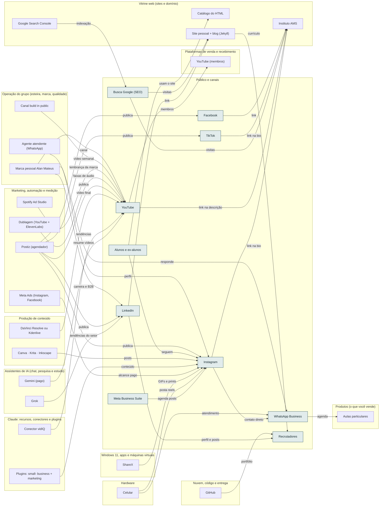

<!-- Arquivo GERADO por tools/gerar_docs.py a partir de data/. Edite os dados, não este arquivo. -->

# Camada 21 · Público e canais

[← Arquitetura](../arquitetura.md) · [Índice da documentação](../README.md)

> **Ligação com a camada de baixo:** Link na bio, vídeo, post, busca e indicação levam a pessoa até o site ou o WhatsApp.

**10 blocos** · 7 precisam de conta · 0 marcados como futuro

## Mapa de conexões

## Blocos

| Bloco | Tipo | O que faz |
|---|---|---|
| [Meta Business Suite](#mbs) | Remoto · precisa de conta | Agenda posts e reels do Instagram com antecedência e mostra as métricas. Grátis. |
| [Instagram](#ig) | Remoto · precisa de conta | Canal principal de venda: posts, reels e link na bio para o Instituto AMS. |
| [YouTube](#yt) | Remoto · precisa de conta | Aulas e vídeos de vendas. Gera público para os cursos e para o livro. |
| [LinkedIn](#li) | Remoto · precisa de conta | Vitrine para a vaga de dev: projetos, posts técnicos e certificações. |
| [WhatsApp Business](#wa) | Remoto · precisa de conta | Atendimento de alunos particulares e clientes de sites. |
| [Busca Google (SEO)](#seo) | Remoto | Pessoas chegando ao blog e aos sites pelos artigos. |
| [Alunos e ex-alunos](#alunos) | Físico | Seu público inicial: alunos do EMTI, ex-alunos e contatos. |
| [Recrutadores](#recr) | Físico | Quem decide a vaga de dev. Olham GitHub, LinkedIn e o site. |
| [TikTok](#tiktok) | Remoto · precisa de conta | Cortes verticais diários. Conteúdo realista de IA precisa do rótulo de IA. |
| [Facebook](#facebook) | Remoto · precisa de conta | Reels e posts da página da marca; mesma conta de anúncios do Instagram. |

### Meta Business Suite

*Remoto · precisa de conta*

Agenda posts e reels do Instagram com antecedência e mostra as métricas. Grátis.

| Direção | Bloco | Camada | O que passa |
|---|---|---|---|
| → envia para | [Instagram](21-pub.md#ig) | Público e canais | agenda posts |

### Instagram

*Remoto · precisa de conta*

Canal principal de venda: posts, reels e link na bio para o Instituto AMS.

| Direção | Bloco | Camada | O que passa |
|---|---|---|---|
| → envia para | [Instituto AMS](17-web.md#inst) | Vitrine web (sites e domínio) | link na bio |
| → envia para | [WhatsApp Business](21-pub.md#wa) | Público e canais | contato direto |
| ← recebe de | [Celular](01-hw.md#cel) | Hardware | posta reels |
| ← recebe de | [ShareX](03-win.md#sharex) | Windows 11, apps e máquinas virtuais | GIFs e prints |
| ← recebe de | [Meta Business Suite](21-pub.md#mbs) | Público e canais | agenda posts |
| ← recebe de | [Meta Ads (Instagram, Facebook)](20-mkt.md#ads) | Marketing, automação e medição | alcance pago |
| ← recebe de | [Plugins: small- business + marketing](07-clc.md#pbiz) | Claude: recursos, conectores e plugins | conteúdo |
| ← recebe de | [Canva · Krita · Inkscape](12-cont.md#img) | Produção de conteúdo | posts |
| ← recebe de | [Alunos e ex-alunos](21-pub.md#alunos) | Público e canais | seguem |
| ← recebe de | [Postiz (agendador)](20-mkt.md#postiz) | Marketing, automação e medição | publica |
| ← recebe de | [Marca pessoal Alan Mateus](22-oper.md#omarca) | Operação do grupo (esteira, marca, qualidade) | perfil |

### YouTube

*Remoto · precisa de conta*

Aulas e vídeos de vendas. Gera público para os cursos e para o livro.

| Direção | Bloco | Camada | O que passa |
|---|---|---|---|
| → envia para | [YouTube (membros)](19-venda.md#ytm) | Plataformas de venda e recebimento | membros |
| → envia para | [Instituto AMS](17-web.md#inst) | Vitrine web (sites e domínio) | link na descrição |
| ← recebe de | [Gemini (pago)](06-chat.md#gem) | Assistentes de IA (chat, pesquisa e estudo) | resume vídeos |
| ← recebe de | [Conector vidIQ](07-clc.md#cvid) | Claude: recursos, conectores e plugins | tendências |
| ← recebe de | [DaVinci Resolve ou Kdenlive](12-cont.md#edit) | Produção de conteúdo | vídeo final |
| ← recebe de | [Postiz (agendador)](20-mkt.md#postiz) | Marketing, automação e medição | publica |
| ← recebe de | [Dublagem (YouTube + ElevenLabs)](20-mkt.md#dub) | Marketing, automação e medição | faixas de áudio |
| ← recebe de | [Spotify Ad Studio](20-mkt.md#spotads) | Marketing, automação e medição | lembrança da marca |
| ← recebe de | [Canal build in public](22-oper.md#obuild) | Operação do grupo (esteira, marca, qualidade) | vídeo semanal |
| ← recebe de | [Marca pessoal Alan Mateus](22-oper.md#omarca) | Operação do grupo (esteira, marca, qualidade) | canal |

### LinkedIn

*Remoto · precisa de conta*

Vitrine para a vaga de dev: projetos, posts técnicos e certificações.

| Direção | Bloco | Camada | O que passa |
|---|---|---|---|
| → envia para | [Recrutadores](21-pub.md#recr) | Público e canais | perfil e posts |
| → envia para | [Site pessoal + blog (Jekyll)](17-web.md#site) | Vitrine web (sites e domínio) | link |
| ← recebe de | [Grok](06-chat.md#grok) | Assistentes de IA (chat, pesquisa e estudo) | tendências do setor |
| ← recebe de | [Postiz (agendador)](20-mkt.md#postiz) | Marketing, automação e medição | publica |
| ← recebe de | [Marca pessoal Alan Mateus](22-oper.md#omarca) | Operação do grupo (esteira, marca, qualidade) | carreira e B2B |

### WhatsApp Business

*Remoto · precisa de conta*

Atendimento de alunos particulares e clientes de sites.

| Direção | Bloco | Camada | O que passa |
|---|---|---|---|
| → envia para | [Aulas particulares](16-prod.md#aulas) | Produtos (o que você vende) | agenda |
| ← recebe de | [Celular](01-hw.md#cel) | Hardware | atendimento |
| ← recebe de | [Instagram](21-pub.md#ig) | Público e canais | contato direto |
| ← recebe de | [Agente atendente (WhatsApp)](22-oper.md#oatend) | Operação do grupo (esteira, marca, qualidade) | responde |

### Busca Google (SEO)

*Remoto*

Pessoas chegando ao blog e aos sites pelos artigos.

| Direção | Bloco | Camada | O que passa |
|---|---|---|---|
| → envia para | [Site pessoal + blog (Jekyll)](17-web.md#site) | Vitrine web (sites e domínio) | visitas |
| → envia para | [Instituto AMS](17-web.md#inst) | Vitrine web (sites e domínio) | visitas |
| ← recebe de | [Google Search Console](17-web.md#gsc) | Vitrine web (sites e domínio) | indexação |

### Alunos e ex-alunos

*Físico*

Seu público inicial: alunos do EMTI, ex-alunos e contatos.

| Direção | Bloco | Camada | O que passa |
|---|---|---|---|
| → envia para | [Catálogo do HTML](17-web.md#catal) | Vitrine web (sites e domínio) | usam o site |
| → envia para | [Instagram](21-pub.md#ig) | Público e canais | seguem |

### Recrutadores

*Físico*

Quem decide a vaga de dev. Olham GitHub, LinkedIn e o site.

| Direção | Bloco | Camada | O que passa |
|---|---|---|---|
| ← recebe de | [LinkedIn](21-pub.md#li) | Público e canais | perfil e posts |
| ← recebe de | [GitHub](11-nuvem.md#gh) | Nuvem, código e entrega | portfólio |
| ← recebe de | [Site pessoal + blog (Jekyll)](17-web.md#site) | Vitrine web (sites e domínio) | currículo |

### TikTok

*Remoto · precisa de conta*

Cortes verticais diários. Conteúdo realista de IA precisa do rótulo de IA.

| Direção | Bloco | Camada | O que passa |
|---|---|---|---|
| → envia para | [Instituto AMS](17-web.md#inst) | Vitrine web (sites e domínio) | link na bio |
| ← recebe de | [Postiz (agendador)](20-mkt.md#postiz) | Marketing, automação e medição | publica |

### Facebook

*Remoto · precisa de conta*

Reels e posts da página da marca; mesma conta de anúncios do Instagram.

| Direção | Bloco | Camada | O que passa |
|---|---|---|---|
| → envia para | [Instituto AMS](17-web.md#inst) | Vitrine web (sites e domínio) | link |
| ← recebe de | [Postiz (agendador)](20-mkt.md#postiz) | Marketing, automação e medição | publica |

---

[↑ Camada 22 · Operação do grupo (esteira, marca, qualidade)](22-oper.md) · [↓ Camada 20 · Marketing, automação e medição](20-mkt.md)
