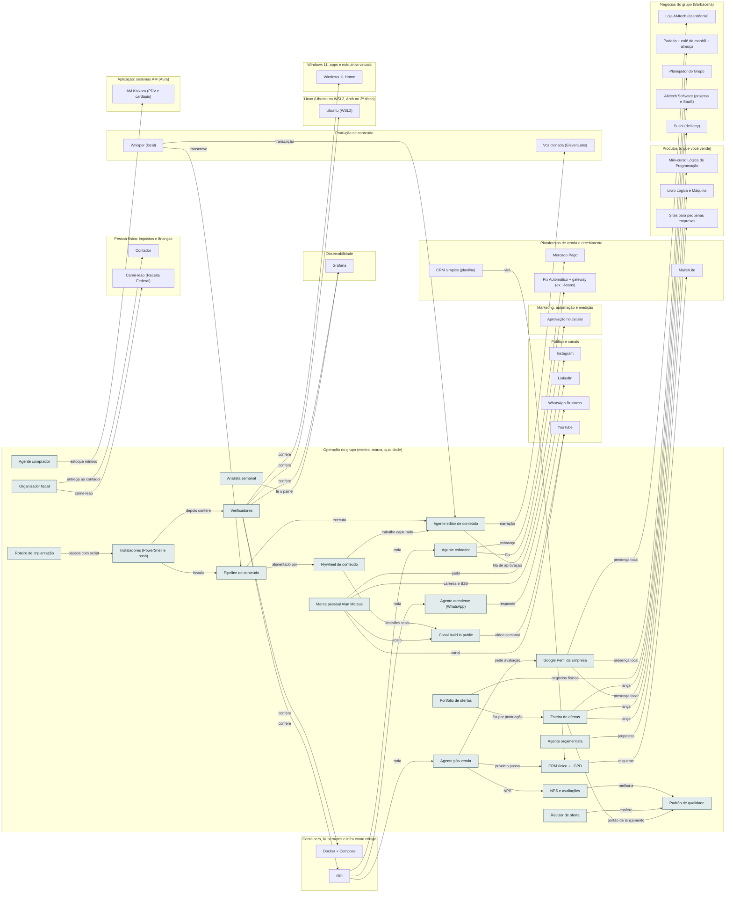

<!-- Arquivo GERADO por tools/gerar_docs.py a partir de data/. Edite os dados, não este arquivo. -->

# Camada 22 · Operação do grupo (esteira, marca, qualidade)

[← Arquitetura](../arquitetura.md) · [Índice da documentação](../README.md)

> **Ligação com a camada de baixo:** Toda oferta passa pela esteira e pelo padrão de qualidade antes de chegar ao público; cada venda e cada trabalho voltam como dado e conteúdo.

**22 blocos** · 2 precisam de conta · 9 marcados como futuro

## Mapa de conexões

## Blocos

| Bloco | Tipo | O que faz |
|---|---|---|
| [Portfólio de ofertas](#ocatal) | Local | data/portfolio.json: todas as ofertas do grupo com estágio, notas, pontuação e próximo passo. Gera docs/operacao/portfolio.md e o portfólio interativo. |
| [Esteira de ofertas](#oesteira) | Local | Ideia, validação, construção, lançamento e escala, com portões objetivos. Uma oferta em construção e uma em validação por vez. |
| [Padrão de qualidade](#oqual) | Local | Checklist de 'pronto' por tipo de oferta: infoproduto, livro, software, serviço, negócio físico e conteúdo. |
| [Marca pessoal Alan Mateus](#omarca) | Remoto | O guarda-chuva de confiança do grupo: Instituto AMS, Editora AMS Silva, AMtech e os negócios locais apontam para você. |
| [Google Perfil da Empresa](#ogbp) | Remoto · precisa de conta · futuro | O canal local mais importante: loja, assistência e restaurantes. Post semanal, fotos, horários e resposta a avaliações em 24 h. |
| [NPS e avaliações](#oaval) | Remoto | Uma pergunta depois de cada compra ou serviço e pedido de avaliação no Google. Reclamação vira issue da oferta. |
| [CRM único + LGPD](#ocrm) | Local | Uma ficha por cliente com ofertas compradas, origem e consentimento. Começa em planilha e MailerLite; vira tabela no PostgreSQL do grupo. |
| [Flywheel de conteúdo](#ofly) | Local | Cada aula, capítulo, projeto, reparo ou prato vira várias peças: cortes, carrossel, artigo, newsletter, questão, template. |
| [Canal build in public](#obuild) | Remoto · precisa de conta · futuro | Vídeo semanal com rosto mostrando decisões reais do grupo: números, setup, aulas. Gera confiança para todas as ofertas. |
| [Agente atendente (WhatsApp)](#oatend) | Local · futuro | Responde perguntas frequentes, mostra catálogo e horários e agenda. Passa para você o que não souber. Nunca promete preço fora da tabela. |
| [Agente orçamentista](#oorc) | Local · futuro | Monta propostas a partir dos pacotes e do histórico, para você aprovar. |
| [Agente cobrador](#ocob) | Local · futuro | Lembra vencimentos e envia o Pix; avisa você nos atrasos. Não faz estorno nem acordo sozinho. |
| [Agente pós-venda](#opos) | Local · futuro | Pergunta a nota, pede avaliação e oferece o próximo passo da jornada do cliente. |
| [Agente editor de conteúdo](#oedit) | Local | Transforma transcrições em cortes, títulos, legendas, carrosséis, posts do Google e newsletter, seguindo o guia de estilo da marca. |
| [Analista semanal](#oanal) | Local · futuro | Lê o painel toda segunda e manda 3 fatos e 1 sugestão de decisão. Só leitura. |
| [Organizador fiscal](#ofisc) | Local · futuro | Junta notas, extratos e vendas do mês para o contador e para o carnê-leão. |
| [Revisor de oferta](#orevo) | Local | Confere cada lançamento contra o padrão de qualidade antes de ir ao ar. |
| [Agente comprador](#ocomp) | Local · futuro | Sugere a lista de compras dos negócios de comida pelo estoque mínimo e pela previsão de produção. |
| [Roteiro de implantação](#oimpl) | Local | data/implantacao.json: fases e passos com critério de pronto, cada passo ligado aos blocos que implanta. Gera docs/implantacao/roteiro.md e a página de acompanhamento; o CI falha se um bloco do setup ficar de fora. |
| [Instaladores (PowerShell e bash)](#oinst) | Local | instalar.ps1 (winget, WSL2, .wslconfig) e bootstrap.sh (ferramentas, linguagens, Claude Code, ai-jail, Git assinado). Seguros para rodar de novo. |
| [Verificadores](#overif) | Local | verificar.ps1 e verificar.sh: somente leitura, dizem 'pronto' ou listam o que falta. Também conferem os serviços da automação. |
| [Pipeline de conteúdo](#opipe) | Local | tools/conteudo/processar.py com timer de 15 min: entrada → transcrição → peças pelo guia de marca → fila de aprovação → aviso no Telegram. |

### Portfólio de ofertas

*Local*

data/portfolio.json: todas as ofertas do grupo com estágio, notas, pontuação e próximo passo. Gera docs/operacao/portfolio.md e o portfólio interativo.

| Direção | Bloco | Camada | O que passa |
|---|---|---|---|
| → envia para | [Esteira de ofertas](22-oper.md#oesteira) | Operação do grupo (esteira, marca, qualidade) | fila por pontuação |
| → envia para | [Planejador do Grupo](15-neg.md#nplan) | Negócios do grupo (Barbacena) | negócios físicos |

### Esteira de ofertas

*Local*

Ideia, validação, construção, lançamento e escala, com portões objetivos. Uma oferta em construção e uma em validação por vez.

| Direção | Bloco | Camada | O que passa |
|---|---|---|---|
| → envia para | [Padrão de qualidade](22-oper.md#oqual) | Operação do grupo (esteira, marca, qualidade) | portão de lançamento |
| → envia para | [Mini-curso Lógica de Programação](16-prod.md#curso) | Produtos (o que você vende) | lança |
| → envia para | [Livro Lógica e Máquina](16-prod.md#livro) | Produtos (o que você vende) | lança |
| → envia para | [AMtech Software (projetos e SaaS)](15-neg.md#nsoft) | Negócios do grupo (Barbacena) | lança |
| ← recebe de | [Portfólio de ofertas](22-oper.md#ocatal) | Operação do grupo (esteira, marca, qualidade) | fila por pontuação |

### Padrão de qualidade

*Local*

Checklist de 'pronto' por tipo de oferta: infoproduto, livro, software, serviço, negócio físico e conteúdo.

| Direção | Bloco | Camada | O que passa |
|---|---|---|---|
| ← recebe de | [Esteira de ofertas](22-oper.md#oesteira) | Operação do grupo (esteira, marca, qualidade) | portão de lançamento |
| ← recebe de | [Revisor de oferta](22-oper.md#orevo) | Operação do grupo (esteira, marca, qualidade) | confere |
| ← recebe de | [NPS e avaliações](22-oper.md#oaval) | Operação do grupo (esteira, marca, qualidade) | melhoria |

### Marca pessoal Alan Mateus

*Remoto*

O guarda-chuva de confiança do grupo: Instituto AMS, Editora AMS Silva, AMtech e os negócios locais apontam para você.

| Direção | Bloco | Camada | O que passa |
|---|---|---|---|
| → envia para | [Instagram](21-pub.md#ig) | Público e canais | perfil |
| → envia para | [YouTube](21-pub.md#yt) | Público e canais | canal |
| → envia para | [LinkedIn](21-pub.md#li) | Público e canais | carreira e B2B |
| → envia para | [Canal build in public](22-oper.md#obuild) | Operação do grupo (esteira, marca, qualidade) | rosto |

### Google Perfil da Empresa

*Remoto · precisa de conta · futuro*

O canal local mais importante: loja, assistência e restaurantes. Post semanal, fotos, horários e resposta a avaliações em 24 h.

| Direção | Bloco | Camada | O que passa |
|---|---|---|---|
| → envia para | [Loja AMtech (assistência)](15-neg.md#nloja) | Negócios do grupo (Barbacena) | presença local |
| → envia para | [Sushi (delivery)](15-neg.md#nsushi) | Negócios do grupo (Barbacena) | presença local |
| → envia para | [Padaria + café da manhã + almoço](15-neg.md#npad) | Negócios do grupo (Barbacena) | presença local |
| ← recebe de | [Agente pós-venda](22-oper.md#opos) | Operação do grupo (esteira, marca, qualidade) | pede avaliação |

### NPS e avaliações

*Remoto*

Uma pergunta depois de cada compra ou serviço e pedido de avaliação no Google. Reclamação vira issue da oferta.

| Direção | Bloco | Camada | O que passa |
|---|---|---|---|
| → envia para | [Padrão de qualidade](22-oper.md#oqual) | Operação do grupo (esteira, marca, qualidade) | melhoria |
| ← recebe de | [Agente pós-venda](22-oper.md#opos) | Operação do grupo (esteira, marca, qualidade) | NPS |

### CRM único + LGPD

*Local*

Uma ficha por cliente com ofertas compradas, origem e consentimento. Começa em planilha e MailerLite; vira tabela no PostgreSQL do grupo.

| Direção | Bloco | Camada | O que passa |
|---|---|---|---|
| → envia para | [MailerLite](19-venda.md#mailer) | Plataformas de venda e recebimento | etiquetas |
| ← recebe de | [Agente pós-venda](22-oper.md#opos) | Operação do grupo (esteira, marca, qualidade) | próximo passo |
| ← recebe de | [CRM simples (planilha)](19-venda.md#crm) | Plataformas de venda e recebimento | vira |

### Flywheel de conteúdo

*Local*

Cada aula, capítulo, projeto, reparo ou prato vira várias peças: cortes, carrossel, artigo, newsletter, questão, template.

| Direção | Bloco | Camada | O que passa |
|---|---|---|---|
| → envia para | [Agente editor de conteúdo](22-oper.md#oedit) | Operação do grupo (esteira, marca, qualidade) | trabalho capturado |
| → envia para | [Canal build in public](22-oper.md#obuild) | Operação do grupo (esteira, marca, qualidade) | decisões reais |
| ← recebe de | [Pipeline de conteúdo](22-oper.md#opipe) | Operação do grupo (esteira, marca, qualidade) | alimentado por |

### Canal build in public

*Remoto · precisa de conta · futuro*

Vídeo semanal com rosto mostrando decisões reais do grupo: números, setup, aulas. Gera confiança para todas as ofertas.

| Direção | Bloco | Camada | O que passa |
|---|---|---|---|
| → envia para | [YouTube](21-pub.md#yt) | Público e canais | vídeo semanal |
| ← recebe de | [Flywheel de conteúdo](22-oper.md#ofly) | Operação do grupo (esteira, marca, qualidade) | decisões reais |
| ← recebe de | [Marca pessoal Alan Mateus](22-oper.md#omarca) | Operação do grupo (esteira, marca, qualidade) | rosto |

### Agente atendente (WhatsApp)

*Local · futuro*

Responde perguntas frequentes, mostra catálogo e horários e agenda. Passa para você o que não souber. Nunca promete preço fora da tabela.

| Direção | Bloco | Camada | O que passa |
|---|---|---|---|
| → envia para | [WhatsApp Business](21-pub.md#wa) | Público e canais | responde |
| ← recebe de | [n8n](08-cnt.md#n8n) | Containers, Kubernetes e infra como código | roda |

### Agente orçamentista

*Local · futuro*

Monta propostas a partir dos pacotes e do histórico, para você aprovar.

| Direção | Bloco | Camada | O que passa |
|---|---|---|---|
| → envia para | [Sites para pequenas empresas](16-prod.md#sites) | Produtos (o que você vende) | propostas |

### Agente cobrador

*Local · futuro*

Lembra vencimentos e envia o Pix; avisa você nos atrasos. Não faz estorno nem acordo sozinho.

| Direção | Bloco | Camada | O que passa |
|---|---|---|---|
| → envia para | [Pix Automático + gateway (ex.: Asaas)](19-venda.md#pixa) | Plataformas de venda e recebimento | Pix |
| → envia para | [Mercado Pago](19-venda.md#mp) | Plataformas de venda e recebimento | cobrança |
| ← recebe de | [n8n](08-cnt.md#n8n) | Containers, Kubernetes e infra como código | roda |

### Agente pós-venda

*Local · futuro*

Pergunta a nota, pede avaliação e oferece o próximo passo da jornada do cliente.

| Direção | Bloco | Camada | O que passa |
|---|---|---|---|
| → envia para | [Google Perfil da Empresa](22-oper.md#ogbp) | Operação do grupo (esteira, marca, qualidade) | pede avaliação |
| → envia para | [NPS e avaliações](22-oper.md#oaval) | Operação do grupo (esteira, marca, qualidade) | NPS |
| → envia para | [CRM único + LGPD](22-oper.md#ocrm) | Operação do grupo (esteira, marca, qualidade) | próximo passo |
| ← recebe de | [n8n](08-cnt.md#n8n) | Containers, Kubernetes e infra como código | roda |

### Agente editor de conteúdo

*Local*

Transforma transcrições em cortes, títulos, legendas, carrosséis, posts do Google e newsletter, seguindo o guia de estilo da marca.

| Direção | Bloco | Camada | O que passa |
|---|---|---|---|
| → envia para | [Aprovação no celular](20-mkt.md#aprov) | Marketing, automação e medição | fila de aprovação |
| → envia para | [Voz clonada (ElevenLabs)](12-cont.md#voz) | Produção de conteúdo | narração |
| ← recebe de | [Flywheel de conteúdo](22-oper.md#ofly) | Operação do grupo (esteira, marca, qualidade) | trabalho capturado |
| ← recebe de | [Whisper (local)](12-cont.md#whis) | Produção de conteúdo | transcrição |
| ← recebe de | [Pipeline de conteúdo](22-oper.md#opipe) | Operação do grupo (esteira, marca, qualidade) | executa |

### Analista semanal

*Local · futuro*

Lê o painel toda segunda e manda 3 fatos e 1 sugestão de decisão. Só leitura.

| Direção | Bloco | Camada | O que passa |
|---|---|---|---|
| → envia para | [Grafana](09-obs.md#graf) | Observabilidade | lê o painel |

### Organizador fiscal

*Local · futuro*

Junta notas, extratos e vendas do mês para o contador e para o carnê-leão.

| Direção | Bloco | Camada | O que passa |
|---|---|---|---|
| → envia para | [Carnê-leão (Receita Federal)](18-emp.md#nfse) | Pessoa física: impostos e finanças | carnê-leão |
| → envia para | [Contador](18-emp.md#conta) | Pessoa física: impostos e finanças | entrega ao contador |

### Revisor de oferta

*Local*

Confere cada lançamento contra o padrão de qualidade antes de ir ao ar.

| Direção | Bloco | Camada | O que passa |
|---|---|---|---|
| → envia para | [Padrão de qualidade](22-oper.md#oqual) | Operação do grupo (esteira, marca, qualidade) | confere |

### Agente comprador

*Local · futuro*

Sugere a lista de compras dos negócios de comida pelo estoque mínimo e pela previsão de produção.

| Direção | Bloco | Camada | O que passa |
|---|---|---|---|
| → envia para | [AM Kaixara (PDV e cardápio)](10-app.md#nkaix) | Aplicação: sistemas AM (Aura) | estoque mínimo |

### Roteiro de implantação

*Local*

data/implantacao.json: fases e passos com critério de pronto, cada passo ligado aos blocos que implanta. Gera docs/implantacao/roteiro.md e a página de acompanhamento; o CI falha se um bloco do setup ficar de fora.

| Direção | Bloco | Camada | O que passa |
|---|---|---|---|
| → envia para | [Instaladores (PowerShell e bash)](22-oper.md#oinst) | Operação do grupo (esteira, marca, qualidade) | passos com script |

### Instaladores (PowerShell e bash)

*Local*

instalar.ps1 (winget, WSL2, .wslconfig) e bootstrap.sh (ferramentas, linguagens, Claude Code, ai-jail, Git assinado). Seguros para rodar de novo.

| Direção | Bloco | Camada | O que passa |
|---|---|---|---|
| → envia para | [Verificadores](22-oper.md#overif) | Operação do grupo (esteira, marca, qualidade) | depois confere |
| → envia para | [Pipeline de conteúdo](22-oper.md#opipe) | Operação do grupo (esteira, marca, qualidade) | instala |
| ← recebe de | [Roteiro de implantação](22-oper.md#oimpl) | Operação do grupo (esteira, marca, qualidade) | passos com script |

### Verificadores

*Local*

verificar.ps1 e verificar.sh: somente leitura, dizem 'pronto' ou listam o que falta. Também conferem os serviços da automação.

| Direção | Bloco | Camada | O que passa |
|---|---|---|---|
| → envia para | [Ubuntu (WSL2)](04-lin.md#wsl) | Linux (Ubuntu no WSL2, Arch no 2º disco) | confere |
| → envia para | [Docker + Compose](08-cnt.md#docker) | Containers, Kubernetes e infra como código | confere |
| → envia para | [Windows 11 Home](03-win.md#w11) | Windows 11, apps e máquinas virtuais | confere |
| → envia para | [n8n](08-cnt.md#n8n) | Containers, Kubernetes e infra como código | confere |
| → envia para | [Grafana](09-obs.md#graf) | Observabilidade | confere |
| ← recebe de | [Instaladores (PowerShell e bash)](22-oper.md#oinst) | Operação do grupo (esteira, marca, qualidade) | depois confere |

### Pipeline de conteúdo

*Local*

tools/conteudo/processar.py com timer de 15 min: entrada → transcrição → peças pelo guia de marca → fila de aprovação → aviso no Telegram.

| Direção | Bloco | Camada | O que passa |
|---|---|---|---|
| → envia para | [Agente editor de conteúdo](22-oper.md#oedit) | Operação do grupo (esteira, marca, qualidade) | executa |
| → envia para | [Flywheel de conteúdo](22-oper.md#ofly) | Operação do grupo (esteira, marca, qualidade) | alimentado por |
| ← recebe de | [Whisper (local)](12-cont.md#whis) | Produção de conteúdo | transcreve |
| ← recebe de | [Instaladores (PowerShell e bash)](22-oper.md#oinst) | Operação do grupo (esteira, marca, qualidade) | instala |

---

[↓ Camada 21 · Público e canais](21-pub.md)
