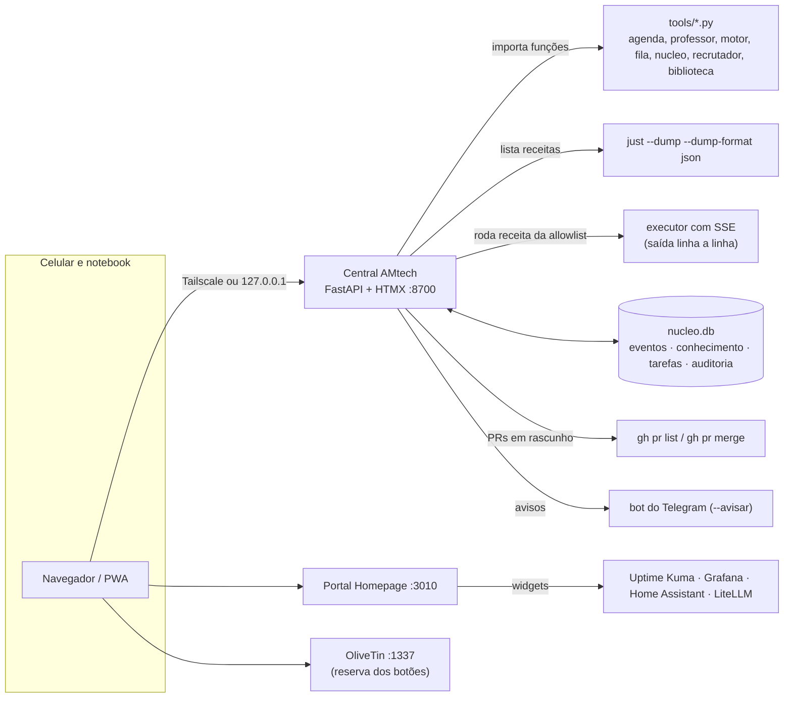

<!-- Escrito à mão. Contexto mestre da Central AMtech. Fonte: conversa de 21/11/2026 sobre o dev-setup v2.40.0. -->

# Central AMtech: uma tela para tudo que está no dev-setup

[← Índice da documentação](../README.md) · Prompts por fase: [PROMPTS.md](PROMPTS.md) · Protótipo: [prototipo/index.html](prototipo/index.html) (também publicado no Claude como artefato “Central AMtech”)

> **Próximo passo:** o frontend de usuário final (Minha AMtech) e o portal do aluno (Instituto AMS) estão planejados em [frontend.md](frontend.md) (ADR 0024, proposta).

## v1 pronta (2.61.0): como usar

No Ubuntu, em `~/dev/dev-setup`:

```bash
just central-usuario alan   # uma vez: cria o usuário (a senha vai para o KeePassXC)
just ligar                  # deixa a Central sempre no ar (serviço amtech-central), junto com a fila e o Ollama
```

Abra **http://127.0.0.1:8700** no navegador do Windows. Para testar sem serviço: `just central` (só enquanto o terminal estiver aberto).

| Tela | O que faz |
|---|---|
| **Hoje** | **"O que você quer fazer?"**: escreva o pedido em português (ex.: "o que estudo hoje?", "como está o backup?", "crie a página de vendas do curso"). Depois: aprovações pendentes, botões rápidos, guardar no núcleo, últimas execuções e sugestões de "virar regra" |
| **Pedido** | O plano que a Central montou, de onde veio (regra fixa = 0 tokens, IA local = R$ 0) e o resultado ao vivo; ações pedem um clique e, se for o caso, aprovação |
| **Roteiro** | Os próximos passos do `data/implantacao.json` que dependem de você, com **Feito** (por passo ou fase inteira) e **Pedir ajuda**; progresso por fase e filtro por empresa |
| **Estudo** | Revisões vencidas do Professor, domínio por nível e os formulários de estudo (Professor, diagnóstico, erro, atrito, colher, livros, recrutador, Akita) |
| **Empresas** | Rendas da onda 0 e 1 com próximo passo, métrica e **Pedir à Central**; as outras ofertas; as 6 empresas e os produtos |
| **Serviços** | Estado dos serviços do Ubuntu (Central, fila, bot, Ollama), as ferramentas com tela (link quando no ar, perfil que sobe) e ligar/desligar |
| **Núcleo** | Buscar no que já se sabe, guardar nota ou lição, tarefas (criar e marcar feita) |
| **Ajuda** | Guia de uma página: telas, custo de cada caminho e o que fazer quando algo não funciona |
| **Comandos** | Todas as receitas de `data/central.json` por área, com formulário dos argumentos; as proibidas não aparecem |
| **Aprovar** | Receitas que pedem aprovação: ✅ roda, ❌ recusa; vale 30 min e uma vez só; o merge pede o número do PR |
| **Execução** | Saída ao vivo |
| **Auditoria** | Quem fez o quê, e se a corrente de hash está íntegra |

Para a IA local interpretar pedidos livres, deixe o Ollama no ar (`just ligar`). Sem ele, a Central ainda reconhece as frases
fixas e manda trabalho de código para a fila.

Arquitetura e decisões: [ADR 0023](../adr/0023-arquitetura-da-central.md). Mudar o que a Central pode rodar é editar
`data/central.json` e passar no `just check`.

**Objetivo:** abrir uma tela só, no notebook ou no celular, e daí ver o que espera você, rodar qualquer receita do `just`, mandar pedidos para a fila, estudar, acompanhar as empresas e os serviços, sem lembrar de comandos, portas ou de qual HTML abrir.

**Regra de ouro:** a Central não decide nem guarda nada sozinha. Ela é a tela de cima do que já existe: `justfile`, `tools/*.py`, `nucleo.db`, fila e motor. Mudou o dado, mudou a tela.

## 1. O que já existe e o que falta

| Já existe | Problema | A Central resolve com |
|---|---|---|
| 6 painéis HTML gerados (cockpit, mapa, index, acompanhamento, portfólio, planejador) | Mostram o plano, não o estado real; são só para ler | Telas vivas lendo `nucleo.db`, fila e agenda |
| 55 receitas no `justfile` + `just menu` (gum) | É preciso estar no terminal e lembrar dos argumentos | Botões com formulário dos argumentos e saída ao vivo |
| Bot do Telegram + fila (`/pedir`, `/fila`) | Bom para avisar, ruim para revisar e aprovar | Tela Pedir + caixa de aprovações; o Telegram fica só para avisos |
| ~28 serviços web em portas soltas | Cada um em uma porta; **5 conflitos** | Portal com status e links, gerado de `data/portas.json` |
| Aprovações espalhadas (PR em rascunho, `akita pendentes`, `motor-ok`, `decisoes`, compras, publicações) | Cada uma num comando diferente | **Caixa de entrada única** “Esperando você” |

**Conflitos de porta encontrados** (quando os serviços sobem juntos). **Resolvidos na v2.45.0:** fonte única em `data/portas.json`, conferida por `tools/portas/portas.py --check` no `just check` e no CI. Avaliação do plano da Central: [docs/avaliacao](../avaliacao/2026-11-25-avaliacao-completa.md), seções 3 e 12.

| Porta | Quem usa | Proposta |
|---|---|---|
| 3000 | Forgejo (soberania) × Juice Shop (lab) | Juice Shop → 3100 |
| 3001 | Grafana (automação) × AdGuard (rede) | AdGuard → 3011 |
| 3002 | Uptime Kuma (automação) × Metabase (dados) | Metabase → 3012 |
| 8080 | Zigbee2MQTT (jarvis) × WebGoat (lab) | WebGoat → 8180 |
| 8090 | PocketBase × Akaunting (soberania) | Akaunting → 8091 |
| — | Portas novas | Portal 3010 · OliveTin 1337 · Central 8700 |

**Bug achado no caminho:** `just coerencia` quebrava com `FileNotFoundError` quando `~/dev` não existia. Corrigido na v2.44.1.

## 2. Decisão: montar → colar → construir (a sua triagem)

| Camada | Ferramenta | Por quê | Custo |
|---|---|---|---|
| Portal (atalhos e status) | **Homepage** (gethomepage.dev), configurada por YAML | Configuração como código, versionável, com widgets para Uptime Kuma, Grafana, Home Assistant e outros | 1 sessão |
| Botões do `just` | **OliveTin** | Página web que roda só comandos predefinidos: mesma regra do bot (nada de comando livre) | 1 sessão |
| Central (o que é seu de verdade) | **FastAPI + HTMX + SSE**, em `tools/central/` | Python porque todos os `tools/*.py` já são Python e a Central importa as funções direto (sem reescrever); HTMX mantém poucos arquivos e nenhum build de front | 4 a 6 sessões |
| Celular | A Central instalada como app (PWA) + **Tailscale** | Mesma tela no celular; nada exposto na internet | 1 sessão |

A Central é a evolução natural do aura-status (painel para quem trabalha sozinho): se ela ficar boa, vira produto da AMtech Software. Por isso ela tem ADR própria (0022) e testes desde o começo.

> Por que não Next.js? A ADR 0017 põe TypeScript no AM Gestão (produto). A Central é ferramenta interna que vive dentro do dev-setup, ao lado de dezenas de scripts Python; FastAPI reaproveita tudo sem uma segunda base de código. Se virar produto, o front pode migrar para Next.js depois, consumindo a mesma API.

## 3. Arquitetura



### Fonte de cada tela

| Tela | O que mostra | De onde vem (sem inventar dado) |
|---|---|---|
| Hoje | esperando você, agora, estudo do dia, fila, custo de IA, onda 0 | `agenda.py agora`, `professor.py hoje`, `recrutador.py semana`, `fila.py listar`, `motor.py relatorio`, `data/portfolio.json` |
| Aprovar | caixa de entrada única | `gh pr list --draft` (ramos `fila/*`), `akita pendentes`, `motor.py` (decisões sem resultado), `agenda.py decisoes`, fila de publicação do pipeline, compras da biblioteca |
| Comandos | 55 receitas por área, favoritas, formulário de argumentos, confirmação | `just --dump --dump-format json` + `data/central.json` (áreas, quais pedem confirmação) |
| Pedir | formulário, escada do motor, fila | `motor.py decidir` e `fila.py adicionar/listar` |
| Estudo | Professor hoje, trilha com níveis, erros e atritos, biblioteca | `professor.py`, `registro.py`, `biblioteca.py`, `data/professor/curriculo.json` |
| Empresas e rendas | 6 empresas, ofertas das ondas 0 e 1, pendências do site, decisões | `data/empresas.json`, `data/portfolio.json`, `just site X --checar`, `agenda.py decisoes` |
| Serviços | todos os serviços, porta, estado, ligar/parar | `data/portas.json` (novo) + `docker compose ps --format json` + `systemctl --user is-active` |
| Núcleo | buscar, lembrar, tarefas, auditoria | `nucleo.py buscar/lembrar/tarefa`, tabela `auditoria` |
| Roteiro | 63 fases, 572 passos, marcar feito | `data/implantacao.json` + `passos_feitos` do `nucleo.db` |

### API mínima (FastAPI)

| Método e rota | Faz |
|---|---|
| `GET /api/hoje` | junta os blocos da tela Hoje |
| `GET /api/aprovacoes` · `POST /api/aprovacoes/{id}/{acao}` | lista e age (aprovar, recusar, ajuste, decidir); grava na auditoria |
| `GET /api/receitas` · `POST /api/rodar` | lista da allowlist; roda e devolve um id |
| `GET /api/rodar/{id}/saida` | SSE com a saída linha a linha |
| `POST /api/pedir` · `GET /api/fila` | motor + fila |
| `GET /api/servicos` · `POST /api/servicos/{id}/{ligar\|parar}` | estado e controle |
| `GET /api/nucleo/buscar?q=` · `POST /api/nucleo/lembrar` · tarefas | base central |
| `GET /api/roteiro` · `POST /api/feito/{id}` | progresso |

## 4. Segurança (não negociável)

1. **Só 127.0.0.1.** Acesso pelo celular apenas pelo Tailscale (`tailscale serve`). Nunca porta aberta no roteador nem túnel público.
2. **Login obrigatório**, mesmo dentro do Tailscale: senha forte guardada no KeePassXC, cookie de sessão `HttpOnly` + `SameSite=Strict`, e token CSRF nos `POST`. A identidade do Tailscale pode ser a segunda camada (conferir nos documentos do Tailscale antes de confiar nela).
3. **Allowlist de receitas.** A Central roda só receitas do `justfile`, com argumentos passados como lista (nunca `shell=True` com texto do usuário). Argumento validado por receita (ids com regex, texto livre só em `pedir`, `lembrar`, `erro`, `atrito`, `triagem`, `motor`).
4. **Confirmação** nas receitas que mudam o sistema ou gastam: `instalar`, `ligar`, `desligar`, `backup`, `os-instalar`, `vitrine`, `arquiteto-claude`, `lab-abrir`, `coerencia --corrigir`, e em todo merge, publicação e compra (degrau 5).
5. **Tudo auditado** na tabela `auditoria` do `nucleo.db`: quem, quando, o quê, nível.
6. **Nunca segredo na tela nem no Git.** Chaves de widgets (Homepage) vêm de variáveis de ambiente cifradas com sops/age ou do cofre. A Central não recebe nem mostra senha.
7. **Sem dado de aluno**, nunca. O que vier do DED+ passa pela limpeza antes de aparecer em qualquer tela.
8. **Não roda como root.** Usuário comum, serviço `systemd --user`, igual à fila.

## 5. Fases e quando cada uma está pronta

| Fase | Entrega | Pronto quando |
|---|---|---|
| 0 | Portas sem conflito, `data/portas.json`, correção do `coerencia.py`, ADR 0022 | `just check` passa; `docker compose config` sem portas repetidas; ADR escrita |
| 1 | Portal Homepage gerado dos dados | `just portal` sobe em :3010 com todos os serviços; `--check` no CI |
| 2 | OliveTin com allowlist | Botões das receitas seguras funcionando; as perigosas pedem confirmação |
| 3 | Central: API de leitura + executor SSE | `GET /api/hoje` devolve dado real; rodar `just agora` mostra a saída ao vivo; testes pytest |
| 4 | Central: as 9 telas, igual ao protótipo | Todas as telas com dado real no notebook; funciona no celular (390 px) |
| 5 | Caixa de aprovações ligada de verdade | Aprovar um PR da fila faz o merge pelo `gh` e avisa no Telegram; tudo na auditoria |
| 6 | Celular (PWA + Tailscale), login, testes de ponta a ponta | Abrir pelo celular fora de casa, logar, aprovar um item; Playwright verde no CI |

## 6. Limites honestos

- O notebook precisa estar **ligado e com internet**. Desligado, a Central não responde. A VM da fase Soberania resolve isso depois.
- O OliveTin e a Central **executam comandos**: um descuido na allowlist vira uma porta para o seu computador. Por isso há login, allowlist, confirmação e auditoria, e a revisão da fase 2 deve ser sua, linha por linha.
- Os widgets do Homepage precisam de chaves das ferramentas (Kuma, Home Assistant). Sem a chave, o widget mostra só o link.
- O protótipo publicado é **simulação**: as ações ficam só no navegador e as saídas dos comandos foram capturadas do repositório em 21/11/2026.

## 7. Regras do dev-setup que valem aqui

- Nada escrito à mão no que é gerado: `tools/portal/gerar.py` e `data/central.json` alimentam portal e Central; o CI roda `--check`.
- `just check` antes de cada commit; PR em rascunho; você faz o merge.
- Uma linha no `ESTADO.md` e uma entrada no `CHANGELOG.md` por fase; ADR nova quando a decisão mudar.
- `just coerencia` depois de cada fase, para que nenhum texto contradiga o plano.
- Poucos arquivos: a Central inteira cabe em `tools/central/` (app.py, executor.py, fontes.py, templates/, static/, testes).
