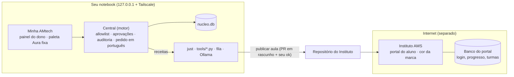

<!-- Escrito à mão. Plano do frontend do setup (27/11/2026). Decisão em docs/adr/0024-frontend-minha-amtech-e-instituto.md. -->

# Frontend do setup: Minha AMtech e Instituto AMS

[← Central](README.md) · Decisão: [ADR 0024](../adr/0024-frontend-minha-amtech-e-instituto.md) · Protótipo navegável: artefato “Minha AMtech” no claude.ai

## 0. Como este plano foi feito

Li o inventário completo dos três repositórios (cerca de 1.440 arquivos e 1 milhão de palavras) e li a fundo tudo o que define como o setup é usado.

**Fontes vivas:**
- `dev-setup` (docs, data, tools, ADRs, avaliações);
- vault: pastas 01 a 10 e 13, mais PLANO-UNICO, CARTÃO e PLANO-PASSO-A-PASSO;
- `mapa-de-estudo`.

**Ficaram de fora de propósito:**
- `11-setup-dev-setup` do vault (cópia do dev-setup);
- `99-arquivo` (planos substituídos pelo PLANO-UNICO);
- `12-artefatos` (páginas geradas antes; usadas só como referência de conteúdo de aula).

As regras e os números abaixo citam a fonte. Quando algo é sugestão minha, está escrito.

## 1. O que o frontend precisa resolver

O setup existe para quatro trabalhos do Alan, nas ~20 h por semana que sobram da escola, do restaurante e da Licenciatura (PLANO-PASSO-A-PASSO, Parte 1):

| Trabalho | O que o setup já faz (dev-setup) | O que falta é tela para |
|---|---|---|
| **Estudar** | Professor, mapa de estudo, diagnóstico, ficha, colheita, Anki, Akita, recrutador | Seguir o bloco das 6h sem abrir terminal, com o protocolo de fim de bloco guiado |
| **Ensinar** | Colheita gera aula, exercícios N1–N4 e Anki; fábrica de documentos da escola; AM Mentor (735 exercícios) | Preparar e liberar aula para a turma; os alunos estudarem por um portal |
| **Gerar renda** | Portfólio (98 ofertas em ondas), portões, hora mínima, pipeline de conteúdo, fila | Ver as ondas, delegar o próximo passo de cada renda e medir horas × renda |
| **Construir sistemas** | Fila com motor (Claude → grátis → local), PR em rascunho, CI, triagem | Pedir código e conferir prévias sem lembrar comando |

E um quinto, que deve ocupar **o mínimo**: **operar o setup** (backup, serviços, segredos, auditoria).

**Restrições que o desenho respeita** (todas do repositório):
- Rotina: âncora 6h–8h, blocos profundos na segunda à noite e na quinta de manhã, domingo de folga, cuidar dos cães todo dia, restaurante à noite de terça a domingo.
- Rotina "à prova de distração" (palavras do seu plano): uma coisa por vez, uma ação principal por tela.
- Nada publicado, pago, enviado ou assinado sem aprovação; dado de aluno nunca em IA (CONTINUAR, `06-clientes-e-dados.md`).
- Hora mínima de R$ 45, teto de 7 h extras por semana, portão de 3 meses, regra "uma entra, uma sai" (avaliação de 25/11).
- Critério de aceite do PO (avaliação, §2): abrir pelo notebook ou celular, fazer login e, **em menos de 1 minuto**, ver o que espera você, aprovar ou recusar e rodar o que mais usa.

## 2. Duas superfícies, um motor

| | **Minha AMtech** | **Instituto AMS** |
|---|---|---|
| Quem usa | Só você (e, no futuro, quem você der papel) | Alunos e, depois, outros professores |
| Tipo de superfície (RNFT-D03) | Painel administrativo: **paleta Aura fixa** | Superfície pública: **cor da marca do Instituto** |
| Onde roda | Notebook, `127.0.0.1:8700`; celular pelo Tailscale | Internet, sem nenhuma ligação com o seu computador |
| Stack | A Central que já existe (FastAPI + HTML do servidor, ADR 0023) | Stack de produto da ADR 0017 (TypeScript, Next.js, PostgreSQL/Supabase), começando pelo modelo Astro que já existe em `infra/templates/site-marca` para as páginas públicas |
| Executa algo? | Sim, só pela allowlist | **Nunca.** Recebe conteúdo publicado por PR |
| Dados | `nucleo.db` local, no backup | Só o que o aluno precisa; menores com autorização do responsável; nada vai para IA |

**Por que separar (Segurança, Arquiteto, Jurídico):**
- A Central roda comandos no seu computador.
- Alunos, muitos menores no EMTI, não podem ter caminho até ela.
- O próprio catálogo de softwares já trata a Plataforma do Instituto (`ed-instituto`) e o AM Mentor (`ed-ammentor`) como produtos da suíte AM Escola, à parte.

## 3. Design system: Aura, fonte única

Você já tem um design system: o **Aura** (vault, `04-documentos-transversais/rnf-transversais-design-tema.md` e `kaixara-frontend-documento-unico.md`). O frontend segue esse sistema, sem inventar outro:

| Item | Valor (Aura) |
|---|---|
| Primária | `#0E3A45` (hover `#0A2C35`) |
| Texto | grafite `#2D3436` |
| Fundo | off-white `#F7F5F0` |
| Acento (pontual, nunca dominante) | `#B08D57` |
| Semânticas fixas (RNFT-D02) | erro `#C0392B`, sucesso `#2E7D5B`, alerta `#C99A3E`, informação `#3B6FA0` |
| Estado | aberta `#3B6FA0`, confirmada `#2E7D5B`, cancelada `#7A8A8C`, divergência `#C99A3E`; foco `2px solid #4A9DD6` |
| Gráficos | `--viz-1..5` na ordem `#B08D57 #4A9DD6 #C96A3F #8A6FD6 #5AA88A` |
| Tipografia | Inter (título 600/24px, corpo 400/14px); números em JetBrains Mono 500 |
| Grade, borda, ícone | Grade de 4 px; borda 8 px (4 px em elemento pequeno); só ícones Lucide (16, 20 e 28 px) |
| Sombra, camadas, movimento | sm/lg, z-index 10/20/30/31/40, 120/220/380 ms com `cubic-bezier(0.2,0,0,1)` |
| Comportamento | 5 estados por componente; toast em vez de modal; skeleton em vez de spinner; alvo de toque de 44 px; confirmação destrutiva com nome ("Cancelar a aula de terça?") |

**Sugestão (Arquiteto):** gravar esses valores **uma vez** em `data/aura.json` e gerar dele:
- `tools/central/static/aura.css` (Minha AMtech);
- o preset de tema do Instituto.

O `--check` no CI garante a RNFT-D06 (nenhuma cor fora do arquivo de tokens). Hoje há três versões diferentes da mesma marca:
- o Aura, com acento `#B08D57`;
- `data/marcas/amtech.json`, com destaque `#9A6A26`;
- o CSS da Central v1, com uma cor própria.

## 4. Minha AMtech: telas

O menu tem **5 destinos e uma caixa de entrada**. O técnico (Comandos, Serviços, Auditoria, Núcleo) continua existindo, mas atrás de **"Modo técnico"**, porque não é o seu dia a dia.

| Tela | Trabalho que resolve | O que mostra | Ações (nível) | De onde vem |
|---|---|---|---|---|
| **Início** | "O que importa agora?" (≤ 5 blocos, avaliação §4) | Resumo da noite, caixa de pedido, **Para você decidir**, o dia (rotina real), alertas, rendas da onda 0 | Pedir; aprovar e recusar (pede-ok) | `resumo-manha.sh`, `agenda.py agora`, aprovações, `portfolio.json` |
| **Delegar** | "Faça isso por mim" | Conversa: o pedido, como foi entendido (regra = 0 tokens, IA local = R$ 0, decisão sua), o plano, o progresso ao vivo | Executar plano; aprovar passo | `/prompt` da Central (já existe) |
| **Estudar** | O bloco das 6h, sem terminal | Assunto atual do mapa, o roteiro do assunto (diagnóstico → blocos de 25 min → exercícios N1–N4 → ficha sem consulta → colher), revisões vencidas, horas da semana × meta de 20 h, inglês diário | **Modo foco** (esconde o menu, cronômetro de 25 min, protocolo de fim de bloco passo a passo); registrar erro ou atrito; fechar bloco; colher (pede-ok) | `professor.py`, `mapa.py`, `registro.py`, `colher.py`, tabela `dominio` |
| **Ensinar** | Preparar e liberar aula | Turmas (só números, nunca nome de aluno aqui), a próxima aula de cada turma, material pronto (plano, slides, lista N1–N4, gabarito), documentos da escola | Gerar aula de um assunto; liberar para a turma no Instituto (pede-ok, vira PR); gerar documento da escola | `aulas.json`, `colher.py`, `fabrica`, `documentos`, AM Mentor |
| **Rendas** | "Estou ganhando com menos horas?" | Ondas 0 e 1, estágio e próximo passo, portão de 3 meses, R$ por hora, **horas no setup × horas em renda** | Delegar o próximo passo; marcar etapa | `portfolio.json`, `roi.py`, ActivityWatch |
| **Sistemas** | Construir sem lembrar comando | Projetos (AM Gestão, Central, Instituto), pedidos de código na fila, prévias para conferir | Pedir código; aprovar PR (confirmação dupla) | fila, `gh`, `softwares.json` |
| **Para você decidir** (caixa no topo) | Aprovações num lugar só (avaliação: "a melhor ideia de UX do projeto") | Tudo o que espera o seu ✅, com validade | Aprovar, recusar, ajustar | tabela `central_aprovacoes` |
| **Modo técnico** | Quando algo dá errado | Comandos, Serviços, Auditoria, Núcleo, Roteiro (as telas da v1) | As de hoje | Central v1 |

**Regras de tela (UX):**
- Uma ação principal por tela.
- Mensagens em português de gente: "Aprovar", nunca "pede-ok".
- O erro diz o que fazer.
- Celular primeiro: 390 px e barra inferior com Início, Delegar, Estudar, Ensinar e Rendas.
- Silêncio das 22h30 às 6h30 e no domingo: a tela não pisca e o Telegram não avisa, salvo falha crítica.

## 5. Instituto AMS: telas do aluno e do professor

A aula segue o **modelo de assunto do mapa** (`mapa-de-estudo/assuntos/_MODELO.md`, 17 seções) e o **método do Professor** (`docs/professor/metodo.md`). Assim, o que você estuda vira aula sem reescrever.

| Tela | O que tem |
|---|---|
| **Início do aluno** | "Continue de onde parou", a lista do dia, progresso, sequência de dias |
| **Curso** | Módulos na ordem do mapa (só abre o próximo quando o anterior passou na prova) |
| **Aula** | Blocos de 25 min, com os quadros que você já usa: **Pare e responda**, **Erro comum**, **Agora você tenta**. Exemplos com retirada de apoio e o "resumo de uma tela" para revisão |
| **Exercícios** | N1 a N4, com correção na hora e **gabarito comentado** (o porquê), vindos do AM Mentor |
| **Progresso e certificados** | Por módulo, sem ranking público de menores |
| **Professor** | Turmas, liberar aula, acerto médio por questão (não por aluno identificado), dúvidas abertas |

## 6. Fluxos que precisam ser excelentes

1. **Bom dia em 2 minutos.** Às 6h10 chega o resumo no Telegram; você abre o Início, aprova 1 ou 2 itens e vê o bloco das 6h30.
2. **O bloco das 6h.** Estudar → "Começar" → diagnóstico (4 min) → modo foco 25 min → protocolo de fim de bloco (fechar material, reconstruir, explicar em 3–5 frases, 1–3 cartões, tempo real) → próximo bloco. No fim do assunto: ficha sem consulta → colher (aprovar) → aula, Anki, roteiro de vídeo e capítulo saem sozinhos.
3. **Da colheita à turma.** Ensinar → "Aula de terça" → material já colhido → Liberar (aprovar) → PR no repositório do Instituto → publicado.
4. **Delegar código.** "Crie o script que soma as vendas da planilha" → fila → PR em rascunho → prévia → Aprovar PR (digita o número).
5. **Revisão de quinta (13h).** Rendas: o que vendeu, horas × renda, portões; Roteiro: marcar fases; 5 linhas no ESTADO.
6. **O aluno faz a lista.** Instituto → lista N1–N4 → correção na hora → o acerto médio da turma aparece no Ensinar, sem nome.

## 7. Sugestões por papel

As 15 do `CLAUDE.md`, mais as que acrescentamos.

| Papel | Sugestão |
|---|---|
| **Product Owner** | MVP da Minha AMtech = **Início + Para você decidir + Delegar**, com o critério de aceite de 1 minuto. Estudar entra só depois de 2 semanas de uso real. Gravar a regra "uma entra, uma sai" em `data/coerencia.json` |
| **Arquiteto** | ADR 0024 (este plano). `data/aura.json` como fonte única dos tokens. As telas novas leem pelas mesmas funções (agenda, núcleo, portfólio), sem cópia de dado. O Instituto é outro repositório |
| **UX/UI** | Linguagem do usuário em toda tela; modo foco no estudo; no máximo 5 blocos no Início; "Modo técnico" escondido; celular primeiro |
| **Back-end** | Rotas JSON finas sobre as funções existentes (`/api/hoje`, `/api/estudo`, `/api/rendas`), para a mesma tela servir HTML e o bot do Telegram |
| **Front-end** | Continuar sem build (HTML do servidor + 1 JS pequeno, ADR 0023); componentes Aura com os 5 estados; skeleton; PWA mínimo (manifest + service worker só da casca). Aposentar o protótipo `docs/central/prototipo/dados.js` (254 KB de 21/11, desatualizado) |
| **DBA** | Nada de dado de aluno no `nucleo.db`: turmas aparecem na Minha AMtech só como números agregados vindos do Instituto. Migração nova para horas por frente (ActivityWatch) |
| **QA** | Playwright nas 6 telas em 390 px e 1280 px, claro e escuro; pa11y (já existe no modelo de esteira de sites); teste de "1 minuto até aprovar" |
| **DevOps/SRE** | A Central como serviço (feito na 2.61.0); vigia "a Central respondeu nas últimas 24 h" no resumo da manhã |
| **Segurança** | O Instituto sem caminho até o notebook; publicar só por PR; RLS no banco do portal; entrada de aluno tratada como não confiável (texto de aluno nunca vira pedido da Central) |
| **Redator técnico** | A tela Ajuda vira o "guia de 1 página" pedido na avaliação; textos de tela revisados com o `config/marca.md` (tom direto, sem jargão) |
| **Engenheiro de plataforma** | `just central` e o serviço continuam reproduzíveis do zero; o Instituto com `just instituto --simular` antes de existir |
| **Release** | Uma versão por fase abaixo; tag depois do merge, como hoje |
| **LLMOps** | Toda pergunta repetida vira regra fixa (regra de três já na tela); Delegar mostra o custo de cada pedido |
| **FinOps** | Instituto no plano gratuito (páginas estáticas + banco gratuito) até a primeira venda; nada pago sem portão |
| **Growth** | Rendas mede **horas no setup × horas em renda** toda semana; o Início mostra só a onda 0 |
| **Atacante** | Testar o Instituto como aluno malicioso (acessar a turma de outro, ler o gabarito antes) antes de liberar qualquer turma |
| **Cético** | Antes de cada fase: "isso tira horas suas ou cria horas?" Se cria, não entra |
| **Revisor independente** | Cada fase com revisão sem contexto, como a da 2.61.0, que achou 7 falhas reais |
| **Jurídico/LGPD** | Antes de qualquer aluno do EMTI: autorização da escola, termo do responsável, finalidade escrita; o mini-curso (adultos, Hotmart) pode vir antes |
| **Suporte** | Toda mensagem de erro diz o que fazer; a Ajuda tem "quando algo não funciona" |
| **Mantenedor do futuro** | Poucos arquivos; nada de framework novo na Minha AMtech; testes contando a história de cada regra |
| **Guardião de dados** | Vault público com finanças e saúde (achado de 27/11): manter privado e tirar `13-memoria-do-claude` do repositório |

**O que vi fora do frontend e precisa de você:**
- **Três cores da mesma marca:** Aura `#B08D57`, `data/marcas/amtech.json` `#9A6A26` e o CSS da Central v1. Unificar pelo Aura.
- **Painéis que se repetem:** seis painéis HTML gerados (cockpit, mapa, index, acompanhamento, portfólio, planejador) mostram o plano, não o estado. Quando a Minha AMtech cobrir cada um, aposentar o painel.
- **Duas cópias do setup:** `11-setup-dev-setup` no vault (cópia) e `12-artefatos` com uma página serializada do dev-setup.
- **Os testes de `tools/senhas`** falham no notebook (com o `keepassxc-cli` real) e bloqueiam o `git push`.
- **O ActivityWatch** (a métrica de horas) ainda não está instalado.

## 8. Fases, devagar

Uma versão e um PR por fase, merge seu, e **2 semanas de uso real** entre as fases da Minha AMtech (avaliação de 25/11).

| Fase | Entrega | Pronto quando |
|---|---|---|
| **A0 · Aura** | `data/aura.json` + `aura.css` gerado + `--check`; a Central v1 passa a usar os tokens (mesmas telas) | Nenhuma cor fora do arquivo de tokens; telas iguais às de hoje, com a paleta certa |
| **A1 · Início + decidir** | Casca nova (trilho e barra inferior), Início com ≤ 5 blocos, caixa "Para você decidir" | Critério de 1 minuto cumprido no celular e no notebook |
| **A2 · Delegar** | Conversa sobre o `/prompt` existente, com progresso ao vivo | Os 6 fluxos de pedido do teste passando |
| **A3 · Estudar** | Modo foco, roteiro do assunto, protocolo de fim de bloco, registrar erro e atrito | Um assunto inteiro (0.1) estudado só pela tela |
| **A4 · Rendas** | Ondas, portões, horas × renda (ActivityWatch) | O número de horas da semana aparece sem você digitar |
| **A5 · Ensinar** | Aula a partir da colheita, documentos da escola, liberar por PR | Uma aula real dada com material saído da tela |
| **A6 · Celular** | PWA + Tailscale + bot como cliente da Central (botões ✅) | Aprovar pelo celular fora de casa |
| **I0 · Decidir o Instituto** | Escola, responsáveis, onde hospedar, primeiro público (sugestão: o mini-curso, adultos) | Decisões escritas numa ADR |
| **I1 · Páginas públicas** | Curso e aulas estáticas a partir do modelo Astro (`infra/templates/site-marca`) | Uma aula do 0.2 publicada pela esteira |
| **I2 · Login e progresso** | Contas, turmas, progresso; RLS; termo LGPD | Teste do Atacante passando |
| **I3 · Exercícios** | AM Mentor com correção e gabarito comentado | A lista N1–N4 do 0.2 corrigida na hora |
| **I4 · Certificados e professores** | Certificado por módulo; mais de um professor | — |

## 9. Decisões que são suas

1. **Aprovar a direção** (protótipo navegável) e as 5 telas do menu.
2. **Instituto:** primeiro público (sugestão: adultos do mini-curso, antes do EMTI), onde hospedar (sugestão: grátis até a primeira venda) e quando falar com a escola.
3. **Unificar a cor de destaque pelo Aura** (`#B08D57`) também nos sites da AMtech.
4. **Ordem das fases:** sugestão A0 → A1 → A2, com uso real entre elas, antes de Estudar e Ensinar.
