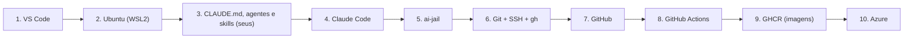
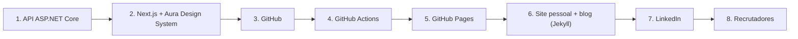
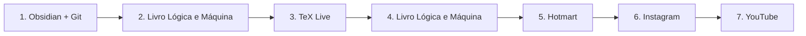
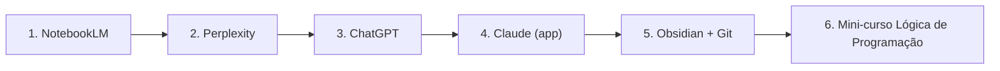
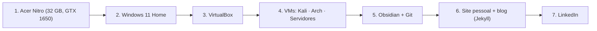
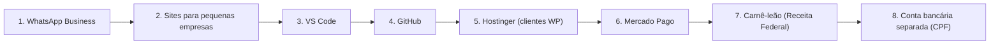
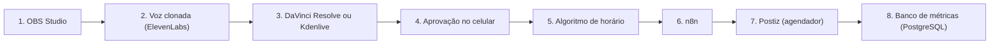
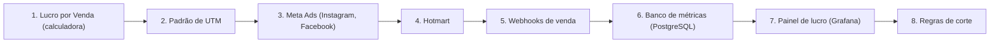

<!-- Arquivo GERADO por tools/gerar_docs.py a partir de data/. Edite os dados, não este arquivo. -->

# Fluxos de ponta a ponta

[← Índice da documentação](README.md)

Cada fluxo mostra o caminho real que o trabalho percorre pelas camadas.

## Vender o mini-curso

```mermaid
flowchart LR
  s0["1. Microfone + câmera"]
  s1["2. OBS Studio"]
  s2["3. DaVinci Resolve ou Kdenlive"]
  s3["4. Mini-curso Lógica de Programação"]
  s4["5. Hotmart"]
  s5["6. Instituto AMS"]
  s6["7. Instagram"]
  s7["8. MailerLite"]
  s8["9. Hotmart"]
  s9["10. Carnê-leão (Receita Federal)"]
  s10["11. Conta bancária separada (CPF)"]
  s11["12. Caixa da Casa / AM Rendara"]
  s0 --> s1
  s1 --> s2
  s2 --> s3
  s3 --> s4
  s4 --> s5
  s5 --> s6
  s6 --> s7
  s7 --> s8
  s8 --> s9
  s9 --> s10
  s10 --> s11
```

1. **[Microfone + câmera](camadas/01-hw.md#mic)**: Microfone e câmera captam a aula.
2. **[OBS Studio](camadas/12-cont.md#obss)**: O OBS grava a tela e o áudio.
3. **[DaVinci Resolve ou Kdenlive](camadas/12-cont.md#edit)**: A edição corta e finaliza.
4. **[Mini-curso Lógica de Programação](camadas/14-prod.md#curso)**: O mini-curso é montado com as aulas.
5. **[Hotmart](camadas/17-venda.md#hotm)**: Você cadastra o produto na Hotmart (ou Kiwify, Eduzz) e uma versão na Udemy.
6. **[Instituto AMS](camadas/15-web.md#inst)**: A página no Instituto AMS leva ao checkout.
7. **[Instagram](camadas/19-pub.md#ig)**: O Instagram leva o público até a página.
8. **[MailerLite](camadas/17-venda.md#mailer)**: O MailerLite envia o lançamento para a lista.
9. **[Hotmart](camadas/17-venda.md#hotm)**: A venda acontece no checkout.
10. **[Carnê-leão (Receita Federal)](camadas/16-emp.md#nfse)**: Você lança as vendas do mês no carnê-leão.
11. **[Conta bancária separada (CPF)](camadas/16-emp.md#banco)**: O dinheiro cai na sua conta separada.
12. **[Caixa da Casa / AM Rendara](camadas/16-emp.md#caixa)**: O Caixa da Casa registra a entrada.

## Codar com agente e publicar

1. **[VS Code](camadas/03-win.md#vsc)**: Você abre o projeto no VS Code.
2. **[Ubuntu (WSL2)](camadas/04-lin.md#wsl)**: O VS Code roda dentro do Ubuntu.
3. **[CLAUDE.md, agentes e skills (seus)](camadas/05-ia.md#kit)**: O CLAUDE.md e seus agentes dão as regras.
4. **[Claude Code](camadas/05-ia.md#cc)**: O Claude Code faz a tarefa.
5. **[ai-jail](camadas/05-ia.md#jail)**: O ai-jail limita o agente à pasta do projeto.
6. **[Git + SSH + gh](camadas/04-lin.md#git)**: Você revisa e faz o commit.
7. **[GitHub](camadas/11-nuvem.md#gh)**: O push vai ao GitHub.
8. **[GitHub Actions](camadas/11-nuvem.md#gha)**: O Actions testa e gera a imagem.
9. **[GHCR (imagens)](camadas/11-nuvem.md#ghcr)**: A imagem vai para o GHCR.
10. **[Azure](camadas/11-nuvem.md#azure)**: O deploy sobe no Azure.

## Conseguir a vaga de dev

1. **[API ASP.NET Core](camadas/10-app.md#api)**: Você constrói a API de um sistema AM.
2. **[Next.js + Aura Design System](camadas/10-app.md#front)**: E as telas em Next.js.
3. **[GitHub](camadas/11-nuvem.md#gh)**: O código fica público no GitHub, com README.
4. **[GitHub Actions](camadas/11-nuvem.md#gha)**: O Actions mostra testes passando (selo verde).
5. **[GitHub Pages](camadas/11-nuvem.md#ghp)**: O Pages publica o portfólio.
6. **[Site pessoal + blog (Jekyll)](camadas/15-web.md#site)**: O site reúne projetos, blog e currículo.
7. **[LinkedIn](camadas/19-pub.md#li)**: O LinkedIn divulga cada entrega.
8. **[Recrutadores](camadas/19-pub.md#recr)**: O recrutador encontra tudo ligado.

## Do livro ao leitor

1. **[Obsidian + Git](camadas/03-win.md#obsd)**: Você escreve os capítulos no Obsidian.
2. **[Livro Lógica e Máquina](camadas/14-prod.md#livro)**: O texto vira o livro.
3. **[TeX Live](camadas/04-lin.md#tex)**: O TeX Live gera o PDF.
4. **[Livro Lógica e Máquina](camadas/14-prod.md#livro)**: O PDF final fica pronto.
5. **[Hotmart](camadas/17-venda.md#hotm)**: A plataforma vende o PDF.
6. **[Instagram](camadas/19-pub.md#ig)**: O Instagram divulga.
7. **[YouTube](camadas/19-pub.md#yt)**: O YouTube mostra trechos em aula.

## Estudar e preparar aula com IA

1. **[NotebookLM](camadas/06-chat.md#nblm)**: O NotebookLM responde com base nos seus PDFs.
2. **[Perplexity](camadas/06-chat.md#perp)**: O Perplexity traz fontes atuais.
3. **[ChatGPT](camadas/06-chat.md#gpt)**: O ChatGPT dá uma segunda explicação.
4. **[Claude (app)](camadas/06-chat.md#capp2)**: O Claude organiza tudo em plano de aula.
5. **[Obsidian + Git](camadas/03-win.md#obsd)**: O resultado fica no vault do Obsidian.
6. **[Mini-curso Lógica de Programação](camadas/14-prod.md#curso)**: O conteúdo vira aula do mini-curso.

## Laboratório de segurança

1. **[Acer Nitro (32 GB, GTX 1650)](camadas/01-hw.md#nb)**: O notebook roda tudo.
2. **[Windows 11 Home](camadas/03-win.md#w11)**: O Windows hospeda as VMs.
3. **[VirtualBox](camadas/03-win.md#vbox)**: O VirtualBox executa.
4. **[VMs: Kali · Arch · Servidores](camadas/03-win.md#vms)**: Kali ataca a VM alvo numa rede isolada.
5. **[Obsidian + Git](camadas/03-win.md#obsd)**: Você documenta no Obsidian.
6. **[Site pessoal + blog (Jekyll)](camadas/15-web.md#site)**: O writeup vira post no blog.
7. **[LinkedIn](camadas/19-pub.md#li)**: O LinkedIn divulga para recrutadores.

## Site para um cliente

1. **[WhatsApp Business](camadas/19-pub.md#wa)**: O cliente chega pelo WhatsApp.
2. **[Sites para pequenas empresas](camadas/14-prod.md#sites)**: Você fecha o serviço de site.
3. **[VS Code](camadas/03-win.md#vsc)**: Desenvolve no VS Code.
4. **[GitHub](camadas/11-nuvem.md#gh)**: Versiona no GitHub.
5. **[Hostinger (clientes WP)](camadas/15-web.md#hostg)**: Publica na Hostinger do cliente.
6. **[Mercado Pago](camadas/17-venda.md#mp)**: Cobra pelo Mercado Pago.
7. **[Carnê-leão (Receita Federal)](camadas/16-emp.md#nfse)**: Lança no carnê-leão.
8. **[Conta bancária separada (CPF)](camadas/16-emp.md#banco)**: Recebe na conta separada.

## Publicar automaticamente no melhor horário

1. **[OBS Studio](camadas/12-cont.md#obss)**: Você grava a tela e o setup.
2. **[Voz clonada (ElevenLabs)](camadas/12-cont.md#voz)**: A voz clonada narra o seu roteiro.
3. **[DaVinci Resolve ou Kdenlive](camadas/12-cont.md#edit)**: A edição monta o vídeo e os cortes.
4. **[Aprovação no celular](camadas/18-mkt.md#aprov)**: Você aprova pelo celular.
5. **[Algoritmo de horário](camadas/18-mkt.md#horario)**: O algoritmo escolhe o horário de cada rede.
6. **[n8n](camadas/08-cnt.md#n8n)**: O n8n gera título, descrição e hashtags.
7. **[Postiz (agendador)](camadas/18-mkt.md#postiz)**: O Postiz publica em todas as redes.
8. **[Banco de métricas (PostgreSQL)](camadas/18-mkt.md#metrics)**: O desempenho volta para o banco e ajusta os horários.

## Medir o lucro de uma campanha

1. **[Lucro por Venda (calculadora)](camadas/18-mkt.md#calc)**: A calculadora define o CPA e o ROAS de empate.
2. **[Padrão de UTM](camadas/18-mkt.md#utm)**: Os links do anúncio levam UTM.
3. **[Meta Ads (Instagram, Facebook)](camadas/18-mkt.md#ads)**: A campanha roda com orçamento de teste.
4. **[Hotmart](camadas/17-venda.md#hotm)**: A venda acontece na plataforma.
5. **[Webhooks de venda](camadas/18-mkt.md#hooks)**: O webhook avisa a venda.
6. **[Banco de métricas (PostgreSQL)](camadas/18-mkt.md#metrics)**: O banco junta venda, taxa e gasto.
7. **[Painel de lucro (Grafana)](camadas/18-mkt.md#painel)**: O painel mostra o lucro real.
8. **[Regras de corte](camadas/18-mkt.md#regras)**: As regras pausam ou escalam.
