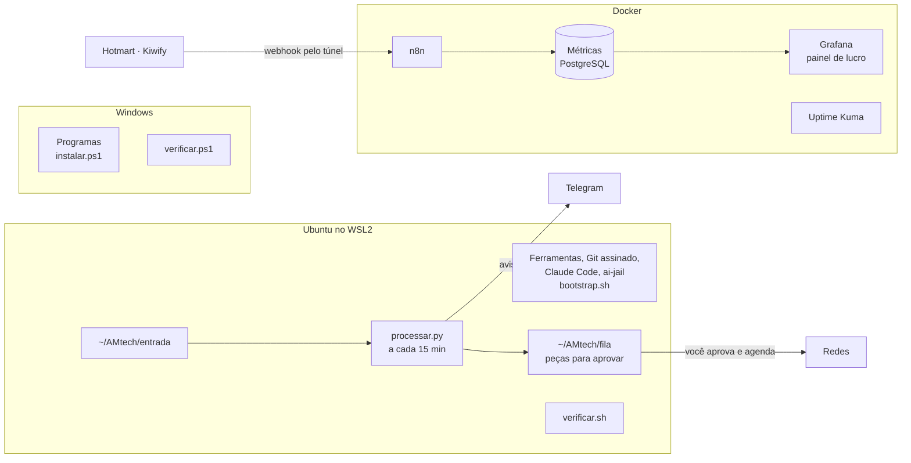

# Implantação

[← Índice da documentação](../README.md)

Como sair do planejamento para o setup funcionando: scripts que instalam, scripts que conferem e um roteiro com o critério de pronto de cada passo. Quando a última fase passar, alimentar o sistema é só colocar arquivos numa pasta.

- [Roteiro de implantação](roteiro.md): 30 fases e 207 passos, na ordem, com o que cada passo implanta (gerado)
- [`acompanhamento.html`](acompanhamento.html): a mesma lista para marcar o progresso no navegador (gerado)

## Todo o planejamento está no passo a passo

Nada foi retirado. Cada um dos 325 blocos do [mapa do setup](../mapa.html), de todas as 23 camadas, entra em algum passo do roteiro, e cada fase diz **quando**: a semana e o mês, ou o gatilho que precisa acontecer antes (o mini-curso vender, a renda passar do valor de virada, o capítulo 1 ficar pronto, o portão de cada negócio).

| Período | Fases |
|---|---|
| Semanas 1 a 11 (out/2026 a jan/2027) | 0 a 14: o núcleo, tudo o que o notebook já suporta |
| Jan a abr/2027 | 15 Base dos sistemas AM, 16 Nuvem e deploy |
| Quando o capítulo 1 estiver pronto | 17 Editora |
| Semana 2 em diante e 2027 | 18 Dados, IA e pendrives |
| 2027, por gatilho ou compra | 19 Marketing pago, 20 Linux nativo, 21 IA nos sistemas AM, 22 Sistemas AM à venda, 23 CNPJ, 24 Agentes do grupo, 25 Editora depois do primeiro livro |
| 2028 | 26 Distribuído, plataforma e segunda nuvem, 27 Infraestrutura própria |
| Fase A, B e C, pelos portões | 28 Negócios do grupo em Barbacena, um por vez |
| Sempre | 29 Estudo contínuo |

No fim do [roteiro](roteiro.md#quando-entra-cada-bloco) e do acompanhamento há a tabela **Quando entra cada bloco**, camada por camada. No diagrama do ecossistema e no mapa, tocar num bloco mostra o passo e a data. O CI confere a cada envio: um bloco novo sem passo, ou uma fase sem data, faz o teste falhar.

As datas são uma proposta para caber em umas 5 horas por semana; os gatilhos não têm data porque dependem de resultado. O que não entra de jeito nenhum está em [Decisões](../fora-do-setup.md), com o motivo.

## O que fica funcionando no fim do núcleo

## O que acontece quando você alimenta o sistema

| Você coloca | Onde | O sistema faz |
|---|---|---|
| Uma aula gravada | `~/AMtech/entrada/aulas` | Transcreve no notebook, gera 3 cortes com início e fim, carrossel, newsletter, questão de concurso e legendas; avisa no Telegram |
| Um capítulo ou trecho do livro | `~/AMtech/entrada/capitulos` | Artigo de blog, cards de conceito, newsletter e roteiro de vídeo curto |
| Anotações de um reparo | `~/AMtech/entrada/reparos` | Post do Google Perfil, dica para Reels e pergunta frequente do site |
| Uma decisão da semana | `~/AMtech/entrada/decisoes` | Roteiro do vídeo de build in public, post no LinkedIn e newsletter |
| Uma ideia solta | `~/AMtech/entrada/ideias` | Ângulos de conteúdo, rascunho de post e a linha para o portfólio de ofertas |
| Todos os documentos que você já tem | `uv run tools/acervo/acervo.py --origem PASTA` | Separa cópias, pessoais, material de terceiros e da escola; converte o resto para o Obsidian (30-Acervo) e escreve 40-Produtos/Produtos do acervo.md com o que dá para vender |
| Uma venda | (chega sozinha) | Webhook da plataforma → n8n → tabela de vendas → painel de lucro por produto e campanha |

Tudo segue o seu [guia de marca](../../config/marca.md). Arquivo que dá erro três vezes vai para `entrada/_com-erro` com o motivo, sem travar a fila.

## Como você sabe que está funcionando

Três verificadores, todos somente leitura, que terminam dizendo "pronto" ou listando exatamente o que falta:

| Verificador | Onde roda | Confere |
|---|---|---|
| `scripts/windows/verificar.ps1` | PowerShell | Programas, WSL2, .wslconfig, Docker, Ollama e, como Administrador, Secure Boot, TPM e criptografia |
| `scripts/wsl/verificar.sh` | Ubuntu | Ferramentas e versões (inclusive nmap, dig, Azure CLI, Terraform, Vercel CLI e Wrangler como opcionais), Git com commits assinados, login no GitHub, pastas |
| `scripts/wsl/verificar.sh --servicos` | Ubuntu | n8n, banco de métricas, Grafana, Uptime Kuma, Postiz e o pipeline de conteúdo |

## O que eu testei e o que não consegui testar

Testado aqui, num Ubuntu 24.04 igual ao do WSL:

- `bootstrap.sh` rodado de verdade duas vezes: instalou .NET 10, fnm, gitleaks, trivy e ai-jail, configurou Git e criou as pastas; na segunda vez não refez nada.
- `verificar.sh`, inclusive a saída em JSON.
- O banco de métricas com dados de exemplo: lucro, CPA, venda repetida que não duplica, e o usuário do Grafana que só lê.
- O pipeline de conteúdo com 10 testes automáticos (transcrição, fila, quarentena, nomes repetidos) e uma rodada simulada.
- O `compose.yaml` validado pelo Docker Compose; os scripts passaram no ShellCheck e no PSScriptAnalyzer.
- Os scripts do Windows rodaram no PowerShell 7 com `winget`, `wsl` e `code` simulados.
- `acervo.py` rodado de verdade com .docx, .pptx, .pdf, .md e .zip parecidos com os do seu Drive: achou a cópia repetida, barrou o contracheque, marcou o livro de editora como terceiros e a prova com nome de aluno como escola com dado pessoal, e sugeriu mini-curso, apostila e estudo de caso. `vault.sh` rodado duas vezes sem sobrescrever nada.
- `lab-ia.sh` rodado de verdade: instalou PyTorch 2.14 (CUDA 13), Transformers, PEFT, TRL, DuckDB, dbt, PySpark e MLflow; um job PySpark e uma consulta DuckDB rodaram; na segunda vez não refez nada.
- `nuvem.sh` rodado de verdade duas vezes: instalou Azure CLI 2.91, Vercel CLI e Wrangler; na segunda vez não refez nada.

Não deu para testar aqui:

- O Windows de verdade (winget, WSL, criptografia). Por isso todo script do Windows tem o modo que só mostra o que faria, e o verificador confere depois.
- Baixar as imagens Docker e subir a stack (o ambiente daqui bloqueia os registros de imagens). O primeiro `docker compose up -d` no seu notebook é o teste.
- O instalador do Node pelo fnm e o do Claude Code, que dependem de sites bloqueados aqui.
- A GPU: aqui não há placa NVIDIA, então o PyTorch rodou na CPU. No notebook, `nvidia-smi` dentro do Ubuntu e o próprio `lab-ia.sh` mostram se a GTX 1650 foi vista; para o CUDA 13 o driver da NVIDIA no Windows precisa estar atualizado.
- O Terraform, que vem do repositório da HashiCorp, também bloqueado aqui. O `nuvem.sh` avisa com ERRO se falhar no seu notebook.
- Os nomes das extensões do VS Code no Marketplace (bloqueado aqui). Se algum mudou, o script mostra ERRO só naquela extensão e segue.
- A chamada real à API do Claude e ao Telegram, que precisam das suas chaves.

## O que nenhum script faz por você

- Criar contas, senhas, 2FA e aprovar pagamentos.
- Aprovar as peças antes de publicar. O pipeline deixa tudo pronto na fila; publicar sem revisão é exatamente o risco que o setup evita.
- Publicar no TikTok pela API sem a auditoria do app (só sai como privado).
- Conectar os webhooks de venda: o n8n precisa de um endereço público (túnel), e o fluxo é montado com você na fase 12.

## Custos novos

| Item | Custo |
|---|---|
| API do Claude para o pipeline | Por uso, separado da assinatura; defina um limite mensal no console da Anthropic |
| Backblaze B2 (cópia fora de casa) | Cerca de US$ 6,95 por TB por mês, ou o armazenamento do plano Google que você já tem |
| Domínio .com.br | Anuidade do Registro.br |
| Azure, Resend, Sentry, SonarQube Cloud | Começam no plano grátis; ligue o alerta de orçamento da Azure antes de criar qualquer recurso |
| ElevenLabs (voz clonada) | Plano pago, só se decidir usar |
| GPU para treinar | Kaggle grátis (30 horas por semana de T4 de 16 GB); se faltar, RunPod com crédito pré-pago, de cerca de US$ 0,27 a 0,90 por hora em GPU de 24 GB (out/2026) |
| ISBN e ficha catalográfica | Por livro, na CBL, quando o primeiro livro estiver pronto |
| Todo o resto (n8n, Grafana, PostgreSQL, Uptime Kuma, Postiz, ai-jail, restic) | Grátis, rodando no seu notebook |

## Primeiro o que dá para fazer hoje

No acompanhamento, o filtro **Só o que dá para fazer hoje** esconde os passos que precisam de compra, de pagamento, de um conteúdo seu que ainda não existe ou de um gatilho que ainda não aconteceu. Sobram 143 dos 207 passos, só com o notebook e contas grátis.

## Ritmo sugerido

O núcleo (fases 0 a 14) leva cerca de 51 horas. Da 15 em diante o ritmo é o da sua renda e das suas compras: os tempos dessas fases são estimativas grosseiras do seu trabalho, e os negócios levam anos. No bloco de construção da sua semana (quinta e sexta de manhã, umas 5 horas):

| Semana | Fases |
|---|---|
| 1 | 0 Preparar, 1 Windows |
| 2 | 2 Linux, 3 GitHub, 4 Agentes |
| 3 | 5 Backup, começo do 6 Acervo |
| 4 | Fim do 6 Acervo, 7 Claude e assistentes, 8 Automação |
| 5 | 9 Pipeline de conteúdo, 10 Estúdio |
| 6 e 7 | 11 Contas, canais e sites |
| 8 a 10 | 12 Vendas e finanças no CPF |
| 11 | 13 Vendas medidas, 14 Teste do núcleo |
| Depois | 15 Sistemas AM e 16 Nuvem quando o primeiro sistema entrar na esteira; 17 Editora quando o capítulo 1 e o seu modelo estiverem prontos; 29 Estudo, contínuo |
| 2027 em diante | 19 a 28, cada uma na data ou no gatilho da tabela acima |
| Quando quiser, depois da fase 2 | 18 Dados, IA e pendrives: os pendrives e o laboratório não dependem de nada além do Linux pronto; o fine-tuning vem depois do dataset |

O acervo vem cedo de propósito: na semana 4 você já sabe tudo o que tem e o que dá para vender, e o pipeline de conteúdo da semana 5 passa a ter material para trabalhar.
