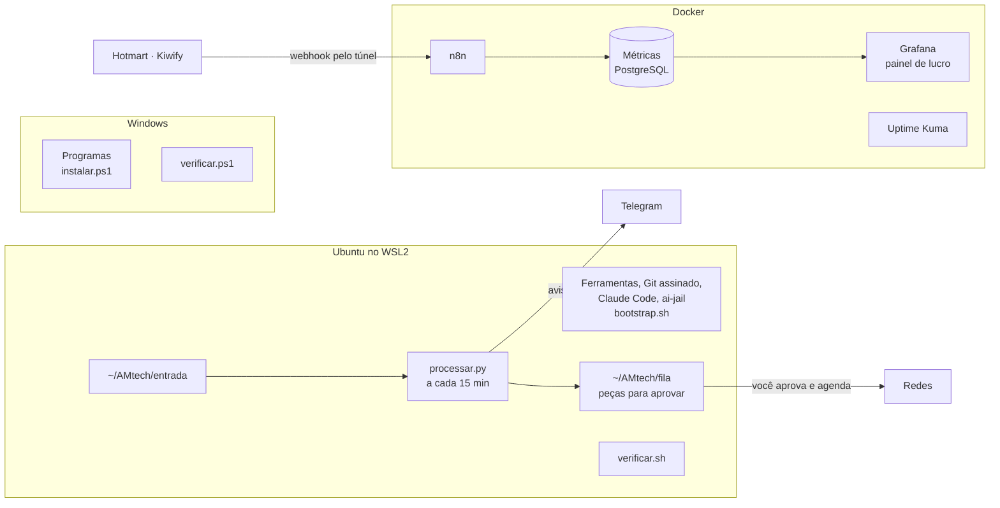

# Implantação

[← Índice da documentação](../README.md)

Como sair do planejamento para o setup funcionando: scripts que instalam, scripts que conferem e um roteiro com o critério de pronto de cada passo. Quando a última fase passar, alimentar o sistema é só colocar arquivos numa pasta.

- [Roteiro de implantação](roteiro.md): 11 fases e 58 passos, na ordem (gerado)
- [`acompanhamento.html`](acompanhamento.html): a mesma lista para marcar o progresso no navegador (gerado)

## O que fica funcionando no fim

## O que acontece quando você alimenta o sistema

| Você coloca | Onde | O sistema faz |
|---|---|---|
| Uma aula gravada | `~/AMtech/entrada/aulas` | Transcreve no notebook, gera 3 cortes com início e fim, carrossel, newsletter, questão de concurso e legendas; avisa no Telegram |
| Um capítulo ou trecho do livro | `~/AMtech/entrada/capitulos` | Artigo de blog, cards de conceito, newsletter e roteiro de vídeo curto |
| Anotações de um reparo | `~/AMtech/entrada/reparos` | Post do Google Perfil, dica para Reels e pergunta frequente do site |
| Uma decisão da semana | `~/AMtech/entrada/decisoes` | Roteiro do vídeo de build in public, post no LinkedIn e newsletter |
| Uma ideia solta | `~/AMtech/entrada/ideias` | Ângulos de conteúdo, rascunho de post e a linha para o portfólio de ofertas |
| Uma venda | (chega sozinha) | Webhook da plataforma → n8n → tabela de vendas → painel de lucro por produto e campanha |

Tudo segue o seu [guia de marca](../../config/marca.md). Arquivo que dá erro três vezes vai para `entrada/_com-erro` com o motivo, sem travar a fila.

## Como você sabe que está funcionando

Três verificadores, todos somente leitura, que terminam dizendo "pronto" ou listando exatamente o que falta:

| Verificador | Onde roda | Confere |
|---|---|---|
| `scripts/windows/verificar.ps1` | PowerShell | Programas, WSL2, .wslconfig, Docker, Ollama e, como Administrador, Secure Boot, TPM e criptografia |
| `scripts/wsl/verificar.sh` | Ubuntu | Ferramentas e versões, Git com commits assinados, login no GitHub, pastas |
| `scripts/wsl/verificar.sh --servicos` | Ubuntu | n8n, banco de métricas, Grafana, Uptime Kuma, Postiz e o pipeline de conteúdo |

## O que eu testei e o que não consegui testar

Testado aqui, num Ubuntu 24.04 igual ao do WSL:

- `bootstrap.sh` rodado de verdade duas vezes: instalou .NET 10, fnm, gitleaks, trivy e ai-jail, configurou Git e criou as pastas; na segunda vez não refez nada.
- `verificar.sh`, inclusive a saída em JSON.
- O banco de métricas com dados de exemplo: lucro, CPA, venda repetida que não duplica, e o usuário do Grafana que só lê.
- O pipeline de conteúdo com 10 testes automáticos (transcrição, fila, quarentena, nomes repetidos) e uma rodada simulada.
- O `compose.yaml` validado pelo Docker Compose; os scripts passaram no ShellCheck e no PSScriptAnalyzer.
- Os scripts do Windows rodaram no PowerShell 7 com `winget` e `wsl` simulados.

Não deu para testar aqui:

- O Windows de verdade (winget, WSL, criptografia). Por isso todo script do Windows tem o modo que só mostra o que faria, e o verificador confere depois.
- Baixar as imagens Docker e subir a stack (o ambiente daqui bloqueia os registros de imagens). O primeiro `docker compose up -d` no seu notebook é o teste.
- O instalador do Node pelo fnm e o do Claude Code, que dependem de sites bloqueados aqui.
- A chamada real à API do Claude e ao Telegram, que precisam das suas chaves.

## O que nenhum script faz por você

- Criar contas, senhas, 2FA e aprovar pagamentos.
- Aprovar as peças antes de publicar. O pipeline deixa tudo pronto na fila; publicar sem revisão é exatamente o risco que o setup evita.
- Publicar no TikTok pela API sem a auditoria do app (só sai como privado).
- Conectar os webhooks de venda: o n8n precisa de um endereço público (túnel), e o fluxo é montado com você na fase 8.

## Custos novos

| Item | Custo |
|---|---|
| API do Claude para o pipeline | Por uso, separado da assinatura; defina um limite mensal no console da Anthropic |
| Backblaze B2 (cópia fora de casa) | Cerca de US$ 6,95 por TB por mês, ou o armazenamento do plano Google que você já tem |
| Domínio .com.br | Anuidade do Registro.br |
| Todo o resto (n8n, Grafana, PostgreSQL, Uptime Kuma, Postiz, ai-jail, restic) | Grátis, rodando no seu notebook |

## Ritmo sugerido

São cerca de 21 horas de trabalho. No bloco de construção da sua semana (quinta e sexta de manhã), dá umas 5 semanas:

| Semana | Fases |
|---|---|
| 1 | 0 Preparar, 1 Windows |
| 2 | 2 Linux, 3 GitHub, 4 Agentes |
| 3 | 5 Automação, 6 Pipeline de conteúdo |
| 4 | 7 Contas e canais |
| 5 | 8 Vendas medidas, 9 Backup, 10 Teste final |

O pipeline de conteúdo já funciona no fim da semana 3. Daí em diante, cada aula que você gravar já vira peças.
