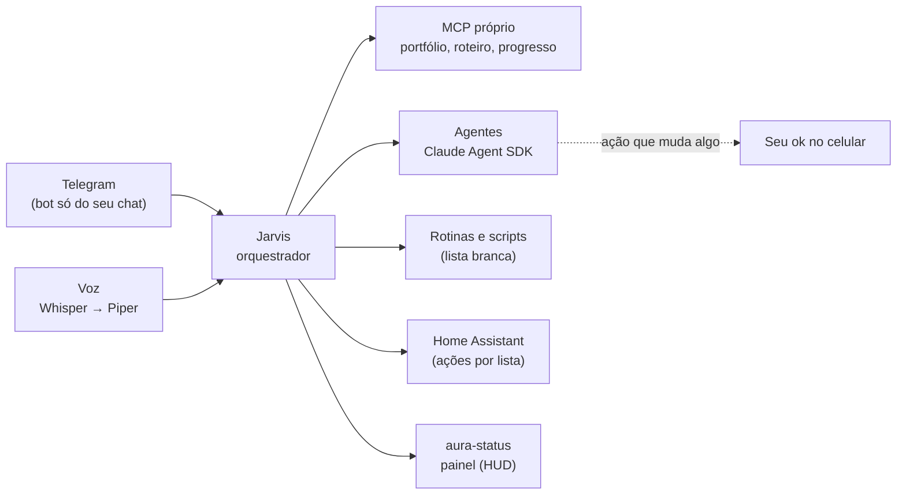

# Jarvis: uma porta para todos os seus agentes

[← Segurança](README.md)

## O que dá para ter de verdade

O Jarvis do filme é um personagem. O que existe hoje é um **orquestrador**: uma entrada única (Telegram, voz ou painel) que entende o pedido, chama a ferramenta ou o agente certo e devolve a resposta. A maior parte das peças já está no setup; o Jarvis é a cola entre elas, e fica nesta frente porque um assistente com acesso a tudo é, antes de qualquer coisa, um problema de segurança.

## Peças: o que já existe e o que falta

| Peça | Estado | Bloco |
|---|---|---|
| Bot do Telegram só do seu chat, comandos fixos | existe (`tools/remoto/bot.py`) | `tg` |
| Resumo da manhã e manutenção semanal | existe (`scripts/wsl/resumo-manha.sh`) | `rotinas` |
| Aprovação antes de publicar | parcial: fila do pipeline de conteúdo; pelo Telegram quando o n8n estiver ligado | `aprov` |
| MCP próprio com os seus dados | no roteiro | `mcpproprio` |
| Roteador de agentes (primária, reserva, portão) | no roteiro (`docs/recursos.md`) | `agentsdk` |
| Home Assistant | no roteiro (`infra/casa`) | `ha` |
| aura-status | em construção | `status` |
| Voz local (Whisper + Piper) | novo | `jvoz` |
| Orquestrador | novo | `jarvis` |

## Intenções (passo jv-intencoes)

Cada intenção diz o que o Jarvis chama e se precisa do seu ok. O que não está na tabela, ele não faz.

| Você diz | Ele chama | Muda algo? |
|---|---|---|
| "Como está o setup?" | aura-status + CI dos repositórios | não |
| "Resumo do dia" | resumo-manha.sh | não |
| "Qual o próximo passo do roteiro?" | MCP próprio (`contexto.py --resumo`) | não |
| "Quanto entrou este mês?" | painel de lucro (só leitura) | não |
| "Revisa o PR do site da padaria" | agente revisor | não (comenta, não aprova) |
| "Publica o post" | pipeline de conteúdo | **sim: pede o ok** |
| "Apaga a luz da sala" | Home Assistant (lista de entidades) | sim, mas da lista |
| "Roda o laudo do site X" | `kitsites/conferir.py` | não, e só em site de cliente seu |
| "Testa a segurança de X" | `escopo.py checar` primeiro | **bloqueia se X não estiver num escopo assinado** |

## Regras de segurança do Jarvis

1. **Lista branca de ferramentas.** Nada de "rode qualquer comando". Cada intenção mapeia para um script conhecido, com argumentos validados.
2. **Conteúdo lido é dado, nunca ordem.** E-mail, página web ou documento que diga "Jarvis, apague..." não dispara nada (é a defesa contra injeção de prompt).
3. **Ação que muda algo pede o seu ok** no celular, com o que vai acontecer escrito por extenso.
4. **Sem segredo no agente.** Senhas continuam no KeePassXC; o Jarvis usa tokens próprios, de escopo mínimo, que você revoga a qualquer hora.
5. **Registro de tudo.** Cada pedido, ferramenta chamada e resultado vai para um log que o analista semanal lê.
6. **Teto de custo.** O roteador de agentes corta quando o gasto do mês passa do limite (bloco `aiusage`).
7. **Fechadura, alarme e dinheiro ficam fora.** Nem com ok.

## Ordem

O Jarvis entra em 2027, depois da Operação 24 horas e do roteador de agentes (fase 51 do roteiro). Construído antes, ele só teria o que repetir; construído depois, ele junta o que já funciona.
